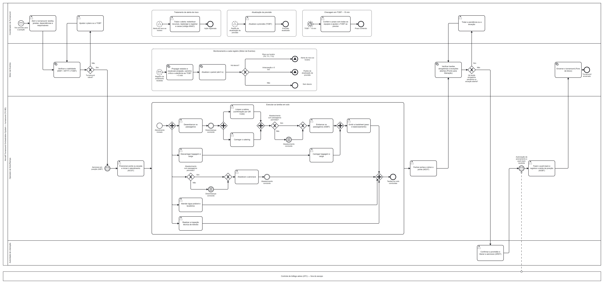
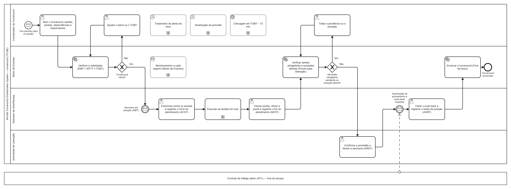
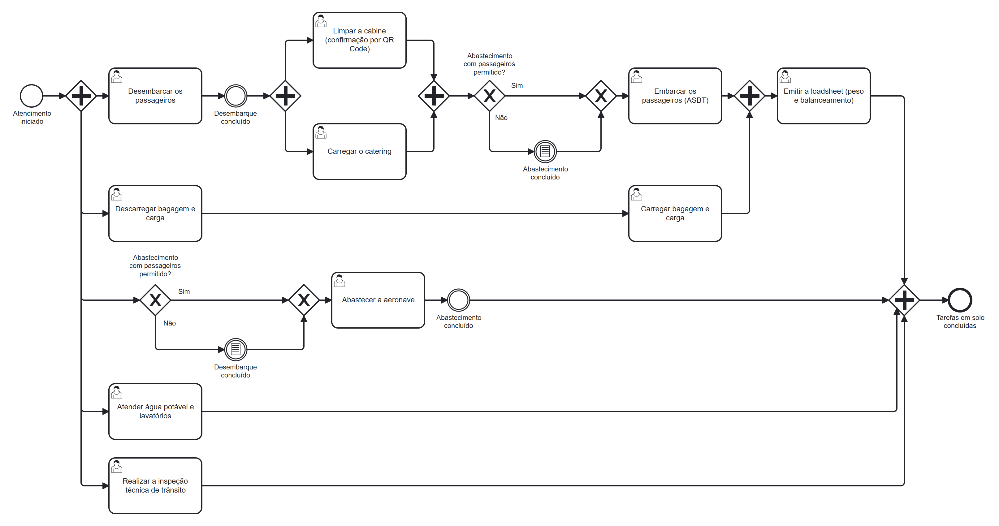
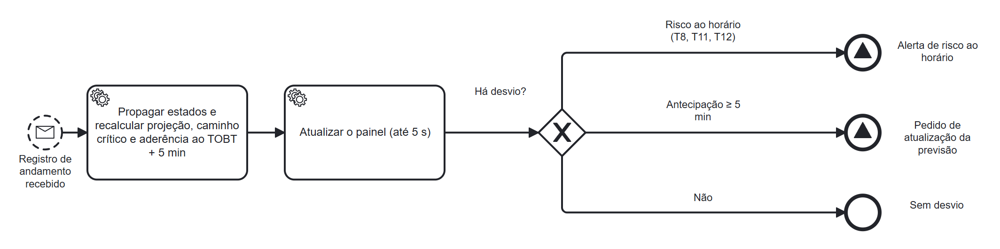
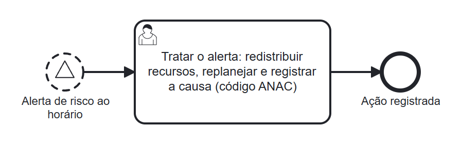
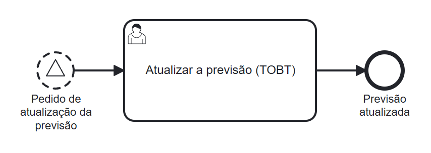
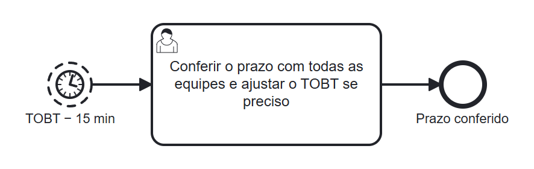

# 4 MAPEAMENTO DE NEGÓCIOS

Referências de horários da tomada de decisão colaborativa em aeroportos (A-CDM) [2][4]: horário programado de chegada à posição (SIBT), horário programado de saída da posição (SOBT), horário estimado de chegada à posição (EIBT), horário real de chegada à posição (AIBT), início real do atendimento em solo (ACGT), início real do embarque (ASBT), fim real do atendimento em solo (AEGT), horário real de prontidão (ARDT), horário real de saída da posição (AOBT), horário-alvo de prontidão (TOBT), horário-alvo de autorização de acionamento (TSAT) e tempo mínimo de turnaround (MTTT). O controle de tráfego aéreo (ATC) permanece externo. Os motivos de atraso usam a tabela da Agência Nacional de Aviação Civil (ANAC) [62]; os pontos de confirmação usam código de resposta rápida (QR Code), conforme ADR-0007.

Processo de negócio do turnaround na versão **TO BE**, ou seja, como ele acontece com o Aircraft Turnaround Orchestration System, em notação de modelo e notação de processos de negócio (BPMN 2.0). O processo é um só e aparece em vistas: a visão geral mostra tudo aberto; as demais mostram o processo principal e cada subprocesso em separado, com mais espaço.

**Visão geral**

**Processo principal**, com as tarefas em solo e os subprocessos de evento recolhidos (o sinal "+" indica um subprocesso que tem vista própria)

**Subprocesso "Executar as tarefas em solo"**

**Subprocesso de evento "Monitoramento a cada registro"**

**Subprocessos de evento "Tratamento de alerta de risco", "Atualização da previsão" e "Checagem em TOBT − 15 min"**

*Fontes editáveis: [`diagramas/04-bpmn-to-be.bpmn`](diagramas/04-bpmn-to-be.bpmn), com o processo principal e uma vista por subprocesso (abre no bpmn.io ou no Camunda Modeler; um clique no "+" abre o subprocesso), e [`diagramas/04-bpmn-to-be-geral.bpmn`](diagramas/04-bpmn-to-be-geral.bpmn), com o mesmo modelo na visão geral.*

**Leitura do diagrama**

- **Pool e lanes.** O pool principal é o turnaround dentro do sistema, com uma lane para cada ator que participa do processo, nesta ordem: Coordenador de Turnaround, Motor de Eventos, Operador de Solo/Rampa e Autoridade de Liberação. O Motor de Eventos fica entre o Coordenador de Turnaround e o Operador de Solo/Rampa porque troca trabalho com os dois; assim as passagens entre atores ficam entre lanes vizinhas. O Administrador do Sistema não tem lane, porque não atua no turnaround (ADR-0010). O controle de tráfego aéreo (ATC) aparece como pool externo fechado, só para marcar a fronteira: a autorização de acionamento e push-back chega de fora e não é emitida pelo sistema.
- **Caminho principal.** O Coordenador de Turnaround abre o turnaround e o Motor de Eventos verifica a viabilidade, isto é, se o horário estimado de chegada à posição (EIBT) somado ao tempo mínimo de turnaround (MTTT) cabe antes do horário-alvo de prontidão (TOBT) [3][7]. Com a aeronave em posição (AIBT), o Operador de Solo/Rampa registra o início do atendimento em solo (ACGT) e executa o subprocesso "Executar as tarefas em solo", em que as tarefas correm em paralelo, conforme as dependências levantadas na pesquisa [20][22][29]: desembarque, limpeza e catering, embarque (ASBT), bagagem e carga, abastecimento, água e lavatórios e inspeção técnica, com a loadsheet depois do embarque e da bagagem. Depois vêm o fechamento de portas com o fim do atendimento (AEGT), a verificação de pendências, a confirmação da prontidão pela Autoridade de Liberação (ARDT) e a saída da posição (AOBT) [2].
- **Gateways com condição.**
  - "Turnaround viável?": se não, o Coordenador de Turnaround ajusta o plano ou o TOBT.
  - "Abastecimento com passageiros permitido?": a regra é configurável por operador (ADR-0005) [26][27]. Se não for permitido, o abastecimento espera o fim do desembarque e o embarque espera o fim do abastecimento.
  - "Há tarefa obrigatória pendente ou exceção aberta?": se houver, o Coordenador de Turnaround trata a pendência antes da liberação.
  - "Há desvio?": separa risco ao horário, antecipação de 5 minutos ou mais e ausência de desvio.
- **Eventos e mensagens.**
  - Mensagens de chegada da aeronave e de autorização do ATC.
  - Marcos "Desembarque concluído" e "Abastecimento concluído", ao fim de cada uma dessas tarefas.
  - Eventos condicionais de "Desembarque concluído" e "Abastecimento concluído": aguardam o estado persistente da tarefa no próprio turnaround, inclusive quando a tarefa já terminou antes de a espera começar.
  - Temporizador em TOBT − 15 minutos para a checagem com as equipes [13].
- **Subprocessos de evento.** Rodam em paralelo ao caminho principal:
  - **Monitoramento a cada registro:** a cada registro de andamento (início, pausa, conclusão, não aplicável ou leitura de QR Code), o Motor de Eventos propaga os estados, recalcula projeção, caminho crítico e aderência ao TOBT + 5 minutos (ADR-0001) e atualiza o painel. Se houver risco ao horário pelos gatilhos da tomada de decisão colaborativa em aeroportos (A-CDM) [2][3], emite um alerta; se houver antecipação de 5 minutos ou mais, pede a atualização da previsão (ADR-0003).
  - **Tratamento de alerta de risco:** o Coordenador de Turnaround redistribui recursos, replaneja e registra a causa com o código da tabela da ANAC (ADR-0006) [62].
  - **Atualização da previsão:** o Coordenador de Turnaround atualiza o TOBT.
  - **Checagem em TOBT − 15 minutos:** o Coordenador de Turnaround confere o prazo com todas as equipes.
- **QR Code.** A limpeza da cabine é confirmada por leitura de QR Code no celular do operador (ADR-0007).

Fontes citadas: [2], [3], [7], [13], [20], [22], [26], [27], [29] e [62], conforme a numeração de `pesquisa/fontes.md`.

<!-- Imagens geradas por `node scripts/exportar_bpmn.mjs especificacao/diagramas/04-bpmn-to-be.bpmn` (e o mesmo para 04-bpmn-to-be-geral.bpmn), depois de `npm install --prefix scripts`; a geometria é conferida por `python scripts/verificar_bpmn.py`. -->
