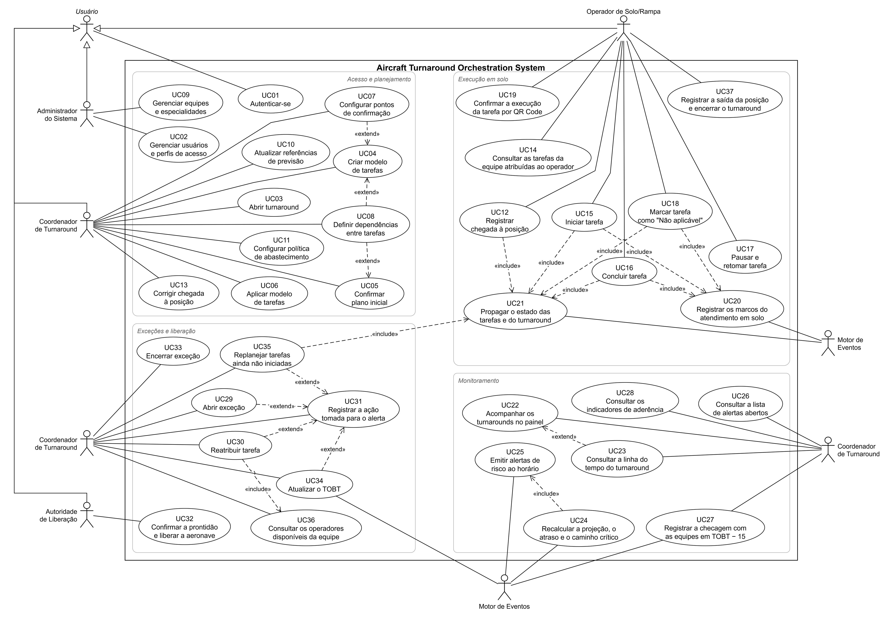

# 9 DIAGRAMA GERAL DE CASOS DE USO

**PRODUTO:** Aircraft Turnaround Orchestration System

O diagrama reúne os 37 casos de uso do sistema, agrupados por função em quatro conjuntos: acesso e planejamento, execução em solo, exceções e liberação, e monitoramento. Os retângulos cinza dentro da fronteira do sistema só organizam a leitura; não são subsistemas. Os atores são os do item 5. Os quatro atores humanos (Operador de Solo/Rampa, Coordenador de Turnaround, Autoridade de Liberação e Administrador do Sistema) especializam o ator abstrato Usuário, que se autentica no sistema (ADR-0010). O Motor de Eventos é o ator não humano que propaga o estado das tarefas, registra os marcos do atendimento em solo, recalcula a projeção e emite os alertas; ele também participa da checagem com as equipes e da atualização do horário-alvo de prontidão (TOBT) [2].

Para que as linhas não atravessem o diagrama, o Coordenador de Turnaround aparece três vezes, uma ao lado de cada conjunto em que atua, e o Motor de Eventos aparece duas vezes. Cada repetição é o mesmo ator, e a generalização para Usuário está desenhada em uma delas. São 39 associações entre atores e casos de uso, 10 relacionamentos «include» e 8 «extend». As setas «include» partem do caso de uso que inclui; as setas «extend» partem do caso de uso que estende para o caso de uso base. A especificação de cada caso de uso está no item 10.

Fonte citada: [2], conforme a numeração de `pesquisa/fontes.md`.

<!-- Fonte editável: especificacao/diagramas/09-casos-de-uso.drawio (draw.io). Imagens: 09-casos-de-uso.png e 09-casos-de-uso.svg, geradas por `python scripts/exportar_drawio.py especificacao/diagramas/09-casos-de-uso.drawio`. Nomes, atores e relacionamentos vêm das tabelas no topo de especificacao/10-especificacoes-de-caso-de-uso/area-a.md a area-d.md; `python scripts/verificar_revisao.py` confere o diagrama contra elas. -->
