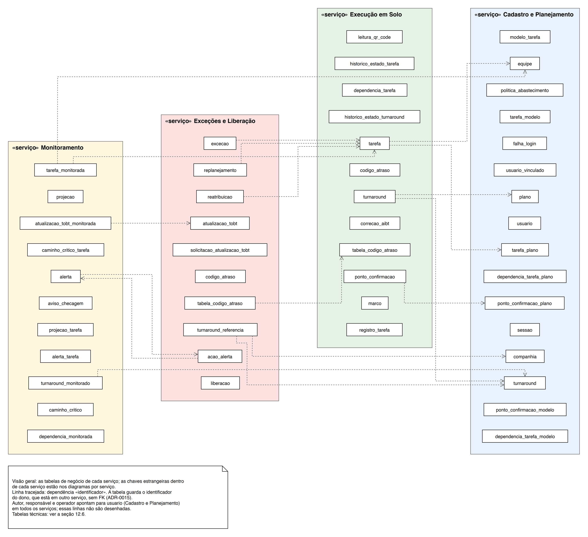
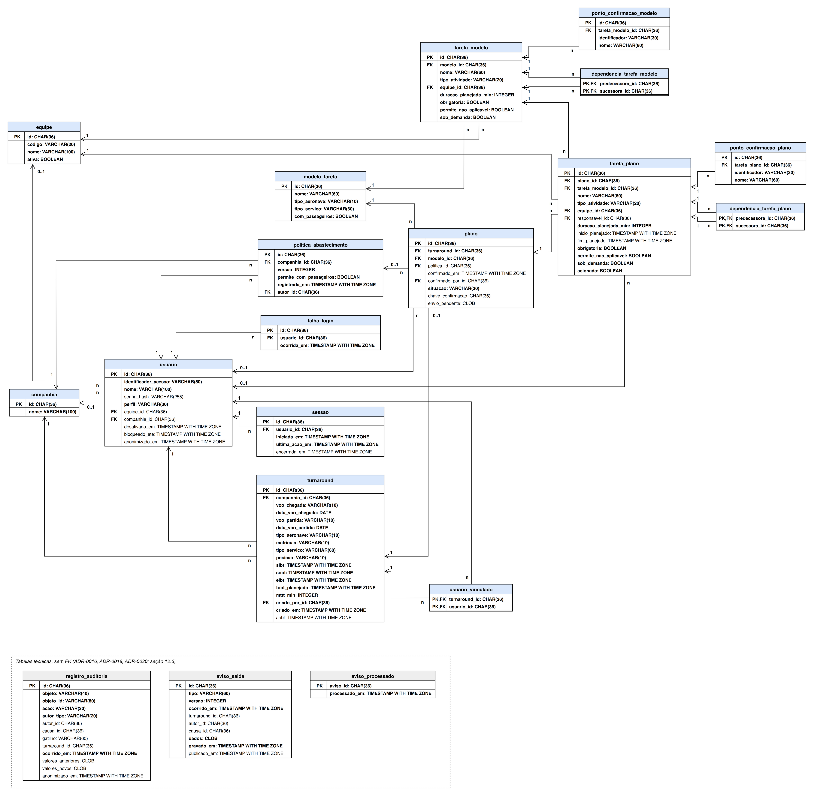
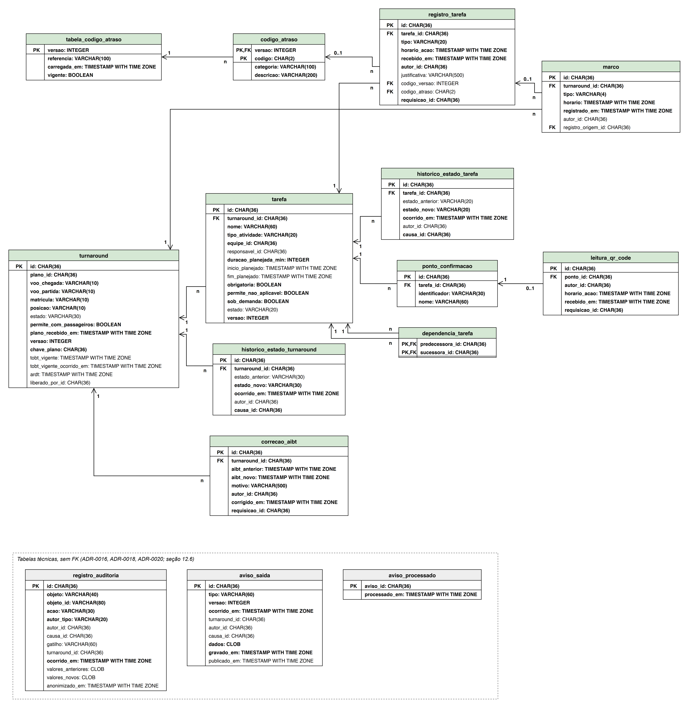
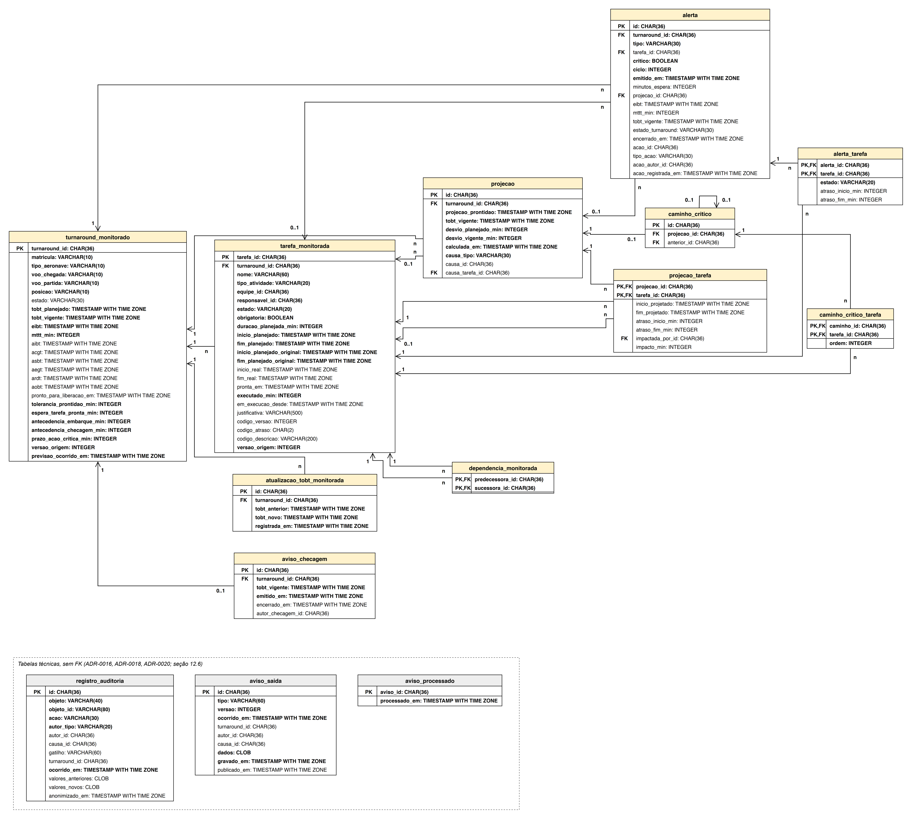
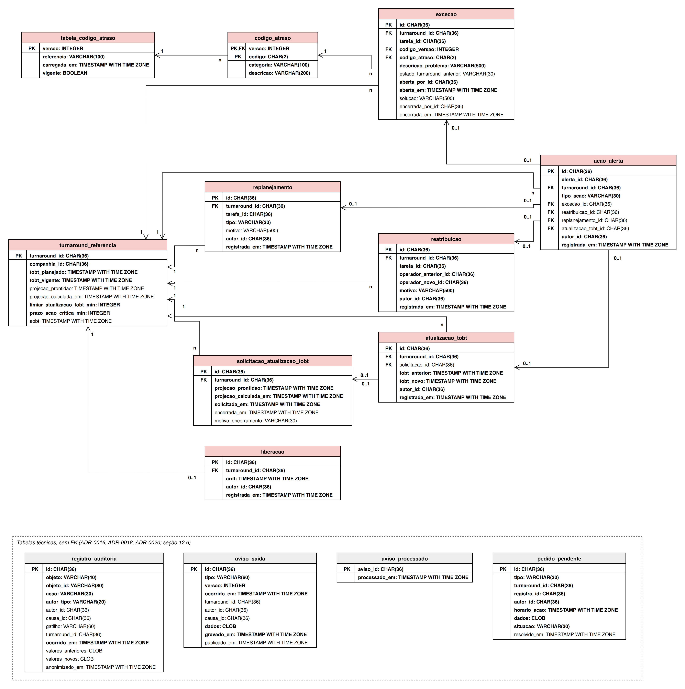

# 12 MODELO DE DADOS

**PRODUTO:** Aircraft Turnaround Orchestration System

<!-- Item 12, tarefa T12 (issue #144), critérios C12.1 a C12.10 de entregas/ra2-criterios-de-aceite.md.
Conteúdo: texto do item; a tabela "Serviço | Tabela | RFs atendidos" (C12.2), que o script da matriz lê
(cabeçalho exato, um RF ou faixa "RF-1 a RF-3" por célula, separados por vírgula); a visão geral e um modelo
lógico por serviço (C12.9), cada um como figura em especificacao/diagramas/12-modelo-de-dados-*.png, com a fonte
editável e a .svg de mesmo nome ao lado (Y.6, Y.7). O dicionário de dados fica no Apêndice B
(apendice-b-dicionario-de-dados.md, C12.10). Tipos SQL padrão (B1); nomes conforme a ADR-0016 (B8). -->

O modelo de dados descreve as tabelas que guardam o que os requisitos funcionais (RF) mandam cadastrar, registrar, calcular e guardar ou consultar. Ele segue a divisão em quatro serviços do registro de decisão de arquitetura (ADR) 0015: Cadastro e Planejamento, Execução em Solo, Monitoramento e Exceções e Liberação. Cada serviço tem o seu banco, e uma tabela pertence a um só serviço. O dicionário de dados, com cada campo, tipo, domínio e restrição, está no Apêndice B.

Os horários seguem a tomada de decisão colaborativa em aeroportos (A-CDM) [2]: horário programado de chegada à posição (SIBT), horário programado de saída da posição (SOBT), horário estimado de chegada à posição (EIBT), horário real de chegada à posição (AIBT), início real do atendimento em solo (ACGT), início real do embarque (ASBT), fim real do atendimento em solo (AEGT), horário real de prontidão (ARDT), horário real de saída da posição (AOBT), horário-alvo de prontidão (TOBT), planejado e vigente, e tempo mínimo de turnaround (MTTT). Os pontos de confirmação usam código de resposta rápida (QR Code) (ADR-0007).

São 49 tabelas de negócio e 13 tabelas técnicas. Todos os 44 RFs aparecem em pelo menos uma tabela de negócio (seção 12.4).

## 12.1 Notação e convenções

- **Notação:** modelo lógico relacional em notação da linguagem de modelagem unificada (UML). Cada tabela é uma caixa com o nome, a região da chave primária (PK) separada por uma linha, uma coluna que marca PK e chave estrangeira (FK) e os demais campos no formato `nome: TIPO`. Os campos obrigatórios estão em **negrito**. A seta parte da tabela que tem a FK e aponta para a tabela que tem a PK, com a cardinalidade nas duas pontas (`1`, `0..1` ou `n`).
- **Tipos:** tipos da linguagem de consulta estruturada (SQL) padrão, porque cada serviço pode usar um banco diferente (decisão B1 dos critérios de aceite): `CHAR(n)`, `VARCHAR(n)`, `INTEGER`, `BOOLEAN`, `DATE`, `CLOB` (objeto grande de caracteres, para conteúdo em notação de objetos JavaScript, JSON) e `TIMESTAMP WITH TIME ZONE` para todo horário com data e fuso. Os horários são gravados em tempo universal coordenado (UTC), conforme a ADR-0016.
- **Identificadores:** identificador universal único (UUID), gerado pelo serviço dono do dado e guardado como `CHAR(36)` (ADR-0016). As exceções são as chaves naturais da tabela de códigos de atraso (`versao`, `codigo`).
- **Nomes:** em português, sem acento, em minúsculas e no singular, separados por sublinhado (ADR-0016). O mesmo dado tem o mesmo nome em todo serviço (`aobt`, `responsavel_id`, `codigo_versao`, `tobt_vigente`). O autor de um registro se chama sempre `<papel>_id` (`autor_id`, `aberta_por_id`, `encerrada_por_id`, `criado_por_id`, `confirmado_por_id`). A tabela que copia uma entidade de outro serviço usa como PK o identificador dessa entidade (`turnaround_id`, `tarefa_id`); a tabela própria usa `id`.
- **Estados:** os campos de estado usam os valores do `CONTEXT.md`, seção 3, com a mesma grafia. Turnaround: Em solo, Operações em andamento, Em exceção, Pronto para liberação, Liberado e Fora de bloco. Tarefa: Aguardando, Pronta, Em execução, Pausada, Concluída e Não aplicável. Os demais domínios estão escritos uma vez no Apêndice B, com a grafia que os outros itens usam.
- **Bancos de cada serviço:** as ADRs de tecnologia usam banco relacional no Cadastro e Planejamento (ADR-0017), na Execução em Solo (ADR-0018) e no Exceções e Liberação (ADR-0020), e banco de documentos (MongoDB) no Monitoramento (ADR-0019). No Monitoramento, cada tabela vira uma coleção com os mesmos campos, e o modelo lógico continua valendo como referência (decisão B1).

## 12.2 Donos dos dados e cópias

Só o serviço dono decide sobre um dado; os outros guardam uma cópia, recebida por aviso, só para exibir ou calcular (ADR-0015, regra 1). Entre serviços não há FK: a tabela guarda o identificador, e o Apêndice B diz, no domínio do campo, qual tabela e qual serviço são os donos.

| Dado | Dono | Quem guarda cópia e para quê |
|---|---|---|
| Turnaround cadastrado (voos, aeronave, posição, SIBT, SOBT, EIBT, TOBT planejado, MTTT) | Cadastro e Planejamento (`turnaround`) | Execução em Solo, Monitoramento e Exceções e Liberação, para exibir e calcular |
| Plano inicial, tarefas, dependências, pontos de QR Code e política de abastecimento | Cadastro e Planejamento (`plano` e tabelas ligadas) | Execução em Solo, que recebe tudo na confirmação do plano (ADR-0015, regra 5) |
| Estado do turnaround e da tarefa, responsável atual, marcos AIBT, ACGT, ASBT, AEGT e AOBT | Execução em Solo | Monitoramento, para projetar e exibir; o Cadastro e o Exceções e Liberação guardam só o AOBT, para o prazo de anonimização do requisito não funcional (RNF) 6 |
| Tabela de códigos de atraso da Agência Nacional de Aviação Civil (ANAC) [62] | Execução em Solo (`tabela_codigo_atraso`, `codigo_atraso`) | Exceções e Liberação, que a usa na exceção (RF-36) |
| Projeção de prontidão, caminho crítico e alertas | Monitoramento | Exceções e Liberação guarda a última projeção, para a solicitação de atualização do TOBT (RF-41) |
| TOBT vigente, exceções, reatribuições, replanejamentos, ações sobre alertas e ARDT | Exceções e Liberação | Monitoramento (TOBT vigente, ação do alerta e ARDT, este para o alerta de prontidão não registrada do RF-31) e Execução em Solo (TOBT vigente e ARDT, só para exibir) |
| Usuários, nomes, perfis, equipes e companhias | Cadastro e Planejamento | Ninguém guarda nome de pessoa: os outros serviços guardam o identificador, e a tela busca o nome no Cadastro |

**Identificadores compartilhados.** O UUID do turnaround nasce no Cadastro e é o mesmo nos quatro serviços. O UUID da tarefa nasce no plano (`tarefa_plano.id`) e é o mesmo na Execução em Solo (`tarefa.id`) e no Monitoramento (`tarefa_monitorada.tarefa_id`); o do ponto de QR Code segue a mesma regra. Assim, um aviso que cita a tarefa vale em qualquer serviço sem conversão (ADR-0016, ponto 7).

## 12.3 Visão geral

A visão geral mostra as tabelas de negócio de cada serviço e as dependências «identificador» entre serviços: a linha tracejada parte da tabela que guarda o identificador e aponta para a tabela dona, em outro serviço. As referências ao usuário, que aparecem em todos os serviços, não são desenhadas. As chaves estrangeiras dentro de cada serviço estão nos diagramas da seção 12.5.

## 12.4 Tabelas e RFs atendidos

Cada linha diz quais RFs gravam ou leem a tabela. As tabelas técnicas não atendem RF e estão na seção 12.6.

| Serviço | Tabela | RFs atendidos |
|---|---|---|
| Cadastro e Planejamento | `equipe` | RF-2, RF-4, RF-5, RF-9, RF-43 |
| Cadastro e Planejamento | `companhia` | RF-3, RF-11 |
| Cadastro e Planejamento | `usuario` | RF-1, RF-2, RF-5, RF-37, RF-42, RF-43 |
| Cadastro e Planejamento | `falha_login` | RF-1 |
| Cadastro e Planejamento | `sessao` | RF-1 |
| Cadastro e Planejamento | `politica_abastecimento` | RF-5, RF-6, RF-11, RF-42 |
| Cadastro e Planejamento | `modelo_tarefa` | RF-4, RF-6 |
| Cadastro e Planejamento | `tarefa_modelo` | RF-4, RF-6, RF-7, RF-8 |
| Cadastro e Planejamento | `dependencia_tarefa_modelo` | RF-4, RF-8 |
| Cadastro e Planejamento | `ponto_confirmacao_modelo` | RF-7 |
| Cadastro e Planejamento | `turnaround` | RF-3, RF-6, RF-10 |
| Cadastro e Planejamento | `plano` | RF-5, RF-6, RF-11 |
| Cadastro e Planejamento | `tarefa_plano` | RF-2, RF-5, RF-6, RF-9 |
| Cadastro e Planejamento | `dependencia_tarefa_plano` | RF-5, RF-8 |
| Cadastro e Planejamento | `ponto_confirmacao_plano` | RF-6, RF-7 |
| Cadastro e Planejamento | `usuario_vinculado` | RF-2 |
| Execução em Solo | `turnaround` | RF-12, RF-14, RF-21, RF-36, RF-39, RF-40, RF-42, RF-44 |
| Execução em Solo | `marco` | RF-12, RF-13, RF-20, RF-44 |
| Execução em Solo | `correcao_aibt` | RF-13 |
| Execução em Solo | `tarefa` | RF-2, RF-9, RF-14, RF-15, RF-16, RF-17, RF-18, RF-19, RF-21, RF-37, RF-39, RF-42, RF-43 |
| Execução em Solo | `dependencia_tarefa` | RF-14, RF-21, RF-42 |
| Execução em Solo | `ponto_confirmacao` | RF-16, RF-19 |
| Execução em Solo | `leitura_qr_code` | RF-16, RF-19 |
| Execução em Solo | `tabela_codigo_atraso` | RF-17, RF-36 |
| Execução em Solo | `codigo_atraso` | RF-17, RF-36 |
| Execução em Solo | `registro_tarefa` | RF-15, RF-16, RF-17, RF-18, RF-20, RF-43 |
| Execução em Solo | `historico_estado_turnaround` | RF-12, RF-21, RF-36, RF-39, RF-40, RF-44 |
| Execução em Solo | `historico_estado_tarefa` | RF-15, RF-16, RF-17, RF-18, RF-21, RF-42 |
| Monitoramento | `turnaround_monitorado` | RF-22, RF-25, RF-26, RF-28, RF-29, RF-30, RF-31, RF-32, RF-34 |
| Monitoramento | `tarefa_monitorada` | RF-22, RF-23, RF-24, RF-26, RF-27, RF-30, RF-31, RF-32, RF-34 |
| Monitoramento | `dependencia_monitorada` | RF-22, RF-23, RF-24 |
| Monitoramento | `projecao` | RF-22, RF-25, RF-26, RF-28, RF-41 |
| Monitoramento | `projecao_tarefa` | RF-23, RF-26, RF-32 |
| Monitoramento | `caminho_critico` | RF-24, RF-26 |
| Monitoramento | `caminho_critico_tarefa` | RF-24 |
| Monitoramento | `alerta` | RF-25, RF-27, RF-28, RF-29, RF-30, RF-31, RF-33, RF-34, RF-38 |
| Monitoramento | `alerta_tarefa` | RF-28, RF-30, RF-31 |
| Monitoramento | `aviso_checagem` | RF-26, RF-32, RF-35 |
| Monitoramento | `atualizacao_tobt_monitorada` | RF-34 |
| Exceções e Liberação | `turnaround_referencia` | RF-36, RF-37, RF-38, RF-39, RF-40, RF-41, RF-42 |
| Exceções e Liberação | `solicitacao_atualizacao_tobt` | RF-41 |
| Exceções e Liberação | `atualizacao_tobt` | RF-38, RF-41 |
| Exceções e Liberação | `tabela_codigo_atraso` | RF-36 |
| Exceções e Liberação | `codigo_atraso` | RF-36 |
| Exceções e Liberação | `excecao` | RF-36, RF-39, RF-40 |
| Exceções e Liberação | `reatribuicao` | RF-37, RF-38 |
| Exceções e Liberação | `replanejamento` | RF-38, RF-42 |
| Exceções e Liberação | `acao_alerta` | RF-38 |
| Exceções e Liberação | `liberacao` | RF-39 |

## 12.5 Modelo lógico por serviço

Cada diagrama mostra as tabelas de negócio do serviço com as suas chaves estrangeiras e, embaixo, as tabelas técnicas do serviço. Um campo que guarda o identificador de outro serviço aparece sem a marca FK.

### 12.5.1 Cadastro e Planejamento

- **Usuário e acesso.** `usuario` guarda um perfil por pessoa, entre os quatro perfis do item 5 (ADR-0010). O Operador de Solo/Rampa tem equipe, e a Autoridade de Liberação tem companhia, porque só confirma turnarounds da companhia que representa, como diz o caso de uso (UC) 32. O usuário ativo é o que não tem `desativado_em`. `falha_login` e `sessao` atendem o bloqueio depois de cinco falhas e o fim da sessão por inatividade (RNF-5). `anonimizado_em` registra a rotina do RNF-6. O Cadastro é o único serviço que guarda nome de pessoa.
- **Política de abastecimento.** `politica_abastecimento` guarda as versões da permissão de abastecimento com passageiros a bordo de cada companhia (RF-11, ADR-0005). Uma companhia sem versão tem a permissão "Não permitido".
- **Modelo e plano.** O modelo de tarefas (`modelo_tarefa`, `tarefa_modelo` e as dependências e os pontos dele) é copiado para o plano do turnaround quando o modelo é aplicado (RF-6). O `plano` é 1:1 com o turnaround e guarda a versão da política vigente nesse momento. A confirmação segue a ADR-0023, ponto 5: o plano passa a "Confirmação pendente", com a chave de idempotência e o conteúdo enviado, e só depois o envio vai à Execução em Solo; enquanto está pendente, o plano não aceita edição. As tarefas do catálogo sob demanda vêm junto, marcadas em `sob_demanda`; `acionada` marca o serviço sob demanda já conhecido e incluído no plano antes da confirmação (RF-5, ADR-0014). A cópia dos pontos de QR Code é independente do modelo: mudar o modelo depois não muda o plano.
- **Turnaround.** `turnaround` guarda os voos com as datas, porque não pode haver dois turnarounds para os mesmos voos e datas (RF-3). O TOBT planejado fica aqui e não muda; o vigente é do Exceções e Liberação. A cópia do `aobt` serve só para contar o prazo do RNF-6, junto com `usuario_vinculado`, que guarda os usuários que tiveram tarefa ou registro no turnaround, recebidos no aviso de encerramento (ADR-0023, ponto 6).

### 12.5.2 Execução em Solo

- **Dona do estado.** `turnaround` e `tarefa` guardam o estado do turnaround e das tarefas (ADR-0015). O estado do turnaround fica vazio até o AIBT, porque antes da chegada nenhum dos seis estados vale. O estado da tarefa fica vazio no item do catálogo sob demanda ainda não acionado; o acionamento (RF-42) o leva a "Aguardando" ou "Pronta". Um item do catálogo não acionado não segura a sucessora na propagação (RF-21) nem impede "Pronto para liberação".
- **Histórico.** `historico_estado_turnaround` e `historico_estado_tarefa` guardam cada mudança de estado com o autor (vazio quando é o Motor de Eventos) e o registro que a causou (RF-21).
- **Marcos.** `marco` guarda AIBT, ACGT, ASBT, AEGT e AOBT, um de cada por turnaround. AIBT e AOBT têm o Operador de Solo/Rampa como autor (RF-12, RF-44); ACGT, ASBT e AEGT vêm do registro de tarefa que os gerou (RF-20). O horário desses três repete o `horario_acao` do registro de origem; a repetição é aceita porque o marco é lido sozinho pelas telas e pelo aviso ao Monitoramento. Se uma tarefa obrigatória for incluída depois de "Pronto para liberação", o novo AEGT substitui o anterior. `correcao_aibt` guarda cada correção do AIBT (RF-13, ADR-0013).
- **Registros feitos sem conexão.** `registro_tarefa`, `leitura_qr_code` e `correcao_aibt` têm a chave de envio `requisicao_id`, única, para que repetir a mesma requisição não grave de novo, e guardam o horário da ação separado do horário de recebimento (RNF-8, ADR-0018).
- **Ordem dos avisos.** Quem guarda cópia não aplica um aviso mais velho por cima de um mais novo. O que nasce de registro de tarefa, que pode ter sido feito sem conexão e chegar depois com horário antigo, é ordenado por versão: `tarefa.versao` conta as mudanças da tarefa e vai em todo aviso de tarefa, e `turnaround.versao` conta as mudanças de estado e de marco do turnaround e vai nos avisos de estado e de marco; o Monitoramento só aplica um aviso de versão maior que a última que recebeu (`tarefa_monitorada.versao_origem`, `turnaround_monitorado.versao_origem`). O que tem um único autor, sempre conectado, é ordenado pelo `ocorridoEm` do aviso: a previsão (EIBT e MTTT) do Cadastro e o TOBT vigente do Exceções e Liberação (`turnaround_monitorado.previsao_ocorrido_em`, `turnaround.tobt_vigente_ocorrido_em` e, no Monitoramento, o `registrada_em` da última atualização em `atualizacao_tobt_monitorada`).
- **Códigos de atraso.** A tabela da ANAC tem 72 códigos de duas letras em 12 categorias [62]; cada carga cria uma versão, e as linhas de uma versão nunca mudam (RNF-22). O registro de pausa aponta para o código pela versão e pela sigla e, por isso, continua mostrando o código usado mesmo depois de uma nova versão.
- **Plano recebido.** `chave_plano` guarda a chave do último plano recebido: o reenvio com a mesma chave recebe o mesmo resultado e não aplica o plano de novo (ADR-0023, ponto 5; RNF-20). Da política de abastecimento, o `turnaround` guarda só a permissão (`permite_com_passageiros`), porque é só dela que a trava do replanejamento precisa (RF-42). A versão vai junto no envio do plano, como pede o formato comum do RNF-4, e fica guardada no Cadastro (`plano.politica_id`).
- **Cópias para exibir.** Voos, matrícula e posição são cópias para as telas do operador (UC12, UC14), para a consulta da liberação, que o Exceções e Liberação pede à Execução em Solo (UC32), e para a tela de saída da posição (UC37). TOBT vigente, ARDT e quem liberou são cópias só para a tela de saída da posição (UC37); o ARDT chega no pedido de liberação.

### 12.5.3 Monitoramento

- **Cópias para calcular.** `turnaround_monitorado`, `tarefa_monitorada` e `dependencia_monitorada` são cópias recebidas por aviso. Só entram as tarefas do plano; uma tarefa do catálogo entra quando a Execução em Solo avisa a inclusão. `tarefa_monitorada` guarda também o que a projeção precisa: o momento em que a tarefa ficou "Pronta" (RF-27), os minutos já executados e a última retomada, para a tarefa pausada (RF-22), e a versão do último aviso aplicado. O `tobt_vigente` repete a última atualização recebida do Exceções e Liberação.
- **Parâmetros.** Os limites do RNF-21 (tolerância de 5 minutos, Y do RF-27, X do RF-30, 15 minutos do RF-32 e 2 minutos do RF-34) são copiados para o turnaround quando ele é aberto, para que uma troca de configuração valha só para os turnarounds abertos depois.
- **Janela do indicador.** `inicio_planejado_original` e `fim_planejado_original` guardam a janela do plano confirmado ou, para a tarefa sob demanda, a da inclusão; o replanejamento muda só a janela atual. O indicador de atividades dentro da janela (RF-34) mede contra a janela original, para não esconder o desvio que o replanejamento corrigiu.
- **Projeção e caminho crítico.** `projecao` guarda cada cálculo da projeção de prontidão, com a causa e o desvio em relação aos dois TOBT (RF-22, RF-25). `projecao_tarefa` guarda, em cada recálculo, a projeção, o atraso e o impacto de cada tarefa (RF-23). `caminho_critico` guarda cada mudança do caminho, ligada ao recálculo que a causou e ao caminho anterior (RF-24); `caminho_critico_tarefa` lista as tarefas em ordem, e duas tarefas empatadas têm a mesma ordem.
- **Alertas.** `alerta` guarda cada alerta emitido com os dados do gatilho do seu tipo e a ação copiada do Exceções e Liberação (RF-27 a RF-31, RF-38). `ciclo` conta as emissões do mesmo tipo para o mesmo turnaround e a mesma tarefa, e só cresce no rearme (RF-27 a RF-31; UC25, RN9). `alerta_tarefa` lista as tarefas citadas no alerta, com o estado na emissão. `aviso_checagem` guarda o aviso de TOBT − 15 e a checagem com as equipes, um por turnaround (RF-32, RF-35); o aviso ainda aberto quando o turnaround entra em "Pronto para liberação" é encerrado sem autor (RF-32; UC27, RN8).

### 12.5.4 Exceções e Liberação

- **Dono do TOBT vigente.** `turnaround_referencia` guarda o TOBT vigente, que começa igual ao planejado (ADR-0003) e só muda pela atualização do RF-41, gravada em `atualizacao_tobt`. Guarda também a última projeção recebida do Monitoramento e os parâmetros de 5 e 2 minutos copiados na abertura (RNF-21, ADR-0020). `solicitacao_atualizacao_tobt` guarda o pedido ao Coordenador de Turnaround e como ele foi encerrado.
- **Exceção.** `excecao` guarda a tarefa afetada, o código de atraso, a descrição, quem abriu e quem encerrou, com a solução (RF-36, RF-40). O estado anterior do turnaround é só para exibir: a volta ao estado é decidida pela Execução em Solo, pelo andamento das tarefas (RF-40).
- **Ações.** `reatribuicao` e `replanejamento` guardam o motivo e o autor de cada ação (RF-37, RF-42); o motivo do replanejamento é obrigatório só na inclusão de serviço sob demanda (ADR-0014). Os valores anterior e novo da tarefa ficam na auditoria da Execução em Solo, que é a dona da tarefa. `acao_alerta` liga cada alerta a uma única ação, e cada ação a no máximo um alerta (RF-38).
- **Liberação.** `liberacao` guarda o ARDT confirmado pela Autoridade de Liberação, um por turnaround (RF-39); a recusa não é gravada.
- **Companhia do turnaround.** `turnaround_referencia.companhia_id` é a única cópia usada para decidir: confere se a Autoridade de Liberação é da companhia do turnaround (UC32). A ADR-0015, regra 1, proíbe decidir com cópia porque a cópia pode estar atrasada em relação ao dono. A companhia é gravada na abertura do turnaround (RF-3) e nenhum RF a muda (o RF-10 só muda EIBT e MTTT), então a cópia é sempre igual à original e não fica atrasada.
- **Âncora local.** `excecao`, `reatribuicao`, `replanejamento` e `acao_alerta` têm `turnaround_id` como FK para `turnaround_referencia`, a âncora local do turnaround neste serviço, que também é a chave do log do RNF-24.

## 12.6 Tabelas técnicas

As tabelas técnicas não atendem RF: elas sustentam a troca de avisos, a auditoria e a recuperação depois de uma falha. Não têm FK, para que a trilha sobreviva à anonimização e não trave exclusões. O Apêndice B descreve os campos de cada uma.

| Tabela | Serviços | Para quê | Decisão |
|---|---|---|---|
| `registro_auditoria` | Todos | Trilha de quem fez o quê e quando: o autor, que é um usuário ou o Motor de Eventos, o registro ou gatilho por horário que causou a ação automática, os valores antes e depois e o turnaround, para o prazo de anonimização | RNF-2, RNF-6 |
| `aviso_saida` | Todos | Avisos a publicar, gravados na mesma transação da mudança; `gravado_em` dá a ordem de publicação. O campo `origem` do envelope não é gravado, porque é sempre o nome do serviço | ADR-0016 |
| `aviso_processado` | Todos | Avisos já recebidos, para descartar o repetido | ADR-0016 |
| `pedido_pendente` | Exceções e Liberação | Pedido à Execução em Solo (exceção, reatribuição, replanejamento e liberação) gravado antes da chamada e retomado depois de uma queda, com o autor, o horário da ação e a chave de idempotência; na retomada, o serviço pergunta à Execução em Solo, pela chave, se o pedido foi aplicado | ADR-0020, RNF-20 |

A ADR-0018 fala em duas tabelas técnicas na Execução em Solo, as de avisos; a terceira, `registro_auditoria`, é a trilha do RNF-2, que todos os serviços têm.

## 12.7 Relacionamentos e normalização

- **Mapeamento.** Cada entidade virou uma tabela com PK. O relacionamento 1:N tem a FK no lado N, como `tarefa.turnaround_id`. O 1:1 tem a FK no lado de participação parcial, com unicidade, como `plano.turnaround_id`, `liberacao.turnaround_id` e `aviso_checagem.turnaround_id`. O N:N virou tabela associativa com PK composta pelas duas FKs: `dependencia_tarefa_modelo`, `dependencia_tarefa_plano`, `dependencia_tarefa`, `dependencia_monitorada`, `projecao_tarefa`, `caminho_critico_tarefa` e `alerta_tarefa`. Atributo multivalorado virou tabela própria, como os pontos de QR Code da tarefa e as tarefas citadas no alerta.
- **Terceira forma normal (3FN).** Não há grupo repetitivo nem dependência parcial ou transitiva. A política de abastecimento é referida pela versão, e não copiada; o código de atraso é referido pela versão e pela sigla; o campo "ativo" do usuário não é guardado, porque deriva de `desativado_em`; e um ponto está confirmado quando tem leitura, sem campo próprio.
- **Valores calculados guardados.** Só quando um RF pede o registro histórico: a projeção de prontidão (RF-22), a projeção e o atraso de cada tarefa (RF-23), o caminho crítico com o anterior (RF-24) e a classificação do alerta como crítico na emissão (RF-33), que o indicador do RF-34 mede depois. `projecao_tarefa` cresce a cada recálculo. [Inferência] Com 30 tarefas por turnaround (RNF-13) e recálculo por minuto, são cerca de 1.200 linhas por minuto no teste de carga.
- **Repetições aceitas.** O horário dos marcos ACGT, ASBT e AEGT repete o do registro de origem (seção 12.5.2), e as cópias entre serviços repetem o dado do dono. As duas são deliberadas: a primeira para a leitura direta do marco, a segunda pela separação dos serviços (ADR-0015).
