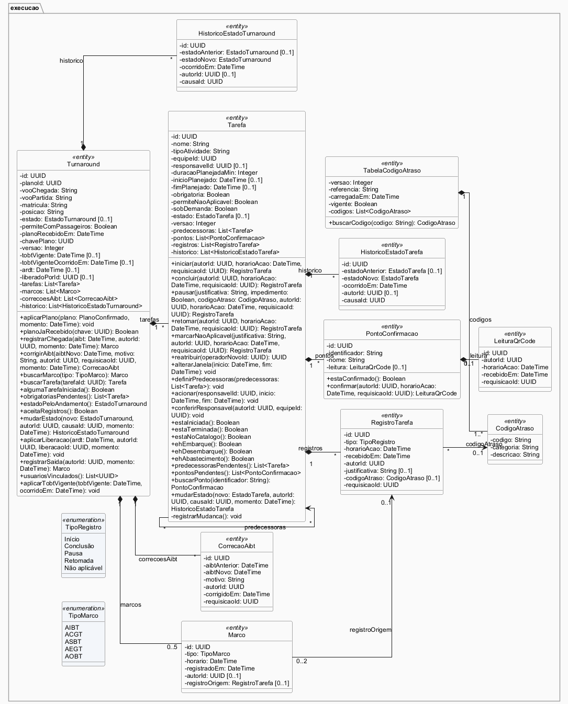
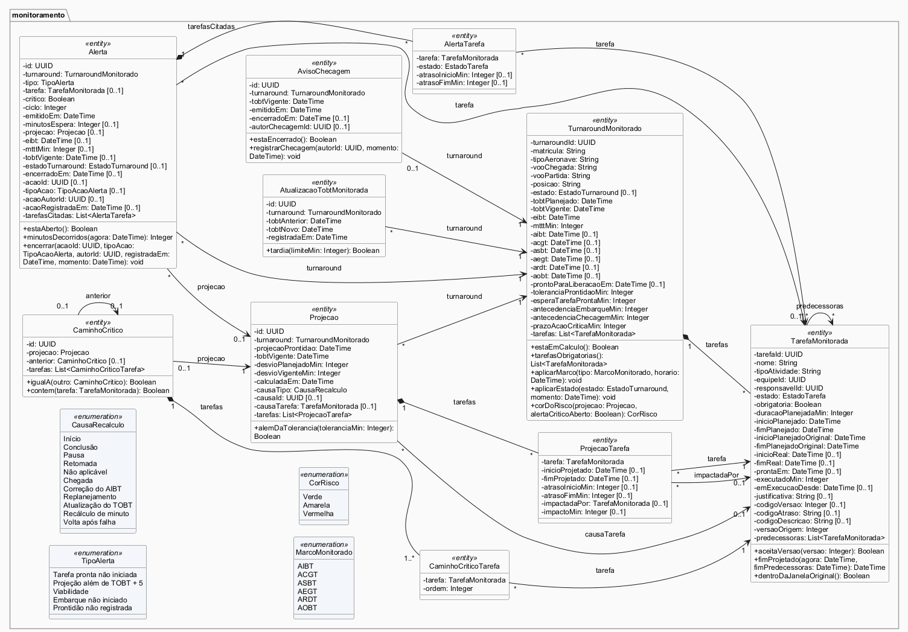
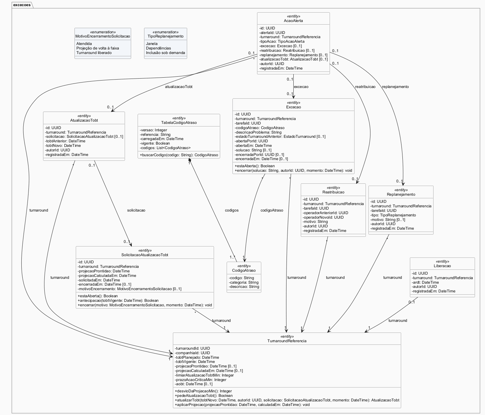
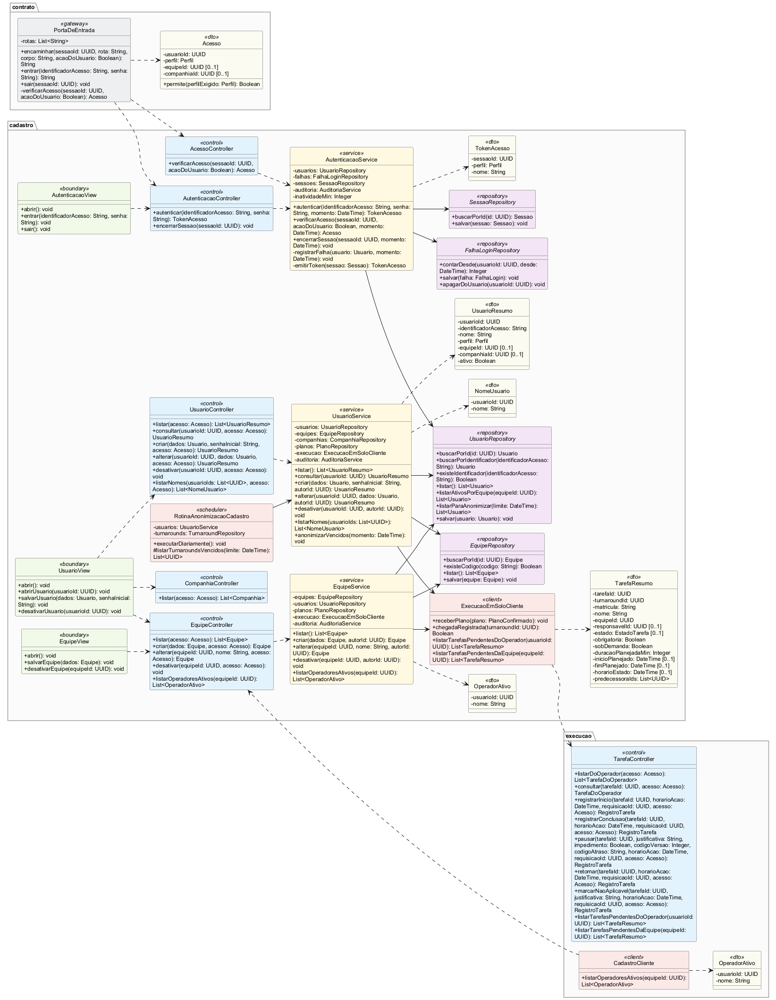
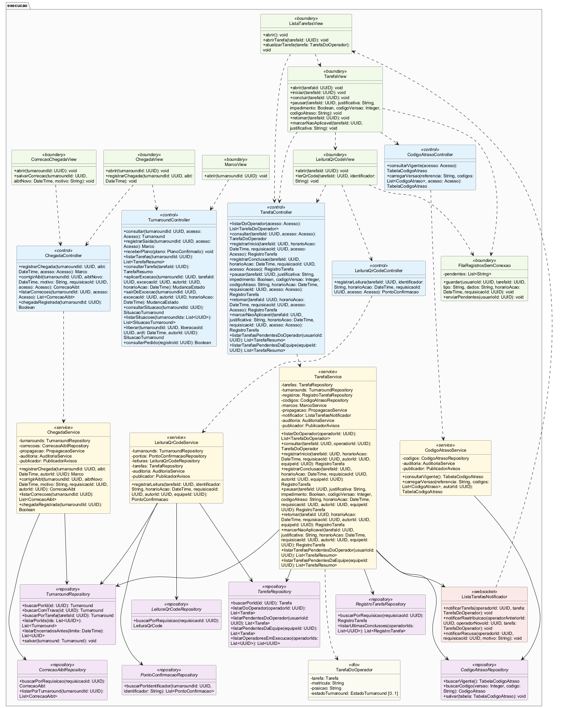
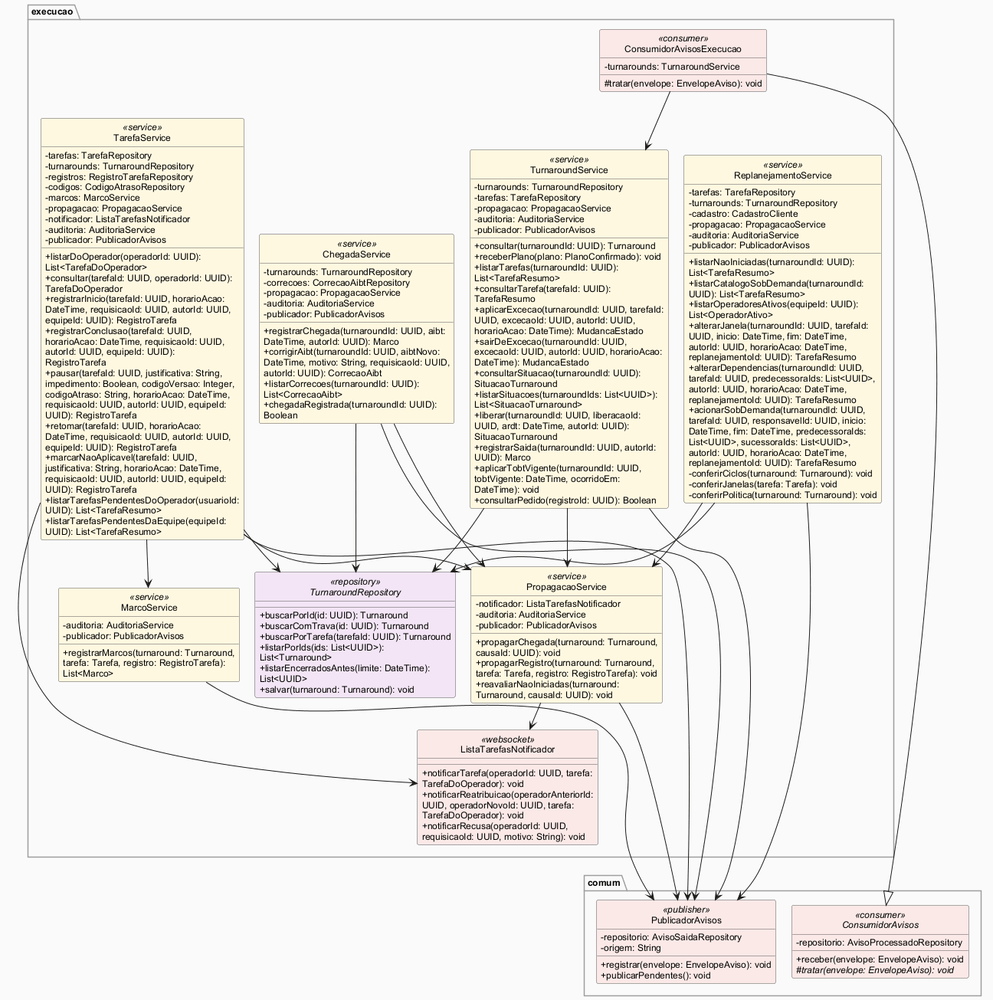
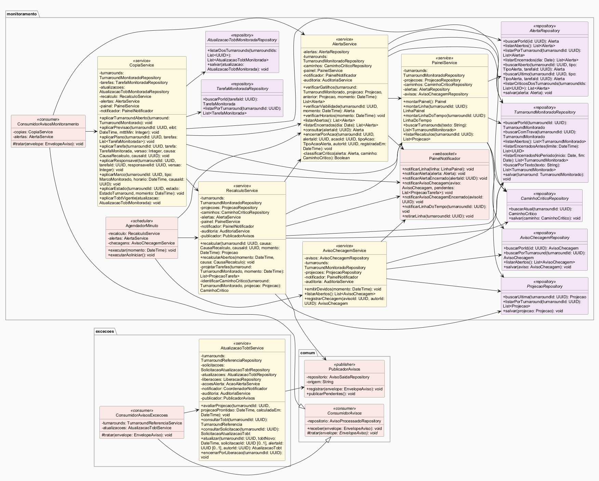
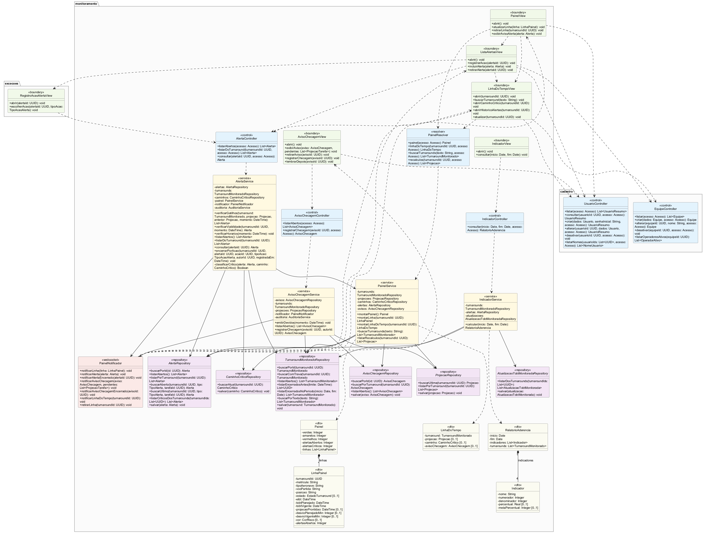
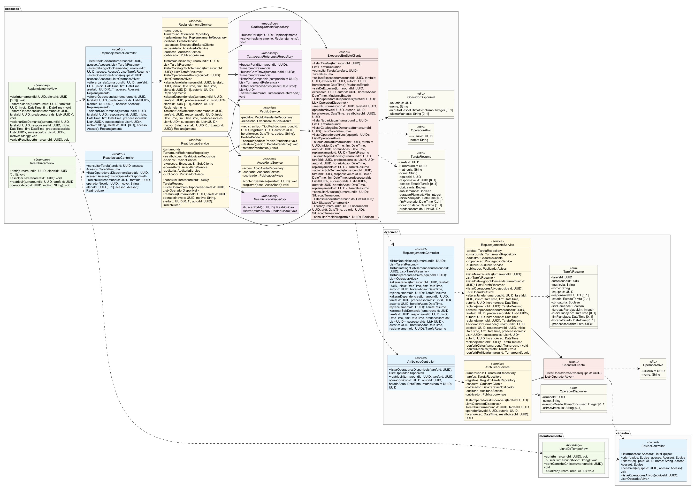
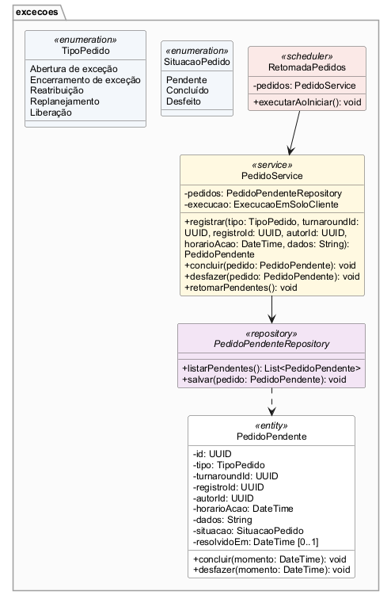

# 13 DIAGRAMA DE CLASSES

**PRODUTO:** Aircraft Turnaround Orchestration System

<!-- Item 13, tarefa T13 (issue #145), critérios C13.1 a C13.10 de entregas/ra2-criterios-de-aceite.md.
Fontes únicas das classes: especificacao/diagramas/13-classes-{contrato,cadastro,execucao,monitoramento,excecoes}.iuml
(PlantUML). Cada figura é uma vista 13-classes-<nome>.puml, que inclui as fontes e escolhe as classes que mostra,
gerada por scripts/gerar_vistas_classes.py;
a .png e a .svg têm o mesmo nome (Y.6, Y.7). scripts/conferir_classes.py confere as fontes contra o Apêndice B, o
CONTEXT.md e, com --sequencia, contra os diagramas de sequência do item 14 (C13.8). Tipos UML neutros (decisão B1). -->

O diagrama de classes descreve como o código do sistema se organiza. Ele parte do modelo de dados do item 12: cada tabela de negócio vira uma classe, com os mesmos nomes de domínio. Também mostra as classes técnicas da arquitetura de implementação, isto é, as que recebem as ações das telas, aplicam as regras de negócio e acessam o banco de cada serviço. O diagrama usa a linguagem de modelagem unificada (UML), em nível técnico: atributos com tipo e métodos com parâmetros e retorno tipados.

## 13.1 Arquitetura de implementação

O sistema tem quatro serviços, cada um com o seu banco, como decidido no registro de decisão de arquitetura (ADR) 0015: Cadastro e Planejamento, Execução em Solo, Monitoramento e Exceções e Liberação. Cada classe pertence a um só serviço, e o pacote da classe no diagrama é o serviço (`cadastro`, `execucao`, `monitoramento`, `excecoes`). Dois pacotes não são serviços: `contrato`, com o que os serviços combinaram entre si (ADR-0016), e `comum`, com a infraestrutura que cada serviço repete no seu próprio código.

Dentro de cada serviço, as classes seguem as camadas de referência da ADR-0015, `Controller → Service → Repository`, mais a tela e a comunicação com os outros serviços:

| Camada | Estereótipo | O que faz | Exemplo |
|---|---|---|---|
| Interface | «boundary» | Tela do site, em Angular (ADR-0016). Os métodos são as ações do usuário na tela. | `LiberacaoView` |
| Controle | «control», «resolver» | Recebe a requisição da porta de entrada ou de outro serviço por transferência de estado representacional (REST); nos painéis, por GraphQL («resolver») | `LiberacaoController`, `PainelResolver` |
| Serviço | «service» | Aplica as regras de negócio e decide sobre o dado de que o serviço é dono | `LiberacaoService` |
| Acesso a dados | «repository» | Lê e grava as tabelas do item 12 do próprio serviço | `LiberacaoRepository` |
| Negócio | «entity» | Classe que corresponde a uma tabela do item 12, com as regras que dependem só dos seus dados | `Liberacao` |
| Dado de troca | «dto» | Objeto de transferência de dados (DTO, em inglês *data transfer object*): dado de entrada ou de saída sem tabela própria, como o resultado de uma consulta | `SituacaoLiberacao` |
| Comunicação | «client», «publisher», «consumer», «websocket», «scheduler», «gateway» | Pedido a outro serviço, aviso pela mensageria, atualização da tela em tempo real, tarefa por horário e porta de entrada | `ExecucaoEmSoloCliente` |

As regras de comunicação são as da ADR-0015 e da ADR-0016:

- **Porta de entrada.** Toda ação do site passa pela `PortaDeEntrada`, que pergunta ao Cadastro, a cada ação, se a sessão e o usuário continuam ativos (`AcessoController.verificarAcesso`, requisito não funcional (RNF) 1). O controle do serviço recebe o `Acesso` (usuário, perfil, equipe e companhia) e confere se o perfil pode fazer a ação. A porta de entrada diz, a cada chamada, se ela é uma ação do usuário ou uma consulta automática, porque só a ação do usuário renova a sessão (RNF-5). O login é a única rota sem sessão: vai direto ao `AutenticacaoController`, que devolve o `TokenAcesso`. A saída (`sair`) também vai ao `AutenticacaoController`, que encerra a sessão no servidor (UC01). Aos serviços, a porta de entrada passa o `Acesso` num token interno assinado, que leva também a sessão e se a chamada é ação do usuário (ADR-0023, pontos 1 e 2). O diagrama mostra só o conteúdo (`Acesso`), e não o token.
- **Pedido.** Quando um serviço precisa da decisão do dono do dado, faz um pedido em REST, com resposta, pelo seu cliente (`ExecucaoEmSoloCliente`, `CadastroCliente`). É o caso do envio do plano confirmado (ADR-0015, regra 5), da consulta da chegada (requisito funcional (RF) 10), da abertura e do encerramento da exceção, da reatribuição, do replanejamento, da liberação e das consultas de tarefas pendentes e de operadores ativos e disponíveis (ADR-0015, regra 3). O diagrama liga cada cliente, por dependência, ao controle do outro serviço que atende o pedido, e todo método do cliente tem o mesmo nome, os mesmos parâmetros e o mesmo retorno no controle. Quando o pedido leva ou devolve um dado de troca, os dois serviços declaram o mesmo «dto», com os mesmos campos (`TarefaResumo`, `SituacaoTurnaround`, `PlanoConfirmado`, `MudancaEstado`, `OperadorAtivo`, `OperadorDisponivel`), porque nenhum usa a classe do outro.
- **Aviso.** O que já aconteceu vai num aviso, com o envelope comum da ADR-0016 (`EnvelopeAviso`). O serviço grava o aviso em `AvisoSaida` na mesma transação da mudança, e o `PublicadorAvisos` o publica na mensageria. Quem recebe usa o seu `ConsumidorAvisos`, que descarta o aviso repetido (`AvisoProcessado`).
- **Tempo real.** A lista de tarefas do operador (`ListaTarefasNotificador`, ADR-0018) e os painéis do coordenador (`PainelNotificador`, ADR-0019) recebem as mudanças por WebSocket, para cumprir os 5 segundos do objetivo 2 (RNF-11). A solicitação de atualização da previsão (`CoordenadorNotificador`, ADR-0020, ponto 3) também chega por WebSocket, porque aparece sem que o coordenador a peça (UC34, passo 2); ela não tem prazo de 5 segundos.
- **Telas de serviços diferentes.** O site é um só, então uma tela pode abrir a tela de outro serviço ou chamar o controle dele pela porta de entrada. O diagrama desenha essas dependências entre serviços (por exemplo, `ListaAlertasView` do Monitoramento abre a `RegistroAcaoAlertaView` do Exceções e Liberação). As telas que mostram uma pessoa buscam o nome no Cadastro (`UsuarioController.listarNomes`), porque os outros serviços guardam só o identificador (item 12, seção 12.2). Fora delas e dos clientes, nenhuma classe de um serviço depende de classe de outro.

**Correspondência com os atores e os estados** (critério Y.4):

- O Motor de Eventos, ator não humano do item 5, não é uma classe: é o comportamento automático de classes de três serviços. Na Execução em Solo, o `MarcoService` grava o início real do atendimento em solo (ACGT), o início real do embarque (ASBT) e o fim real do atendimento em solo (AEGT) (RF-20), e o `PropagacaoService` propaga o estado das tarefas e do turnaround (RF-21). No Monitoramento, o `RecalculoService` recalcula a projeção e o caminho crítico (RF-22 a RF-24), o `AlertaService` emite os alertas (RF-27 a RF-31), e o `AvisoChecagemService` emite o aviso de checagem (RF-32). O `AgendadorMinuto` dispara o que depende do relógio (ADR-0015, regra 7). No Exceções e Liberação, o `AtualizacaoTobtService.avaliarProjecao` compara cada projeção recebida com o horário-alvo de prontidão (TOBT) vigente e abre ou encerra a solicitação de atualização da previsão (caso de uso (UC) 34, passo 1).
- O Operador de Solo/Rampa, o Coordenador de Turnaround, a Autoridade de Liberação e o Administrador do Sistema são os valores da enumeração `Perfil`. As telas que cada um usa estão nas vistas da seção 13.5.
- Os estados do turnaround e da tarefa são as enumerações `EstadoTurnaround` e `EstadoTarefa`, com os valores exatos do `CONTEXT.md`. Só a Execução em Solo os muda (ADR-0015, regra 4); os outros serviços guardam cópia para exibir ou calcular.

## 13.2 Notação e convenções

- **Classe:** compartimentos de nome, atributos e métodos. Visibilidade em todo membro: `-` privado, `#` protegido e `+` público. O membro estático aparece sublinhado (por exemplo, `EnvelopeAviso.novo`).
- **Atributo:** `nome: Tipo`, com a multiplicidade entre colchetes quando o valor pode faltar (`[0..1]`), o que vale também para o parâmetro opcional; o atributo de um campo que o item 12 aceita vazio tem sempre `[0..1]`, e o de campo obrigatório não tem. **Método:** `nome(parametro: Tipo): Retorno`, e `void` quando não há retorno.
- **Tipos neutros** (decisão B1 dos critérios de aceite): `String`, `Integer`, `Real`, `Boolean`, `Date`, `DateTime` (data, hora e fuso, sempre em tempo universal coordenado (UTC)), identificador universal único (`UUID`), um tipo de dado do pacote `contrato`, e `List<T>`. Cada serviço traduz os tipos para a sua linguagem (ADR-0018 e ADR-0020).
- **Nomes** (ADR-0016, ponto 8): classes em PascalCase e no singular, métodos e atributos em camelCase, em português e sem acento. O atributo tem o nome do campo do item 12 em camelCase (`tobt_vigente` → `tobtVigente`). Os métodos começam por verbo, com duas exceções: no `PainelResolver`, os métodos são os campos da consulta GraphQL (`painel`, `linhaDoTempo`); e a consulta derivada de uma entidade tem o nome do resultado (`tarefasObrigatorias`, `desvioDaProjecaoMin`). Toda tela abre por `abrir(...)`, e a classe que aplica um aviso recebido usa `aplicar…` (`aplicarMarco`, `aplicarTobtVigente`), porque só copia o que o dono do dado decidiu. Os valores das enumerações são os valores exatos do domínio, com acento, porque são os que as telas mostram e os avisos levam; no código, cada serviço os escreve na convenção da sua linguagem.
- **Relacionamentos:** associação (seta aberta) quando um atributo tem o tipo de outra classe; composição (losango cheio) quando a parte só existe dentro do todo, como a tarefa dentro do plano; agregação (losango vazio) quando a parte existe sem o todo, como o operador na equipe; dependência (seta tracejada) quando a classe só usa a outra como parâmetro, retorno ou chamada; herança (triângulo) nos consumidores de avisos. As associações têm a multiplicidade nas duas pontas.
- **Gravação.** O todo de uma composição grava as partes: na Execução em Solo, `TurnaroundRepository.salvar` grava o turnaround com as tarefas, os marcos, as correções do horário real de chegada à posição (AIBT), os registros, as leituras e o histórico. Os repositórios das partes só consultam (por exemplo, a busca pela chave de envio). Na Execução em Solo, toda ação que muda o turnaround ou uma tarefa começa por `buscarComTrava`, que trava a linha do turnaround até o fim da transação (ADR-0018), e confere se o turnaround ainda aceita registros (RF-44). No Cadastro, a mudança no plano trava a linha do plano (`PlanoRepository.buscarComTrava`), para que dois coordenadores não o mudem ao mesmo tempo; no Monitoramento, a aplicação de um aviso e o recálculo travam o `TurnaroundMonitorado`; no Exceções e Liberação, a ação trava a `TurnaroundReferencia`.
- **Entrada e saída.** A resposta de cadastro sai num «dto», sem senha, hash nem token (`UsuarioResumo`, `TokenAcesso`; RNF-3); toda referência a `Usuario` dentro de uma resposta (no plano, no turnaround e na política) sai como `UsuarioResumo`. Quando a entrada é a própria classe de negócio, o servidor ignora o identificador, o autor, os horários e a senha guardada, que ele mesmo define.
- **Referência entre classes e entre serviços.** Dentro do serviço, a classe guarda o objeto (`- turnaround: TurnaroundReferencia`), e não o identificador. Entre serviços, guarda só o identificador (`- tarefaId: UUID`), porque cada serviço tem o seu código e o seu banco, e só o dono decide sobre o dado (ADR-0015, regra 1). Nenhuma classe de um serviço tem atributo, parâmetro ou retorno do tipo de uma classe de outro serviço; o que vai de um serviço para outro é um dado de troca do próprio serviço.

## 13.3 Visão geral das classes de negócio

A visão geral mostra as classes de negócio de cada serviço e as associações entre elas, sem os membros. Os membros estão nas vistas da seção 13.4.

## 13.4 Classes de negócio por serviço

Cada vista mostra as classes de negócio do serviço, com atributos e métodos, e as enumerações que ele usa. Os tipos do pacote `contrato` (`UUID`, `EstadoTurnaround`, `EstadoTarefa`, `Perfil`, `TipoAcaoAlerta`) estão na seção 13.6.

### 13.4.1 Cadastro e Planejamento

### 13.4.2 Execução em Solo

### 13.4.3 Monitoramento

### 13.4.4 Exceções e Liberação

### 13.4.5 Diferenças em relação ao modelo de dados

Toda tabela de negócio do item 12 tem classe com o mesmo nome em PascalCase, e todo campo tem atributo com o mesmo nome em camelCase e tipo compatível (`CHAR(36)` → `UUID`, `VARCHAR` → `String` ou enumeração, `INTEGER` → `Integer`, `BOOLEAN` → `Boolean`, `DATE` → `Date`, `TIMESTAMP WITH TIME ZONE` → `DateTime`). As diferenças são intencionais:

- **Chave estrangeira dentro do serviço vira objeto.** `plano.turnaround_id` vira `- turnaround: Turnaround`. Quando a tabela é parte de um todo, a chave vira a lista no todo, com composição: `tarefa_plano.plano_id` é a lista `Plano.tarefas`.
- **Tabelas associativas de dependência viram lista.** `dependencia_tarefa_modelo`, `dependencia_tarefa_plano`, `dependencia_tarefa` e `dependencia_monitorada` são a lista `predecessoras` da própria classe da tarefa. As associativas com atributos próprios continuam classes: `ProjecaoTarefa`, `CaminhoCriticoTarefa` e `AlertaTarefa`.
- **Chave composta vira um atributo.** O par `codigo_versao` e `codigo_atraso` do registro da pausa e da exceção é o atributo `codigoAtraso: CodigoAtraso`.
- **Domínios fechados viram enumeração** (`TipoMarco`, `TipoRegistro`, `TipoAlerta`, `CausaRecalculo`, `TipoReplanejamento` e as demais), com os valores do Apêndice B.
- **Mesmo nome em dois serviços.** `Turnaround`, `TabelaCodigoAtraso` e `CodigoAtraso` existem no Cadastro e na Execução em Solo, ou na Execução em Solo e no Exceções e Liberação, como no item 12. São classes diferentes, cada uma no pacote do seu serviço; o mesmo vale para as classes técnicas de mesmo nome (`TurnaroundController`, `TarefaResumo`, `ConsumidorAvisos…`).
- **Campos da ADR-0023, aceita depois do item 12.** Do ponto 5 (confirmação do plano): `Plano.situacao`, `Plano.chaveConfirmacao` e `Plano.envioPendente`, no Cadastro, e `Turnaround.chavePlano`, na Execução em Solo. Do ponto 6 (prazo dos dados pessoais): a lista `Turnaround.usuariosVinculados`, no Cadastro. O item 12 tem os campos correspondentes em `plano` (B.1.12) e `turnaround` (B.2.1) e a tabela associativa `usuario_vinculado` (B.1.16), que vira a lista `Turnaround.usuariosVinculados` (#205).
- **Classes sem tabela.** Os dados de troca («dto») e as enumerações não têm tabela; as tabelas técnicas do item 12 (seção 12.6) estão no pacote `comum` e, a de pedidos pendentes, no Exceções e Liberação (seção 13.6).

## 13.5 Vistas técnicas por função do sistema

Cada vista mostra, para uma função do sistema, as telas, os controles, os serviços, os repositórios e a comunicação com outros serviços. As classes de negócio não aparecem nas vistas técnicas; estão na seção 13.4. Uma função pode atravessar dois serviços, como o Motor de Eventos e a liberação.

### 13.5.1 Autenticação, usuários e equipes

UC01, UC02 e UC09. O Sair encerra a sessão no servidor (`AutenticacaoService.encerrarSessao`, que chama `Sessao.encerrar`), e a ação seguinte feita com ela é recusada pelo `verificarAcesso`, como na expiração por inatividade (UC01; RNF-5). Usuário e equipe só são desativados, e o operador só troca de equipe, sem tarefa pendente: o Cadastro pergunta à Execução em Solo pelas tarefas já enviadas e confere no próprio plano as tarefas de planos ainda não confirmados (RF-2, RF-9). A consulta de companhias, só de leitura e sem regra, vai do `CompanhiaController` direto ao repositório. A `RotinaAnonimizacaoCadastro` anonimiza, além da trilha, os dados pessoais vencidos (RNF-6). O prazo segue a ADR-0023, ponto 6: ao entrar em "Fora de bloco", a Execução em Solo publica o aviso de encerramento com o horário real de saída da posição (AOBT) e os usuários que tiveram tarefa ou registro no turnaround (`Turnaround.usuariosVinculados`). O Cadastro grava esses vínculos (`Turnaround.aplicarEncerramento`) e anonimiza o usuário na data mais tardia entre 90 dias depois da desativação e 90 dias depois do AOBT de cada turnaround vinculado. Assim, entram também os vínculos feitos só na Execução em Solo, como a reatribuição.

### 13.5.2 Abertura e planejamento do turnaround

UC03 a UC08, UC10 e UC11. A abertura, a previsão e o plano vão aos outros serviços por aviso. A confirmação segue a ADR-0023, ponto 5. O `PlanoService` trava o plano, grava o envio com a situação "Confirmação pendente", a chave (`chaveConfirmacao`) e o conteúdo (`envioPendente`), e só então manda o `PlanoConfirmado`, com a mesma chave, à Execução em Solo (`receberPlano`). Com a resposta positiva, o plano recebe o conteúdo e passa a "Confirmado". Com a recusa, o envio é descartado e o plano fica como estava. Enquanto a confirmação está pendente, o plano não aceita edição (`aceitaEdicao`). Num plano já confirmado, toda mudança (modelo, responsáveis, dependências) segue o mesmo caminho, e a Execução em Solo recusa depois do primeiro início (ADR-0015, regra 5). Se o Cadastro cair depois do envio, a `RetomadaConfirmacaoPlano` reenvia os planos pendentes com a mesma chave. A Execução em Solo guarda a chave do último plano recebido (`Turnaround.chavePlano`) e, no reenvio, responde o mesmo resultado sem aplicar o plano de novo (RNF-20), no mesmo padrão do pedido pendente do Exceções e Liberação (seção 13.6). A alteração de um modelo de tarefas (`ModeloTarefaService.alterar`) não muda as cópias já aplicadas aos planos (UC04; UC06, regra de negócio (RN) 4). A aplicação do modelo recusa o modelo com equipe desativada (UC09, RN3). O AOBT chega no aviso de encerramento da Execução em Solo, com os usuários vinculados, e serve só ao prazo do RNF-6 (seção 13.5.1).

### 13.5.3 Execução das tarefas no solo

UC12 a UC19 e UC37. A `FilaRegistrosSemConexao` guarda no celular o registro e a leitura de código de resposta rápida (QR Code) feitos sem conexão, com o operador, o horário da ação e a chave de envio, e os envia na ordem quando a conexão volta e o mesmo operador está autenticado (RNF-8). A cada registro e a cada leitura, a tarefa confere que é do operador e da equipe dele (`Tarefa.conferirResponsavel`, usada pelo `TarefaService` e pelo `LeituraQrCodeService`; RF-19). Na chegada, o `Turnaround.registrarChegada` confere as recusas da ADR-0013 (regra 2): operador sem tarefa atribuída no turnaround, horário futuro, chegada já registrada e plano não confirmado (RF-12).

### 13.5.4 Motor de Eventos: marcos, propagação, recálculo e alertas

UC20, UC21, UC24, UC25 e o aviso de checagem do UC27. O `AgendadorMinuto` roda em intervalo menor que 5 segundos: confere os gatilhos que dependem do horário a cada execução e recalcula na virada do minuto (RF-22). A cópia no Monitoramento segue a ordem dos avisos do item 12 (seção 12.4): o aviso de tarefa só é aplicado se a versão for maior que a guardada, e o plano não sobrescreve a tarefa que já recebeu aviso da Execução em Solo.

A primeira vista mostra a parte do Motor de Eventos na Execução em Solo, que grava os marcos e propaga o estado; a segunda, a parte no Monitoramento, que recebe os avisos, recalcula e emite os alertas.

### 13.5.5 Painel, linha do tempo, alertas, checagem e indicadores

UC22, UC23, UC26, UC27 e UC28. Os painéis (UC22 e UC23) são lidos por GraphQL, como decidido na ADR-0016 ("GraphQL só nos painéis"). Toda mudança que o Coordenador de Turnaround vê (recálculo, alerta emitido ou encerrado, cópia de estado, marco ou previsão, aviso de checagem) monta a linha do painel de novo e a envia pelo `PainelNotificador`, que também mostra o aviso do alerta sobre a tela e tira do painel o turnaround "Fora de bloco". As telas buscam no Cadastro o nome das pessoas e das equipes.

### 13.5.6 Exceções, atualização do TOBT e ação sobre o alerta

UC29, UC31, UC33 e UC34. A abertura e o encerramento da exceção são pedidos à Execução em Solo, gravados antes como pedido pendente (ADR-0020); a Execução em Solo responde com a mudança de estado (`MudancaEstado`). A ação sobre um alerta (UC31) não é uma chamada à parte: a tela de registro abre a tela da ação com o alerta, e abrir a exceção, reatribuir, replanejar ou atualizar o TOBT recebem o `alertaId` e gravam a `AcaoAlerta` na mesma transação, depois de conferir que o alerta ainda não tem ação. A atualização do TOBT é recusada quando a solicitação já foi encerrada ou o turnaround já foi liberado.

### 13.5.7 Reatribuição e replanejamento

UC30, UC35 e UC36. A decisão é da Execução em Solo, que é a dona da tarefa; o Exceções e Liberação guarda o motivo e o autor. Todo pedido leva o horário da ação e a chave do registro (`reatribuicaoId`, `replanejamentoId`), que a Execução em Solo grava como causa na auditoria; depois de uma queda, `consultarPedido` diz se o pedido já foi aplicado, e o pedido pendente é concluído ou desfeito (ADR-0020). A lista de operadores vem com o nome, buscado no Cadastro na hora, e já ordenada (RF-43).

### 13.5.8 Liberação e saída da posição

UC32 e UC37. O Exceções e Liberação confere as exceções e pede a liberação; a Execução em Solo confere o estado e as tarefas, grava "Liberado" e responde, e só então o horário real de prontidão (ARDT) é gravado no Exceções e Liberação (`Liberacao`), que o avisa ao Monitoramento (RF-31) (ADR-0015, regra 6). O AOBT registrado na saída vai por aviso ao Cadastro, ao Exceções e Liberação e ao Monitoramento.

## 13.6 Contrato entre os serviços e infraestrutura comum

O pacote `contrato` tem o que os quatro serviços combinaram (ADR-0016): o identificador `UUID`, as enumerações de estado e de perfil, o tipo da ação sobre o alerta, o `Acesso` que a porta de entrada passa a cada ação e o `EnvelopeAviso`. O pacote `comum` mostra uma vez a infraestrutura que cada serviço tem no seu código: a trilha de auditoria (RNF-2), a tabela de avisos a publicar, a de avisos processados, o publicador e o consumidor de avisos. Cada serviço tem o seu consumidor, que herda de `ConsumidorAvisos`, e a sua rotina de anonimização, que herda de `RotinaAnonimizacao`: ela lista, pela cópia local, os turnarounds com AOBT há mais de 90 dias, e o `AuditoriaService` anonimiza a trilha deles e a dos registros sem turnaround vencidos (RNF-6).

O Exceções e Liberação tem também o `PedidoPendente`, que guarda o pedido à Execução em Solo antes da chamada e é retomado depois de uma queda (ADR-0020; RNF-20). Quando o serviço volta, a `RetomadaPedidos` aciona o `PedidoService`, que consulta a Execução em Solo (`consultarPedido`) para cada pedido pendente e conclui ou desfaz o registro conforme a resposta.

## 13.7 Conferência

`python scripts/conferir_classes.py` confere as fontes das classes contra os critérios do item: formato dos atributos e dos métodos, tipos, nenhuma classe de outro serviço, associação desenhada para todo atributo que aponta para outra classe de negócio, toda tabela de negócio do Apêndice B com classe e atributos, `[0..1]` só nos campos opcionais, os valores das enumerações contra o `CONTEXT.md` e os domínios do Apêndice B, e o contrato entre os serviços (todo método de cliente igual ao do controle que atende o pedido e o mesmo «dto» com os mesmos campos dos dois lados). Com `--sequencia`, confere também que todo método chamado nos diagramas de sequência do item 14 existe na classe que recebe a mensagem (C13.8); os métodos que o item 14 pedir entram aqui. Depois de criar, renomear ou apagar uma classe, `python scripts/gerar_vistas_classes.py` gera as vistas de novo e avisa a classe que ficou fora de toda vista.
