<!-- Área A, serviço Cadastro e Planejamento (ADR-0015): diagramas de sequência dos casos de uso UC01 a UC11 (issue #148). Formato em 00-item.md. -->
## Convenções dos diagramas da área A

Os diagramas da área A mostram o serviço Cadastro e Planejamento, dono dos usuários, das equipes, dos modelos de tarefas, do cadastro do turnaround, do plano inicial e da política de abastecimento, como decide o registro de decisão de arquitetura (ADR) 0015. Os participantes são as classes do item 13: telas («boundary»), controles («control»), serviços («service»), classes de negócio («entity»), repositórios («repository»), o `ExecucaoEmSoloCliente`, o `PublicadorAvisos`, a `PortaDeEntrada` e o banco do serviço. Cada chamada ao banco cita a tabela do item 12 (Apêndice B.1). As mensagens usam os métodos e os argumentos do item 13, e `python scripts/conferir_classes.py --sequencia` não acusa nenhuma mensagem da área A (C13.8).

**Porta de entrada.** A porta de entrada é da área A (ADR-0016, ponto 2). Toda ação do site passa por ela, e o fragmento `ref` "Verificar acesso na porta de entrada", usado em todos os diagramas do item 14, está desenhado na interação auxiliar abaixo. A cada ação, a porta de entrada consulta o Cadastro: a sessão precisa estar aberta e o usuário ativo (requisito não funcional (RNF) 1). Só a ação do usuário renova a sessão; a consulta automática, não (RNF-5). Depois, a porta de entrada passa ao serviço o token interno assinado, com o usuário, o perfil, a equipe e a companhia, e o serviço confere se o perfil pode fazer a ação (ADR-0023, pontos 1 e 2). As conexões em tempo real (WebSocket) seguem o mesmo caminho e são conferidas de novo a cada minuto (ADR-0023, ponto 7). O login é a única rota sem sessão (UC01).

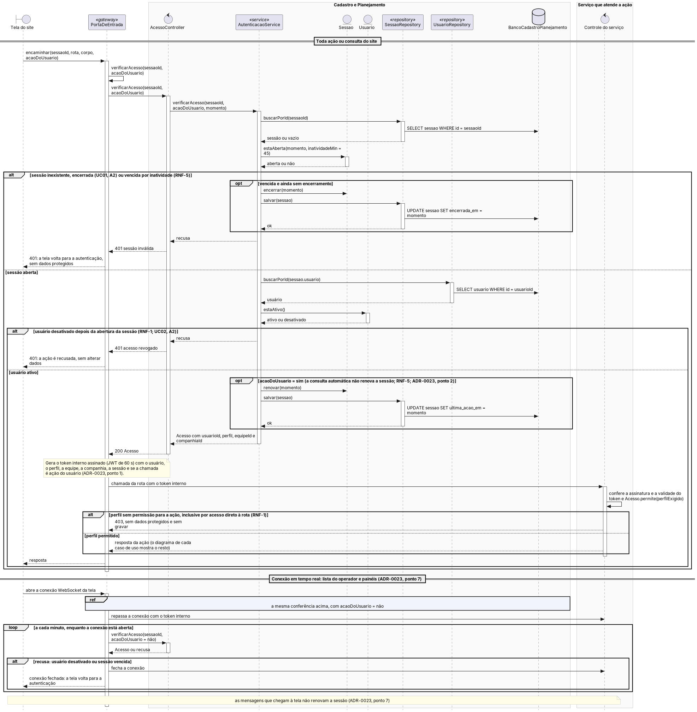

**Pedidos à Execução em Solo.** O Cadastro pergunta à Execução em Solo, dona das tarefas e do horário real de chegada à posição (AIBT), pelas tarefas pendentes antes de desativar um operador ou uma equipe ou de trocar a equipe de um operador (UC02 e UC09), e se a chegada já foi registrada antes de atualizar a previsão (UC10). As tarefas de planos ainda não confirmados, ele confere no próprio banco; o serviço do catálogo sob demanda ainda não acionado não conta como pendente (ADR-0023, ponto 4). Sem resposta da Execução em Solo, a ação é recusada como falha técnica, e nada é gravado.

**Confirmação do plano.** A confirmação do plano (UC05), e toda mudança num plano já confirmado (UC08), segue a ADR-0023, ponto 5. O Cadastro trava o plano, grava o envio como "Confirmação pendente", com uma chave, e só então pede à Execução em Solo (`receberPlano`). Com a resposta positiva, o plano passa a "Confirmado", com a auditoria na mesma transação. Com a recusa (tarefa já iniciada), volta ao que era. Se o Cadastro cair depois do envio, a `RetomadaConfirmacaoPlano` reenvia com a mesma chave, e a Execução em Solo responde o mesmo resultado (RNF-20). Enquanto a confirmação está pendente, o plano não aceita edição.

**Avisos.** Os avisos que o Cadastro publica usam o envelope comum da ADR-0016 (`EnvelopeAviso`). Eles entram na tabela `aviso_saida` na mesma transação da mudança e só depois vão para o RabbitMQ (`publicarPendentes`); quem recebe descarta o aviso repetido. Os nomes são estes:

| Aviso | Quando | Dados | Quem recebe (item 13) |
|---|---|---|---|
| `TurnaroundAberto` | UC03: o turnaround é aberto | voos e datas, aeronave, posição, horário programado de chegada à posição (SIBT), horário programado de saída da posição (SOBT), horário estimado de chegada à posição (EIBT), horário-alvo de prontidão (TOBT) planejado e tempo mínimo de turnaround (MTTT) | Monitoramento e Exceções e Liberação (`aplicarTurnaroundAberto`); o Exceções e Liberação inicia o TOBT vigente igual ao planejado (ADR-0003) |
| `PrevisaoAtualizada` | UC10: o EIBT ou o MTTT muda antes da chegada | EIBT e MTTT | Monitoramento (`aplicarPrevisao`), que faz a checagem de viabilidade (UC25) |
| `PlanoConfirmado` | UC05 e UC08: a Execução em Solo aceita o plano confirmado | tarefas, janelas, responsáveis e dependências | Monitoramento (`aplicarPlano`) |

O Cadastro também recebe o aviso `TurnaroundEncerrado` da Execução em Solo (UC37), com o horário real de saída da posição (AOBT) e os usuários vinculados, para o prazo dos dados pessoais (`aplicarEncerramento`; ADR-0023, ponto 6).

`«extend»` aparece como fragmento `opt` com a condição de extensão: o UC07 e o UC08 estendem o UC04, e o UC08 estende o UC05. A área A não tem `«include»`. O ator do UC01 é o ator abstrato Usuário, porque o caso de uso vale para os quatro perfis humanos (ADR-0010).

Os fluxos agrupados, que não mudam a interação, são estes:

- UC01: o E1 junta o identificador inexistente, o usuário desativado, a conta bloqueada e a senha incorreta, que recebem a mesma mensagem (RN2).
- UC02: o E2 aparece uma vez em cada ação (criar, alterar e desativar), como a recusa da porta de entrada; o E3 da alteração segue o do cadastro novo.
- UC03: o E2 e o E3 são o mesmo retorno: a nova tentativa depois de uma resposta perdida encontra o turnaround já gravado. O A1 é uma nota, porque a virada do dia não muda a interação.
- UC04: o A1 e o A3 são notas sobre os campos da tarefa; a alteração (A4) repete as verificações do passo 5 num `ref`.
- UC05: o A1 abre o plano pelo mesmo caminho do passo 1; o A2 e o A4 são notas sobre os dados enviados, e o A4 aciona a tarefa do catálogo (`acionar`).
- UC06: o E1 junta o modelo incompatível, o plano confirmado e a tarefa iniciada, porque uma tarefa só começa depois da confirmação.
- UC07: o A1 e o A2 são notas sobre a lista enviada.
- UC08: o A1 é uma nota sobre a relação removida; o E3 só acontece no plano já confirmado.
- UC10: o A1 é uma nota: o campo não alterado vai com o valor atual.
- UC11: o A1 é uma nota sobre a escolha.

## UC01 – Autenticar acesso do usuário

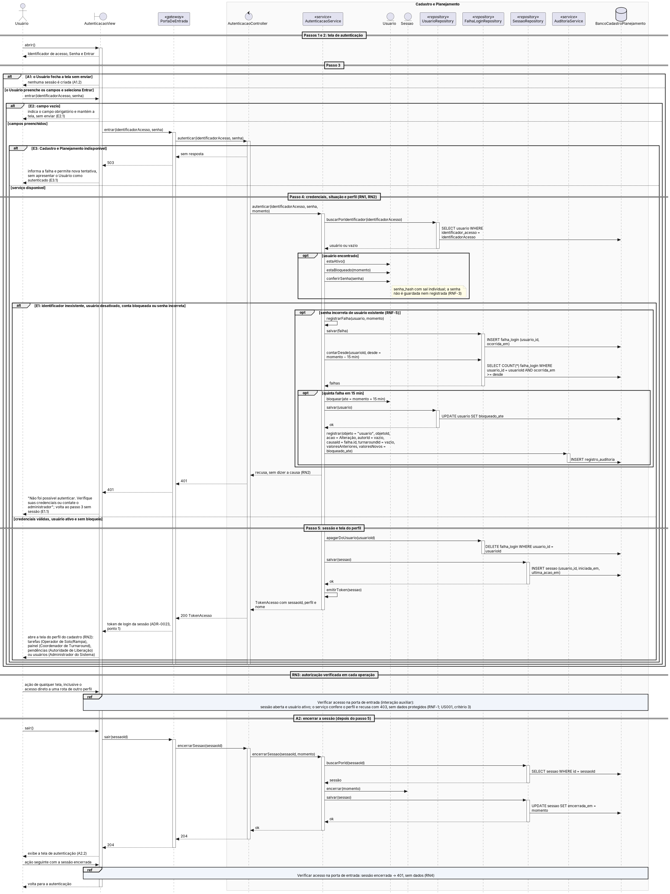

## UC02 – Gerenciar cadastro de usuários e perfis

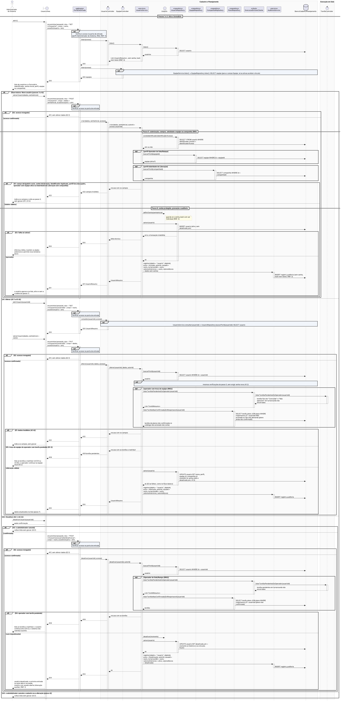

## UC03 – Abrir turnaround da aeronave

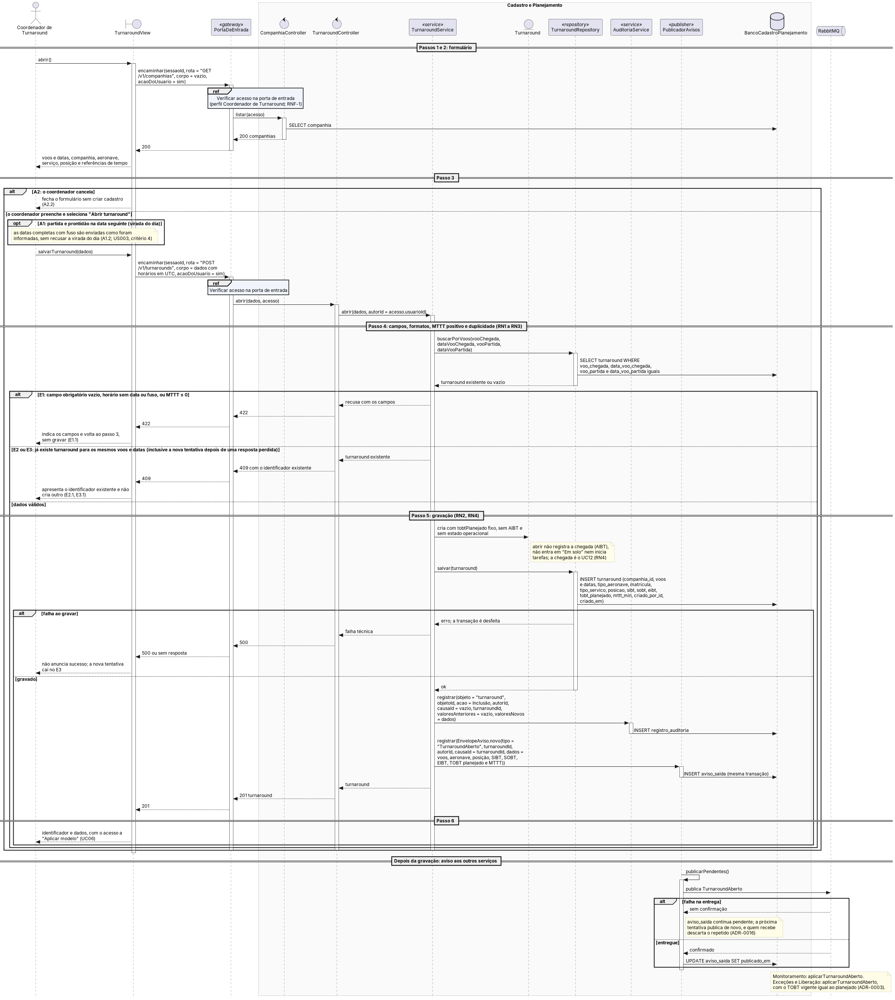

## UC04 – Criar modelo de tarefas

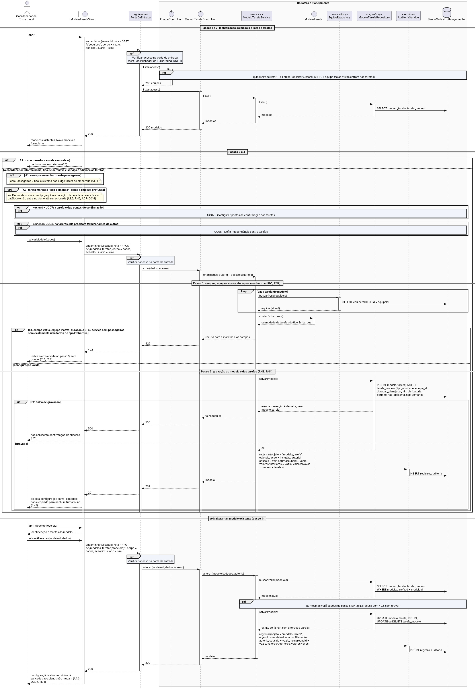

## UC05 – Confirmar plano inicial do turnaround

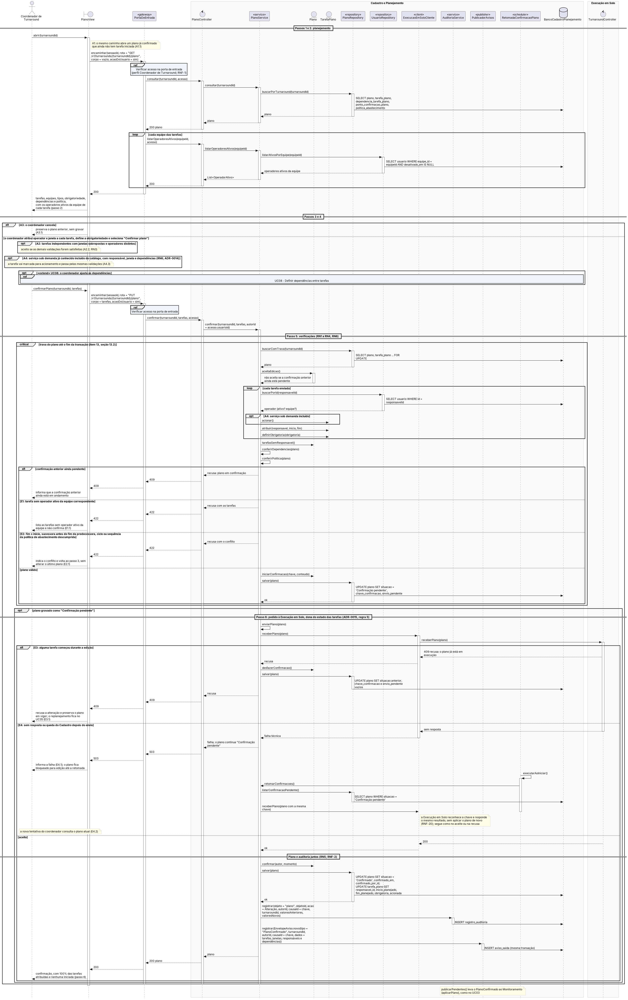

## UC06 – Aplicar modelo de tarefas

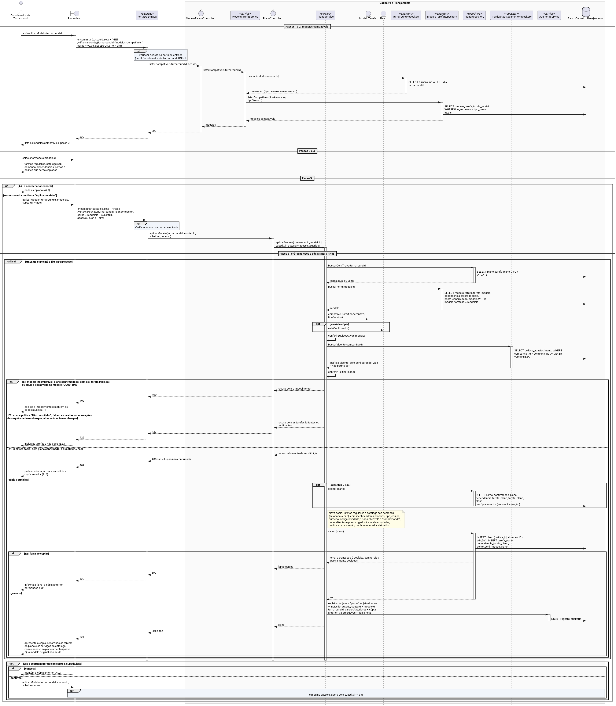

## UC07 – Configurar pontos de confirmação das tarefas

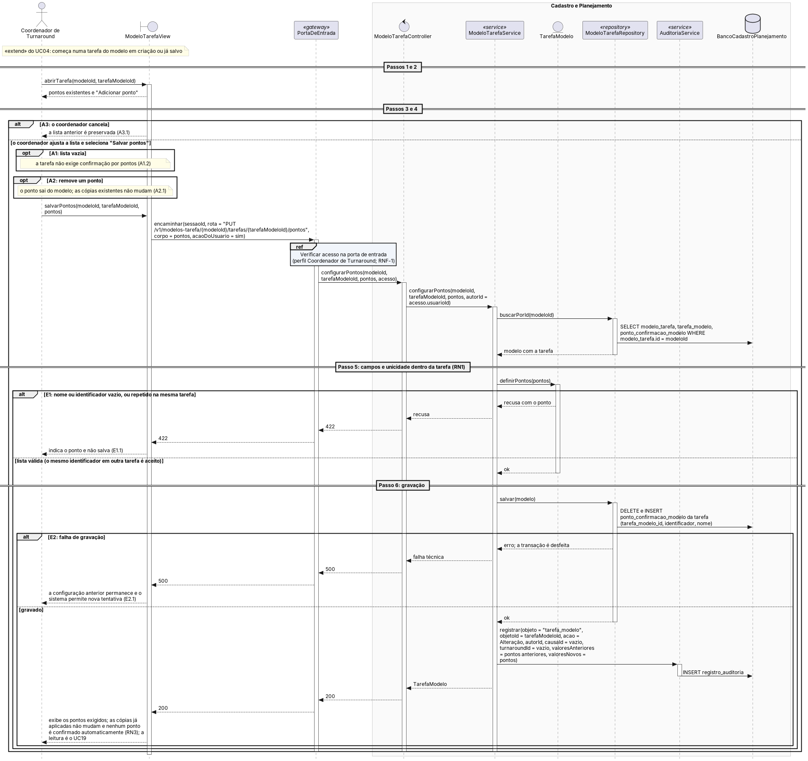

## UC08 – Definir dependências entre tarefas

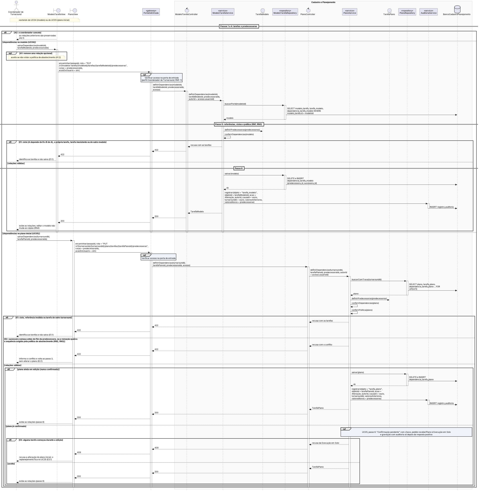

## UC09 – Gerenciar cadastro de equipes e especialidades

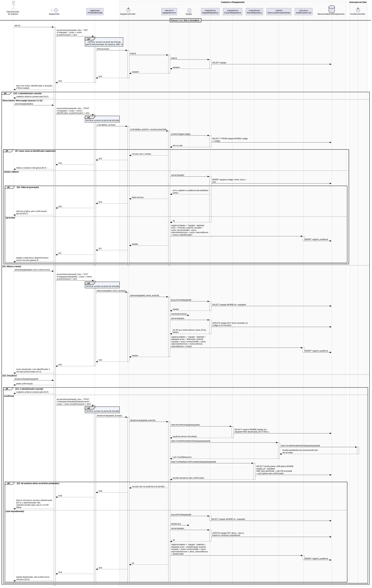

## UC10 – Atualizar referências de previsão do turnaround

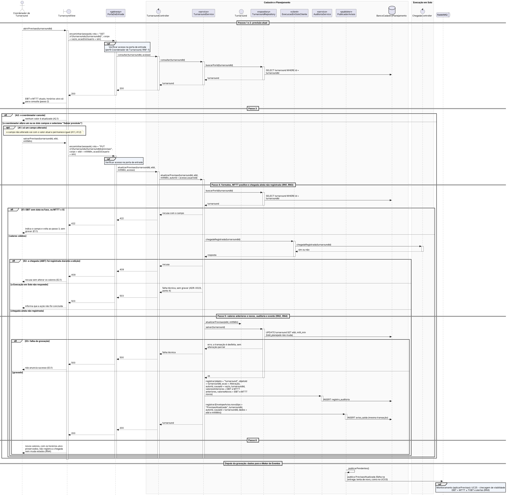

## UC11 – Configurar política de abastecimento

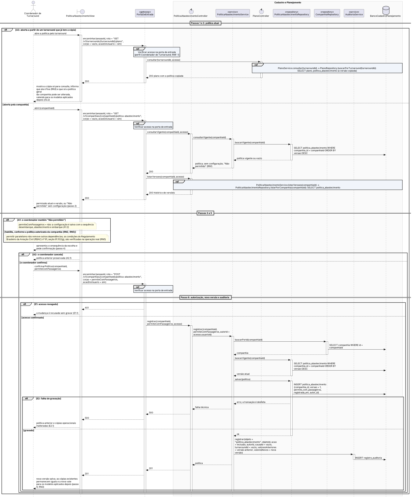
