## Execução em Solo: participantes e convenções

Os diagramas desta parte mostram os 11 casos de uso da execução em solo (UC12 a UC21 e UC37), que formam o microsserviço Execução em Solo (ADR-0015). A notação é a da linguagem de modelagem unificada (UML): o ator que inicia o caso de uso, linhas de vida com ativações, chamadas em seta contínua, retornos em seta tracejada, avisos assíncronos em seta aberta e fragmentos `alt`, `opt`, `loop` e `ref` com a condição de guarda entre colchetes. Os diagramas foram escritos em PlantUML, com a fonte editável em `especificacao/diagramas/14-sequencia-*.puml`.

Siglas desta parte: horário real de chegada à posição (AIBT), início real do atendimento em solo (ACGT), início real do embarque (ASBT), fim real do atendimento em solo (AEGT), horário real de saída da posição (AOBT), horário-alvo de prontidão (TOBT) e horário real de prontidão (ARDT), da tomada de decisão colaborativa em aeroportos (A-CDM) [2][4]; controle de tráfego aéreo (ATC); Agência Nacional de Aviação Civil (ANAC) [62]; código de resposta rápida (QR Code); linguagem de consulta estruturada (SQL), usada nas mensagens ao banco.

**Camadas.** Toda ação vinda de uma tela passa pela porta de entrada (ADR-0016) e desce pelas camadas de referência da ADR-0015, `Controller → Service → Repository`, até o banco de dados da Execução em Solo, e volta pelo mesmo caminho. A tela nunca fala com o banco. Nenhum diagrama acessa o banco de outro serviço: a Execução em Solo conversa com o Cadastro e Planejamento por pedido em chamada direta (B.1) e com os demais serviços por avisos na mensageria (B.2).

| Participante | Estereótipo (camada) | Onde fica | Papel nos diagramas |
|---|---|---|---|
| `TarefaView`, `TurnaroundView`, `ChegadaView` | «boundary» (interface) | Site, no celular do Operador de Solo/Rampa ou no computador do Coordenador de Turnaround | Telas dos protótipos do item 10; guardam no celular os registros feitos sem conexão |
| `PortaDeEntrada` | «gateway» | Porta de entrada única | Confere o token e a situação do usuário no Cadastro e Planejamento a cada ação (B.1; ADR-0016) |
| `TarefaController`, `TurnaroundController` | «control» (controle) | Execução em Solo | Recebem o pedido em transferência de estado representacional (REST) e conferem o perfil |
| `TarefaService`, `TurnaroundService`, `MarcoService`, `PropagacaoService` | «service» (serviço) | Execução em Solo | Aplicam as regras de negócio dos RFs e dos casos de uso |
| `TarefaRepository`, `TurnaroundRepository`, `AvisoRepository` | «repository» (acesso a dados) | Execução em Solo | Leem e gravam as tabelas do banco do serviço |
| `BancoExecucaoEmSolo` | «database» (banco de dados) | Execução em Solo | Banco próprio do serviço |
| `AvisoPublisher`, `MotorDeEventosListener` | «publisher», «control» | Execução em Solo | Publicam os avisos e recebem os avisos da fila do serviço |
| `NotificadorWebSocket` | «boundary» | Execução em Solo | Envia às telas abertas a mudança de estado em até 5 segundos (RNF-11) |
| `RabbitMQ` | «queue» | Mensageria | Entrega os avisos aos serviços (ADR-0016) |

**Motor de Eventos.** O Motor de Eventos é um ator lógico (ADR-0015, regra 7). Na Execução em Solo, ele corresponde ao `MotorDeEventosListener`, que ouve a fila do serviço e executa os marcos (UC20) e a propagação (UC21) a cada aviso de registro aceito. Por isso os diagramas do UC20 e do UC21 começam no ator Motor de Eventos, e os casos de uso que os incluem (UC12, UC15, UC16 e UC18) terminam com um fragmento `ref` para eles.

**Nomes e valores.** Classes, métodos, tabelas e avisos seguem a convenção da ADR-0016. Os horários trafegam em tempo universal coordenado (UTC), e os identificadores são identificadores únicos universais (UUID) versão 4. As condições de guarda e os valores gravados usam os nomes de estado do `CONTEXT.md`, seção 3, para que sejam os mesmos do item 10. Antes da chegada à posição, o turnaround ainda não tem estado (UC22, RN1); por isso o histórico da chegada vai de "sem estado" para "Em solo". Cada chamada ao banco cita a tabela que lê ou grava. As consultas estão em SQL completo; nas gravações (`INSERT` e `UPDATE`), cada campo aparece com o valor gravado (`campo = valor`), de forma abreviada, para caber no diagrama.

| Tabela | O que guarda | Diagramas |
|---|---|---|
| `turnaround` | Cópia do turnaround recebida na confirmação do plano, com o estado do turnaround | UC12, UC13, UC14, UC15 a UC18, UC21, UC37 |
| `tarefa` | Tarefa do turnaround em andamento, com o estado, o responsável, a obrigatoriedade, a indicação de embarque e a permissão de "Não aplicável" | UC12, UC14 a UC21 |
| `dependencia_tarefa` | Predecessora e sucessora de cada tarefa | UC14, UC21 |
| `ponto_confirmacao` | Pontos de QR Code de cada tarefa | UC14, UC16, UC19 |
| `leitura_qr_code` | Leitura de cada ponto, com o autor e o horário | UC19 |
| `registro_tarefa` | Início, conclusão, pausa, retomada e "Não aplicável", com o autor, o horário da ação, a justificativa e o código de atraso | UC15 a UC18, UC37 |
| `codigo_atraso` | Tabela versionada de códigos de atraso (RNF-22) | UC17 |
| `marco` | AIBT, ACGT, ASBT, AEGT e AOBT, com o horário, o autor ou o registro de origem | UC12, UC13, UC20, UC37 |
| `correcao_aibt` | Valor anterior, valor novo, motivo, autor e horário de cada correção da chegada | UC13 |
| `historico_estado` | Estado anterior e novo de cada mudança, com o autor, o horário e o registro que a causou (RF-21; RNF-2) | UC12, UC15 a UC18, UC21, UC37 |
| `aviso_saida`, `aviso_processado` | Caixa de saída dos avisos e avisos já processados. São tabelas técnicas do serviço, sem dado de negócio, e também entram no item 12 | B.2 e todos os que publicam ou consomem aviso |

**Avisos publicados.** `ChegadaRegistrada` (UC12), `ChegadaCorrigida` (UC13), `TarefaIniciada` (UC15), `TarefaConcluida` (UC16), `TarefaPausada` e `TarefaRetomada` (UC17), `TarefaMarcadaNaoAplicavel` (UC18), `MarcoRegistrado` (UC20), `EstadoTarefaAlterado` e `EstadoTurnaroundAlterado` (UC21) e `SaidaRegistrada` (UC37). A leitura de QR Code (UC19) não muda estado e não gera aviso.

## Interações auxiliares

Três interações se repetem em quase todos os casos de uso. Para não repetir as mesmas mensagens em 11 diagramas, elas são desenhadas uma vez e citadas por um fragmento `ref`.

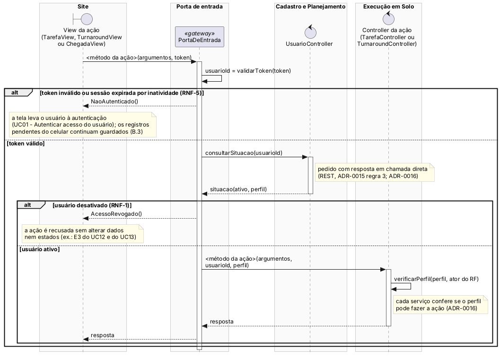

*Interação auxiliar B.1 – Verificar o acesso na porta de entrada.* Cobre a sessão expirada (RNF-5), que leva à autenticação do UC01, e o acesso revogado (RNF-1), que recusa a ação sem alterar dados.

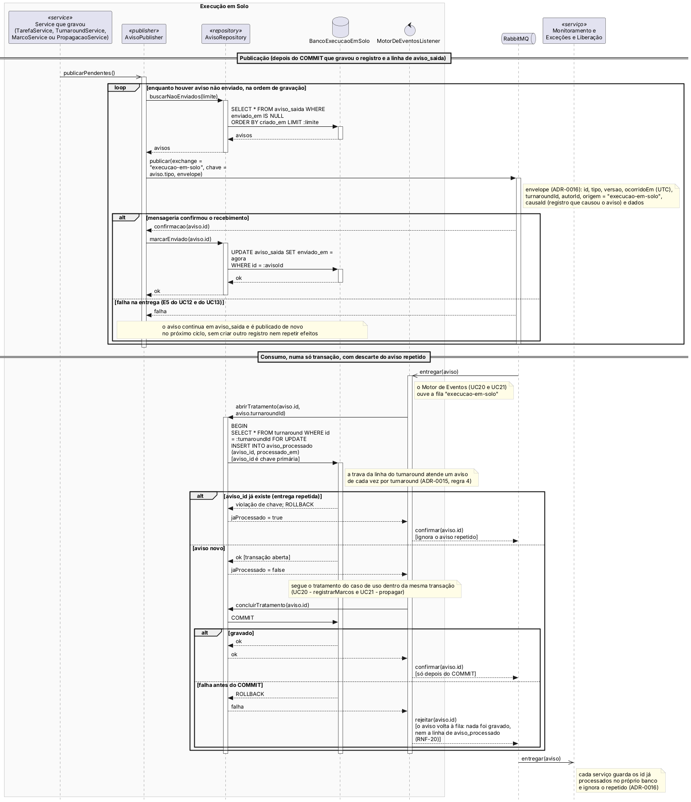

*Interação auxiliar B.2 – Publicar o aviso pela caixa de saída e descartar o aviso repetido.* O aviso é gravado na mesma transação do registro e publicado depois; se a entrega falha, ele fica na caixa de saída para nova tentativa, sem repetir o registro nem os efeitos (E5 do UC12 e do UC13). Quem consome guarda o identificador do aviso e ignora o repetido (ADR-0016). O consumo é uma só transação: ela trava a linha do turnaround, grava o identificador do aviso e as mudanças do UC20 e do UC21, e só depois do `COMMIT` o aviso é confirmado à fila. Se algo falha antes, nada fica gravado e o aviso volta à fila (RNF-20).

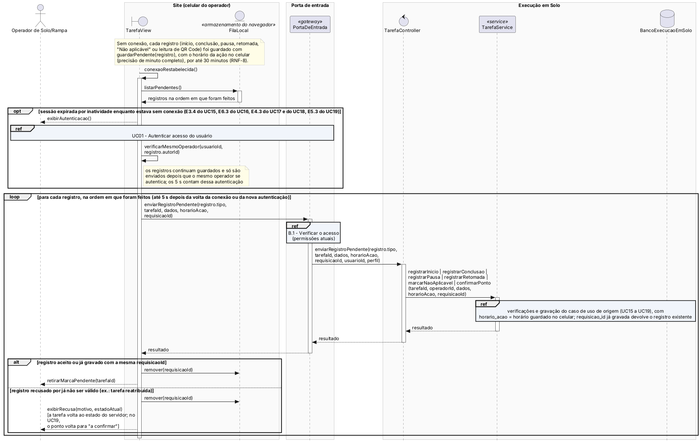

*Interação auxiliar B.3 – Enviar os registros pendentes do celular.* Cobre a segunda parte dos fluxos "Sem conexão com a internet" do UC15 ao UC19: o envio na ordem em que os registros foram feitos, em até 5 segundos, a recusa do registro que já não é válido e a sessão expirada, que só libera o envio depois que o mesmo operador se autentica de novo (RNF-8).

## UC12 – Registrar chegada da aeronave à posição

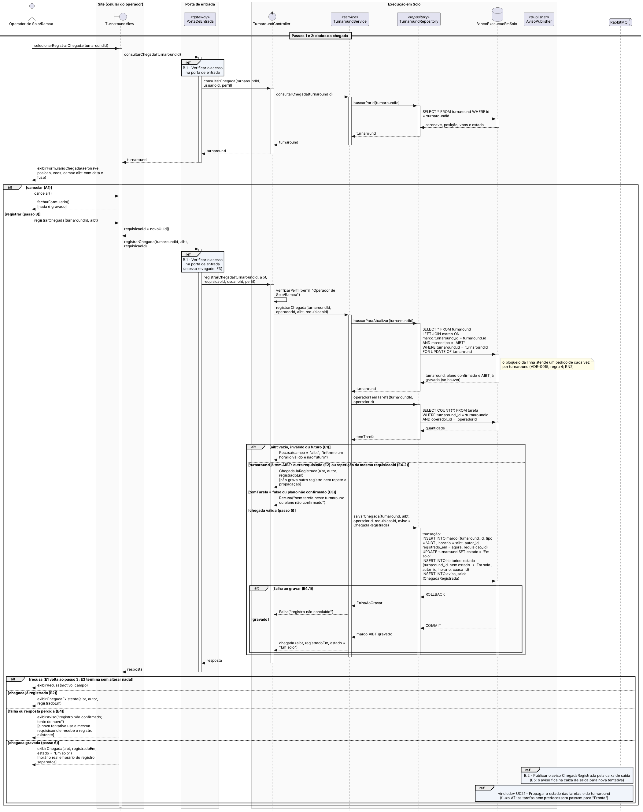

*Diagrama de Sequência do UC12 – Registrar chegada da aeronave à posição.* O bloqueio da linha do turnaround (`FOR UPDATE`) garante uma só chegada, inclusive em pedidos simultâneos (RN2). A nova tentativa depois de resposta perdida (E4.2) usa o mesmo identificador de requisição e cai no mesmo ramo da chegada já registrada (E2). A falha na entrega do aviso (E5) está na B.2. O «include» do UC21 aparece como `ref`.

## UC13 – Corrigir horário de chegada à posição

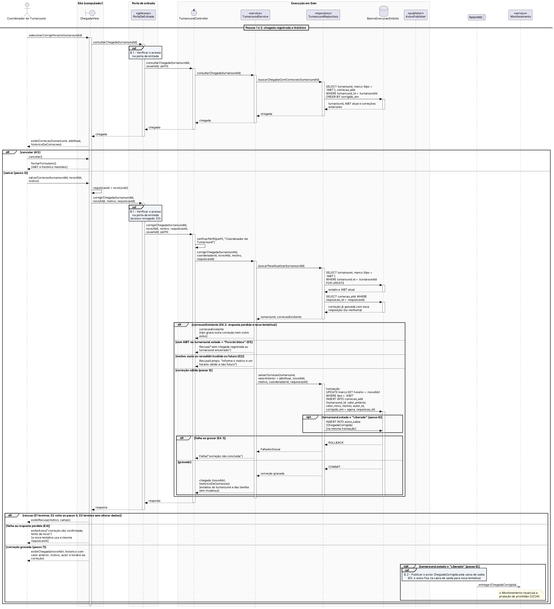

*Diagrama de Sequência do UC13 – Corrigir horário de chegada à posição.* A correção grava o valor anterior, o novo, o motivo, o autor e o horário, e não muda nenhum estado. O aviso `ChegadaCorrigida` só é gravado quando o turnaround não está "Liberado" (passo 6), e o Monitoramento o usa para recalcular a projeção (UC24). O acesso revogado (E3) está na B.1, e a falha na entrega do aviso (E5), na B.2.

## UC14 – Consultar lista de tarefas do operador

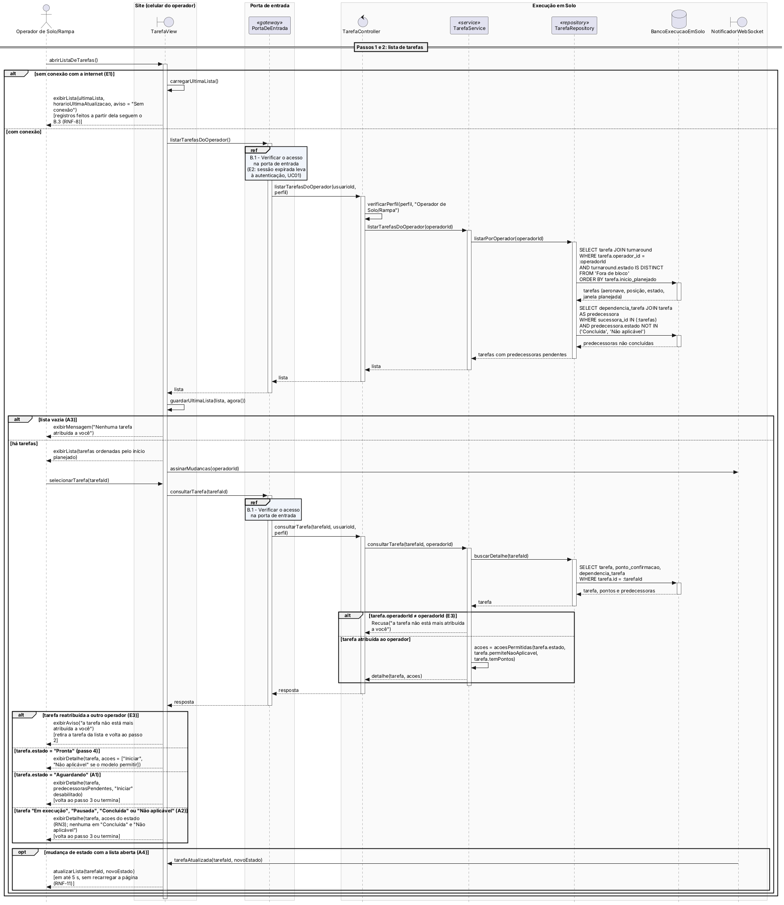

*Diagrama de Sequência do UC14 – Consultar lista de tarefas do operador.* A consulta não grava nada. A sessão expirada (E2) está na B.1. As ações oferecidas no detalhe saem de `acoesPermitidas`, conforme o estado da tarefa (RN3).

## UC15 – Registrar início da tarefa

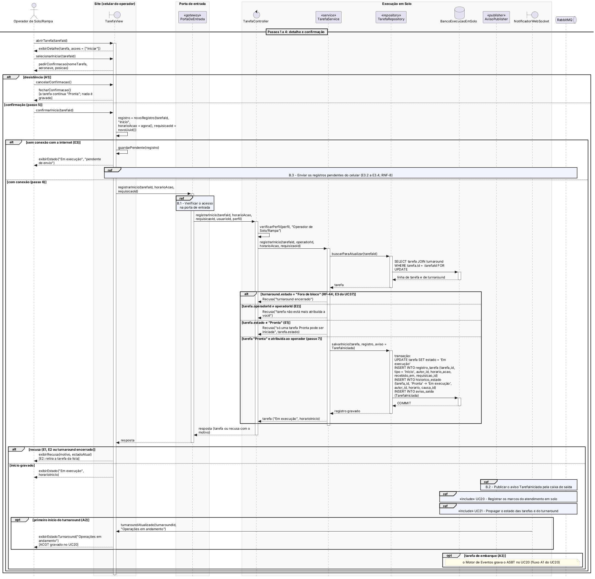

*Diagrama de Sequência do UC15 – Registrar início da tarefa.* O ACGT e o ASBT são gravados pelo Motor de Eventos no UC20, a partir do registro do operador (RF-20); este diagrama só mostra o resultado (A2 e A3). O envio dos registros guardados sem conexão (E3.2 a E3.4) está na B.3.

## UC16 – Registrar conclusão da tarefa

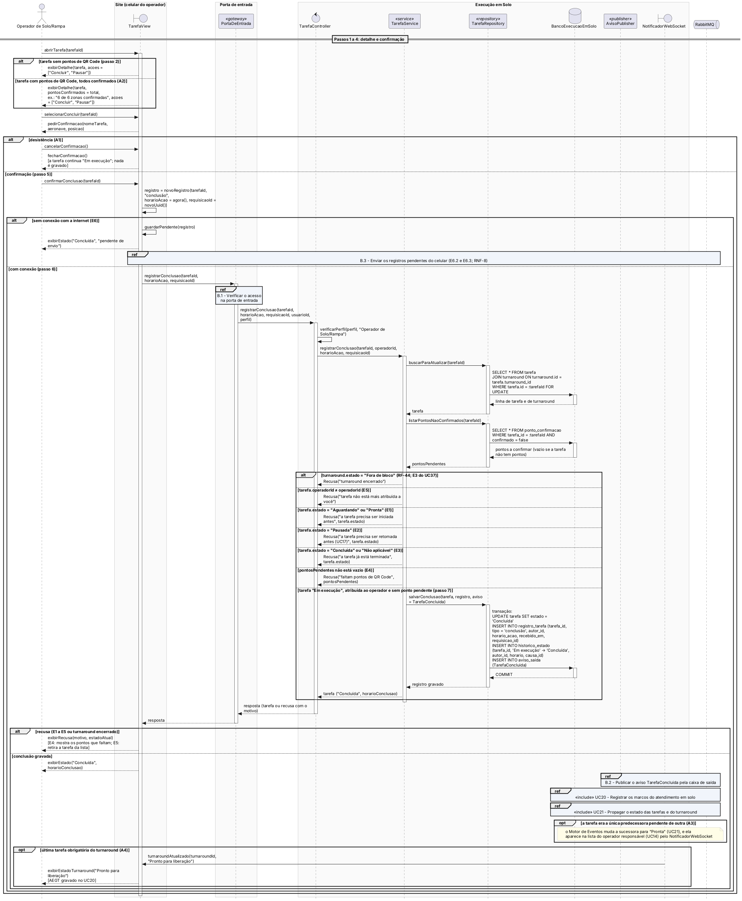

*Diagrama de Sequência do UC16 – Registrar conclusão da tarefa.* A conclusão só é gravada com a tarefa "Em execução" e sem ponto de QR Code a confirmar (RF-16). O AEGT da última tarefa obrigatória é gravado pelo Motor de Eventos no UC20 (A4). O envio sem conexão (E6.2 e E6.3) está na B.3.

## UC17 – Pausar e retomar execução da tarefa

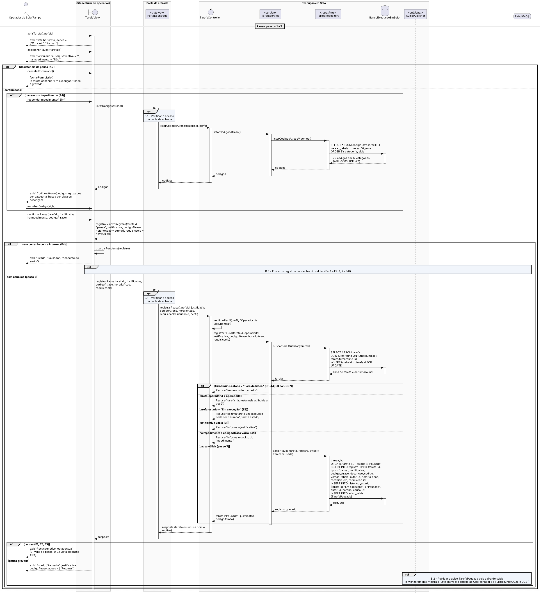

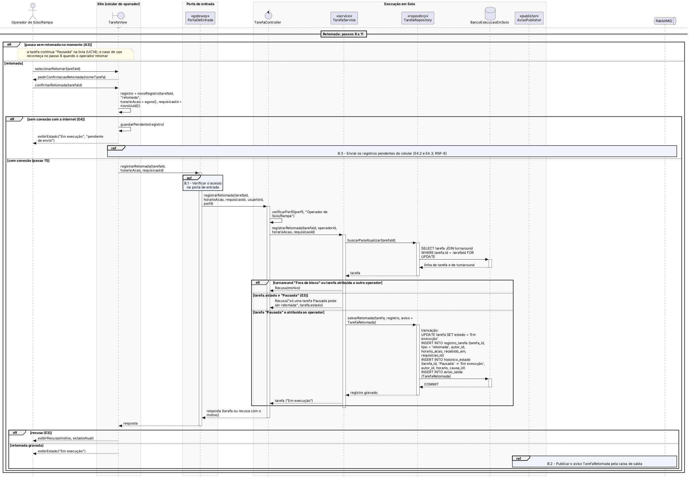

*Diagrama de Sequência do UC17 – Pausar e retomar execução da tarefa.* A parte 1 mostra a pausa, e a parte 2, a retomada. A pausa com impedimento (A1) busca a versão vigente da tabela de códigos da ANAC e grava o código, a descrição e a versão (RNF-22). O envio sem conexão (E4.2 e E4.3) está na B.3.

## UC18 – Marcar tarefa como "Não aplicável"

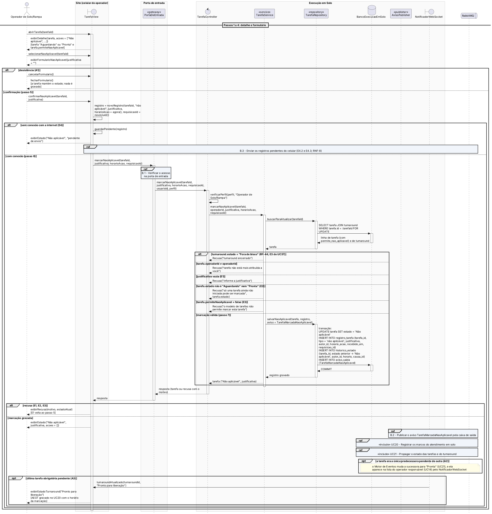

*Diagrama de Sequência do UC18 – Marcar tarefa como "Não aplicável".* A marcação conta como término para a propagação e, na última tarefa obrigatória pendente, para o AEGT, gravado pelo Motor de Eventos no UC20 (A3). O envio sem conexão (E4.2 e E4.3) está na B.3.

## UC19 – Confirmar a execução da tarefa por QR Code

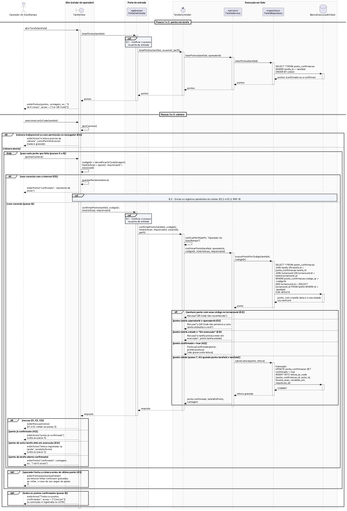

*Diagrama de Sequência do UC19 – Confirmar a execução da tarefa por QR Code.* O ponto é procurado pelo código no turnaround da tarefa aberta, o que permite gravar a leitura na outra tarefa do operador em execução (A3) e recusar o código de tarefa de outro operador (E1) ou desconhecido (E2). O envio sem conexão (E5.2 e E5.3) está na B.3.

## UC20 – Registrar os marcos do atendimento em solo

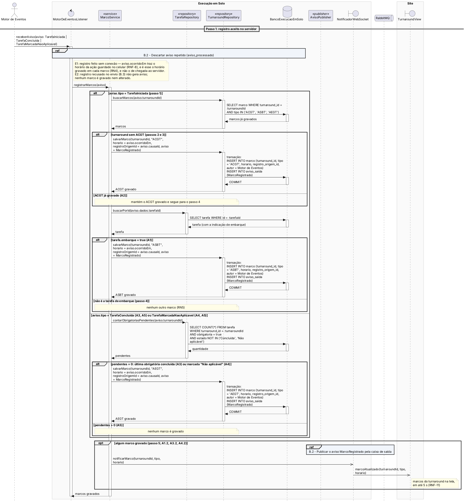

*Diagrama de Sequência do UC20 – Registrar os marcos do atendimento em solo.* Cada marco é gravado com o horário da ação que vem no aviso (`ocorridoEm`) e com o registro de origem (RN4). O aviso é tratado na transação aberta na B.2, com a linha do turnaround travada: dois inícios tratados ao mesmo tempo não gravam dois ACGT (ADR-0015, regra 4). Dois fluxos de exceção estão agrupados numa nota, porque não mudam a interação: no E1 (registro feito sem conexão), a sequência é a mesma, só que o horário da ação veio do celular; no E2 (registro recusado no servidor), não há aviso, e nada acontece.

## UC21 – Propagar o estado das tarefas e do turnaround

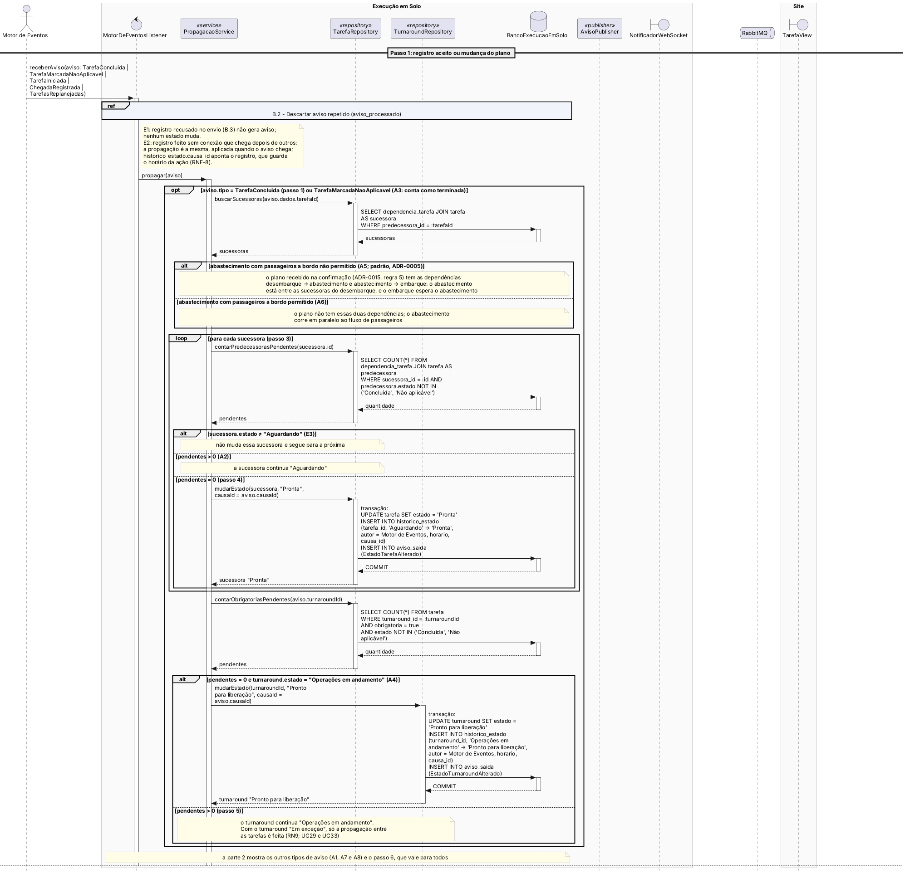

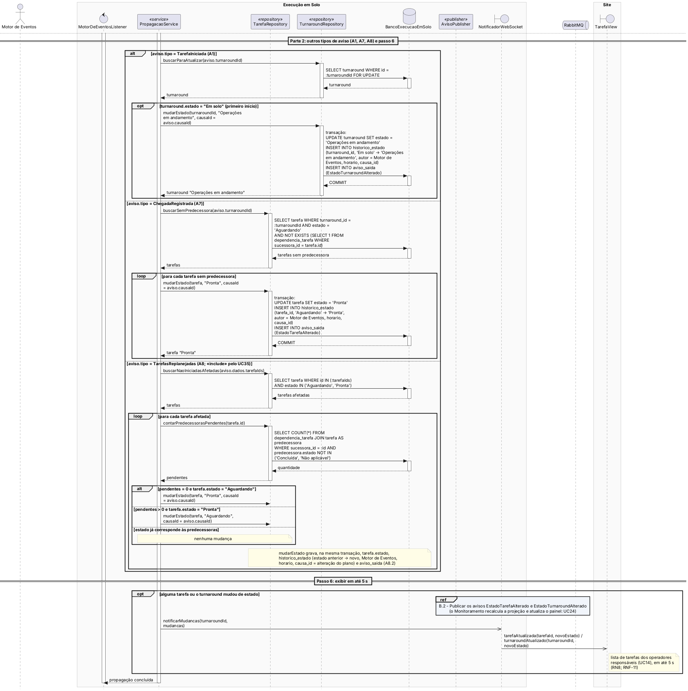

*Diagrama de Sequência do UC21 – Propagar o estado das tarefas e do turnaround.* A parte 1 mostra o término de uma tarefa (fluxo básico, A2 a A6 e E3), e a parte 2 mostra o primeiro início (A1), a chegada (A7), o replanejamento do UC35 (A8) e a exibição em até 5 segundos (passo 6). As dependências do abastecimento chegam com o plano, conforme a política da companhia aérea (ADR-0005; ADR-0015, regra 5); por isso A5 e A6 mudam quais sucessoras a consulta devolve, e não as mensagens. O E1 e o E2 estão agrupados numa nota, como no UC20. Como no UC20, todas as mudanças de um aviso entram numa só transação, aberta na B.2 com a linha do turnaround travada.

## UC37 – Registrar a saída da posição e encerrar o turnaround

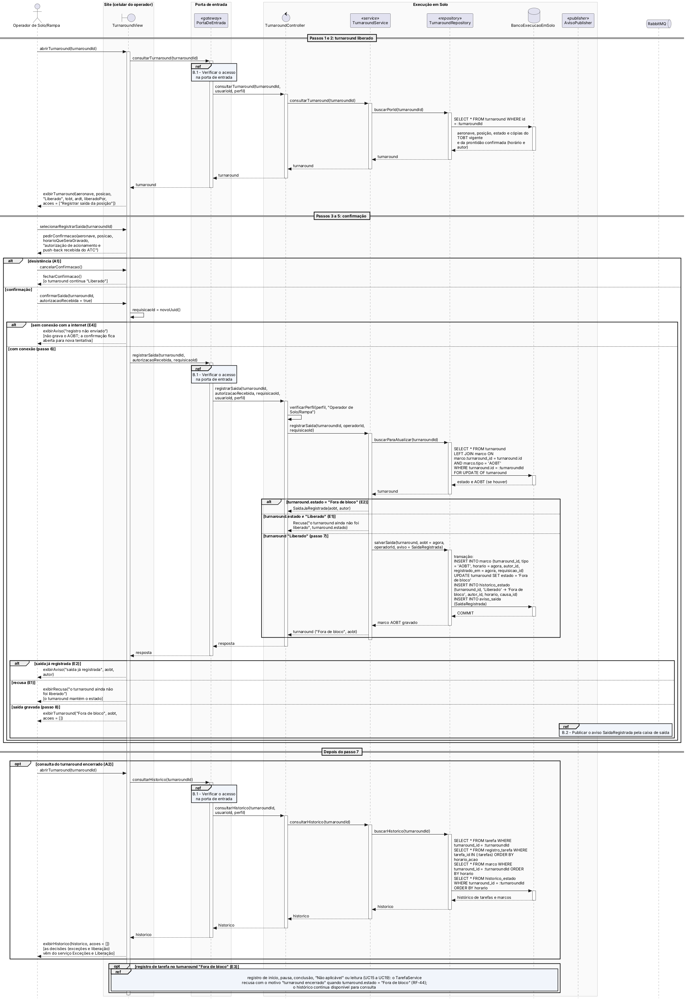

*Diagrama de Sequência do UC37 – Registrar a saída da posição e encerrar o turnaround.* O AOBT é o horário do registro, gravado com o operador (RN2). A autorização de acionamento e de push-back do ATC fica fora do sistema; o operador só marca que a recebeu. O TOBT e a prontidão confirmada exibidos no passo 2 são cópias para exibição; o dono desses dados é o serviço Exceções e Liberação (ADR-0015). A recusa de registro de tarefa no turnaround encerrado (E3) aparece como `ref`, porque a regra é conferida pelo `TarefaService` nos diagramas do UC15 ao UC19.

Fontes citadas: [2], [4] e [62], conforme a numeração de `pesquisa/fontes.md`.

<!-- Fontes editáveis: especificacao/diagramas/14-sequencia-*.puml (PlantUML), com o estilo comum em 14-sequencia-estilo.iuml. Imagens PNG e SVG geradas por `python scripts/exportar_plantuml.py <arquivo.puml>`; um arquivo com `newpage` gera uma imagem por parte (_001). -->
