<!-- Área B, serviço Execução em Solo (ADR-0015): diagramas de sequência dos casos de uso UC12 a UC21 e UC37 (issue #149). Formato em 00-item.md. -->
## Convenções dos diagramas da área B

Os diagramas da área B mostram o serviço Execução em Solo, que é dono da tarefa, dos marcos e do estado do turnaround, como decide o registro de decisão de arquitetura (ADR) 0015 (tabela dos serviços e regra 4). Os participantes são as classes do item 13: telas («boundary»), controles («control»), serviços («service»), classes de negócio («entity»), repositórios («repository»), o `PublicadorAvisos` e o `ListaTarefasNotificador`, além do banco do serviço. Cada chamada ao banco cita a tabela do item 12 (Apêndice B.2). Toda ação do site passa pela `PortaDeEntrada`, e o fragmento `ref` "Verificar acesso na porta de entrada" resume a consulta ao Cadastro e Planejamento a cada ação (requisito não funcional (RNF) 1; ADR-0023). As mensagens usam os métodos e os argumentos do item 13, e `python scripts/conferir_classes.py --sequencia` não acusa nenhuma mensagem da área B (C13.8).

Todo registro que muda uma tarefa ou o turnaround segue o mesmo caminho, mostrado por inteiro no caso de uso (UC) 15 e repetido nos outros:

- O serviço confere primeiro o `requisicaoId`. Se a mesma requisição já foi gravada, ele devolve a resposta da primeira vez, sem gravar de novo (resposta perdida e envio repetido).
- Depois, trava o turnaround até o fim da transação (`buscarComTrava`, fragmento `critical`; ADR-0015, regra 4, e ADR-0018). Com a trava, a classe de negócio confere o estado, o responsável da tarefa (`conferirResponsavel`) e se o turnaround ainda aceita registros (`aceitaRegistros`). As recusas voltam com 409 (estado), 403 (tarefa de outro operador) ou 422 (campo inválido), e nada é gravado.
- O registro aceito grava a tarefa, o histórico de estado, a auditoria e o aviso aos outros serviços na mesma transação. O aviso entra na tabela `aviso_saida` e só depois vai para o RabbitMQ (`publicarPendentes`). Se a entrega falhar, o aviso fica para a próxima tentativa, e quem recebe descarta o repetido (ADR-0016).
- Depois da gravação, o `ListaTarefasNotificador` atualiza a lista do operador por WebSocket em até 5 s (UC14, A4; RNF-11).
- Sem conexão, o celular guarda o registro na `FilaRegistrosSemConexao` com o horário da ação e o envia quando a conexão volta. Se a sessão expirou, ele espera o mesmo operador se autenticar. O servidor confere de novo as permissões e grava o horário da ação, e não o horário da chegada do registro (RNF-8).

O Motor de Eventos, ator do UC20 e do UC21, não é uma classe: é o comportamento automático do `MarcoService` e do `PropagacaoService` (ADR-0015, regra 7; item 13, seção 13.1). Ele não passa pela fila. Quem o inclui o chama na mesma transação e com a mesma trava: o `TarefaService` (UC15, UC16 e UC18), o `ChegadaService` (UC12) e o `ReplanejamentoService` (UC35, da área D) (ADR-0018, pontos 4 e 5). Por isso, o diagrama do UC20 e o do UC21 começam com o Motor de Eventos chamando o serviço e terminam num `ref` à gravação feita por quem os inclui. Nos diagramas que incluem, `«include»` aparece como fragmento `ref` ao UC20 e ao UC21. A área B não tem `«extend»`.

Os avisos que a Execução em Solo publica usam o envelope comum da ADR-0016 (`EnvelopeAviso`) e levam o identificador do que causou a mudança (`causaId`). Todo aviso de tarefa leva a `versao` da tarefa, e todo aviso de estado ou de marco do turnaround leva a `versao` do turnaround, que sobe a cada mudança de estado ou de marco. Assim, quem guarda cópia descarta o aviso mais antigo que chegar depois, inclusive o que nasce de um registro feito sem conexão (item 12, seção 12.5.2, "Ordem dos avisos"). Os nomes são estes:

| Aviso | Quando | Dados | Quem recebe (item 13) |
|---|---|---|---|
| `ChegadaRegistrada` | UC12: o operador registra o horário real de chegada à posição (AIBT) | AIBT, horário do registro, estado "Em solo" e `versao` do turnaround | Monitoramento (`aplicarMarco`, `aplicarEstado`) |
| `AibtCorrigido` | UC13: o Coordenador de Turnaround corrige o AIBT, com o turnaround fora de "Liberado" | AIBT anterior e novo, horário da correção e `versao` do turnaround | Monitoramento, que recalcula a projeção (UC24, A3) |
| `TarefaIniciada`, `TarefaConcluida`, `TarefaPausada`, `TarefaRetomada`, `TarefaMarcadaNaoAplicavel` | UC15 a UC18: o registro do operador é aceito | tarefa, registro, estado novo, `versao` e horário da ação; na pausa, também a justificativa e o código de atraso | Monitoramento (`aplicarTarefa`) |
| `EstadoTarefaPropagado` | UC21: uma tarefa muda de estado pela propagação | tarefa, estado anterior e novo, `versao` | Monitoramento (`aplicarTarefa`) |
| `EstadoTurnaroundAlterado` | UC21: o turnaround passa para "Operações em andamento" ou "Pronto para liberação" | estado anterior e novo e `versao` do turnaround | Monitoramento (`aplicarEstado`) |
| `MarcoRegistrado` | UC20: o Motor de Eventos grava o início real do atendimento em solo (ACGT), o início real do embarque (ASBT) ou o fim real do atendimento em solo (AEGT) | tipo, horário, registro de origem e `versao` do turnaround | Monitoramento (`aplicarMarco`) |
| `TurnaroundEncerrado` | UC37: o operador registra o horário real de saída da posição (AOBT) | AOBT, estado "Fora de bloco", os usuários vinculados ao turnaround e `versao` do turnaround | Cadastro e Planejamento (`aplicarEncerramento`, prazo dos dados pessoais; ADR-0023, ponto 6), Exceções e Liberação (`aplicarAobt`) e Monitoramento (`aplicarMarco`, `aplicarEstado`) |

O horário-alvo de prontidão (TOBT) vigente e o horário real de prontidão (ARDT) aparecem só como cópias, para exibir (item 12, seção 12.5.2). Quem os grava é o Exceções e Liberação.

Os fluxos agrupados, que não mudam a interação, são estes:

- UC12: o E3 junta três recusas (acesso revogado na porta de entrada, plano inicial não confirmado e operador sem tarefa no turnaround), todas sem gravar nada.
- UC14: o A1 e o A2 são saídas do mesmo detalhe da tarefa, conforme o estado.
- UC15, UC16 e UC18: as recusas por estado ficam no mesmo `alt`, e a tela mostra o motivo de cada uma numa só resposta. O A3 e o A4 do UC16 e o A2 e o A3 do UC18 são notas sobre o resultado do UC20 e do UC21.
- UC17: o E1 e o E2 voltam ao formulário pelo mesmo 422.
- UC19: o E2 junta a tarefa de outro operador e a tarefa fora de "Em execução". A leitura do código de resposta rápida (QR Code) não gera aviso, porque não muda o estado da tarefa; a conclusão continua no UC16 (ADR-0007).
- UC21: o E1 é nota no passo 1, porque o registro recusado não chega ao Motor de Eventos; o A5 e o A6 são uma nota sobre as dependências do abastecimento (ADR-0005).
- UC37: o E3 é `ref` aos registros do UC15 ao UC19, que recusam o registro no turnaround encerrado.

O UC17 e o UC21 têm duas partes cada um. No UC17, a parte 1 mostra a pausa, e a parte 2 mostra a retomada e a volta da conexão. No UC21, a parte 1 mostra a propagação depois de um registro de tarefa, e a parte 2 mostra a chegada (A7) e o replanejamento (A8).

## UC12 – Registrar chegada da aeronave à posição

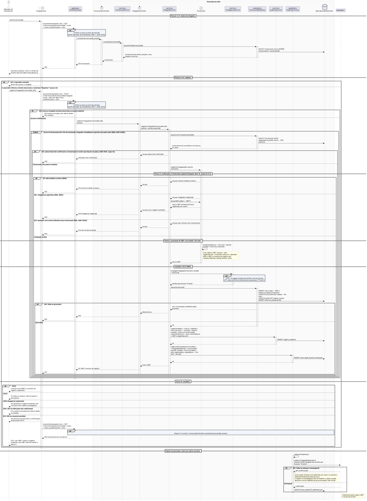

## UC13 – Corrigir horário de chegada à posição

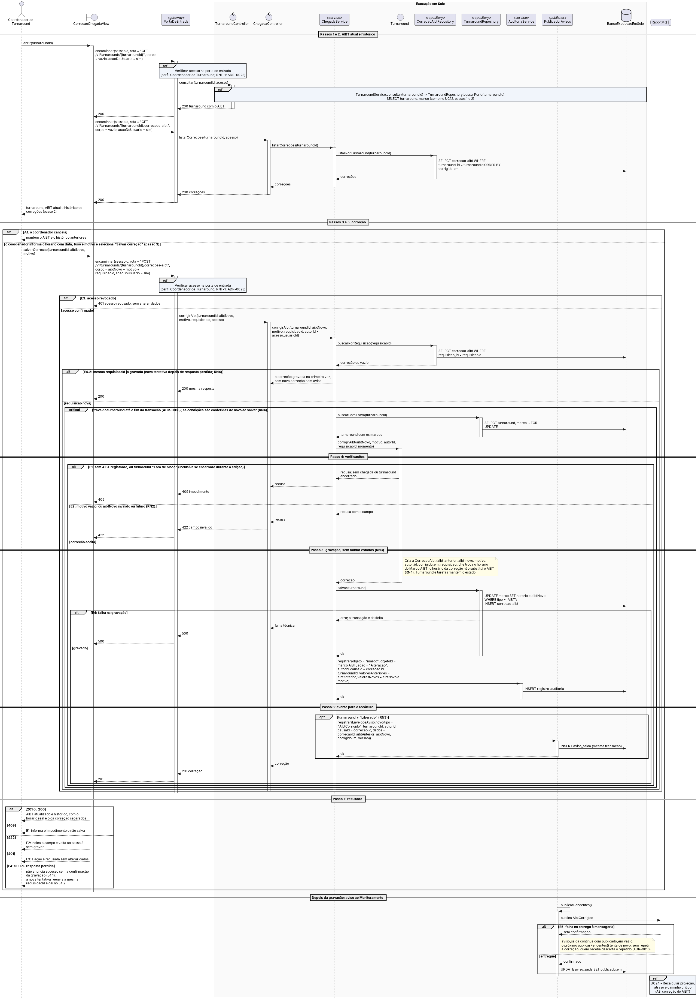

## UC14 – Consultar lista de tarefas do operador

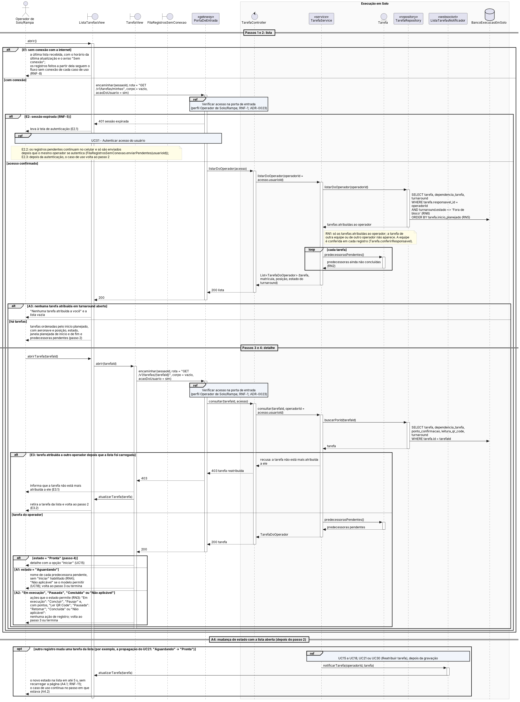

## UC15 – Registrar início da tarefa

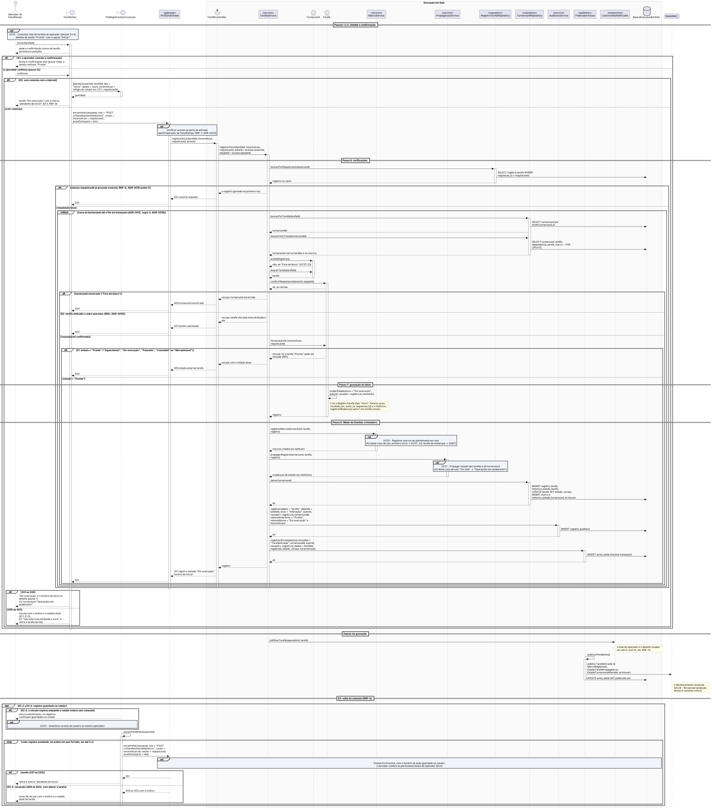

## UC16 – Registrar conclusão da tarefa

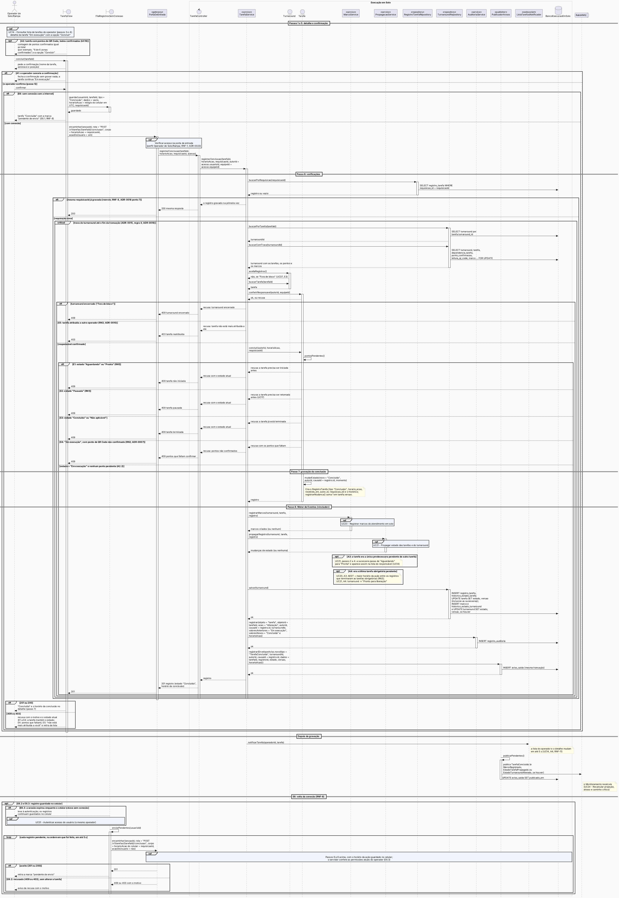

## UC17 – Pausar e retomar execução da tarefa

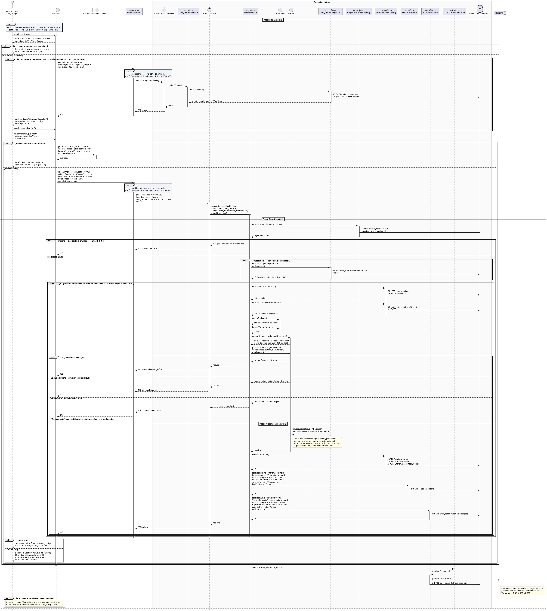

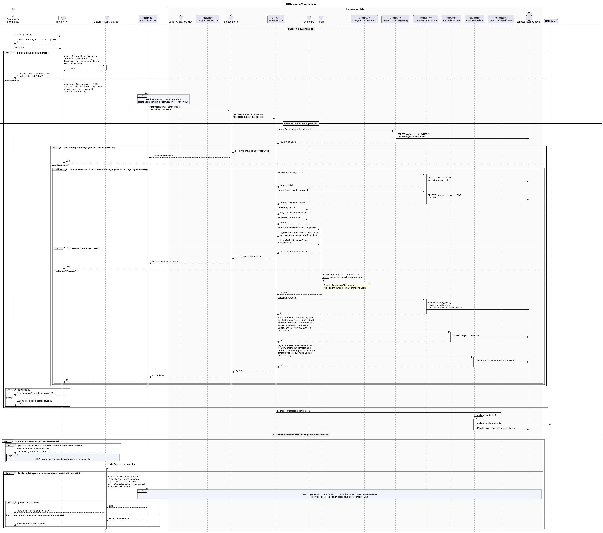

## UC18 – Marcar tarefa como "Não aplicável"

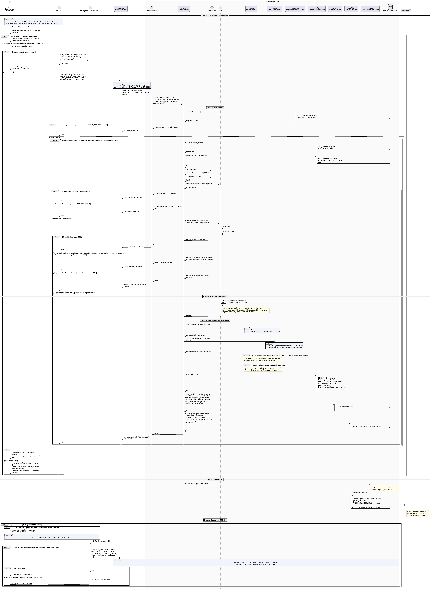

## UC19 – Confirmar execução da tarefa por QR Code

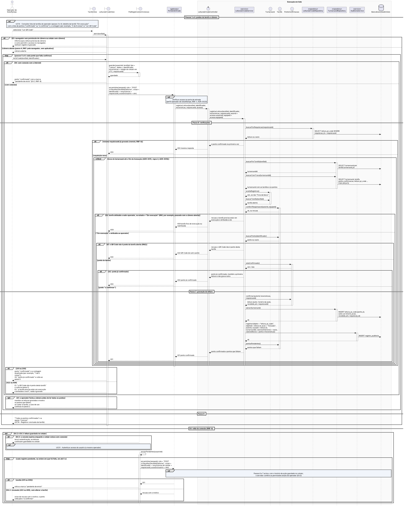

## UC20 – Registrar marcos do atendimento em solo

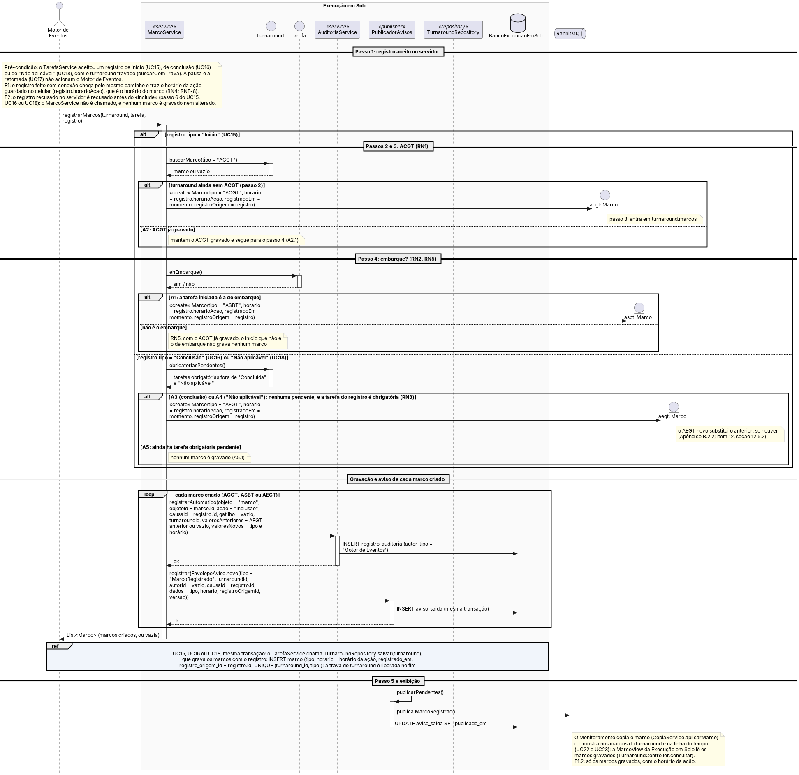

## UC21 – Propagar estado das tarefas e do turnaround

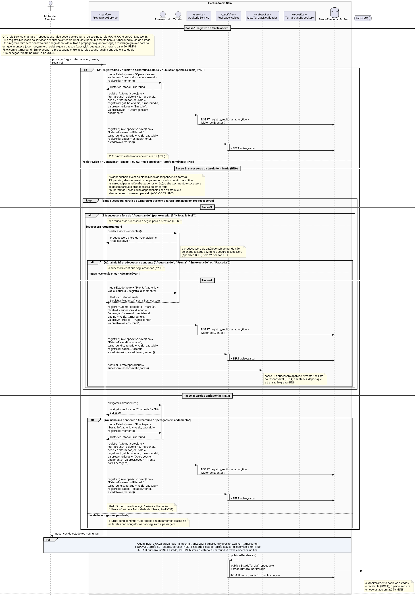

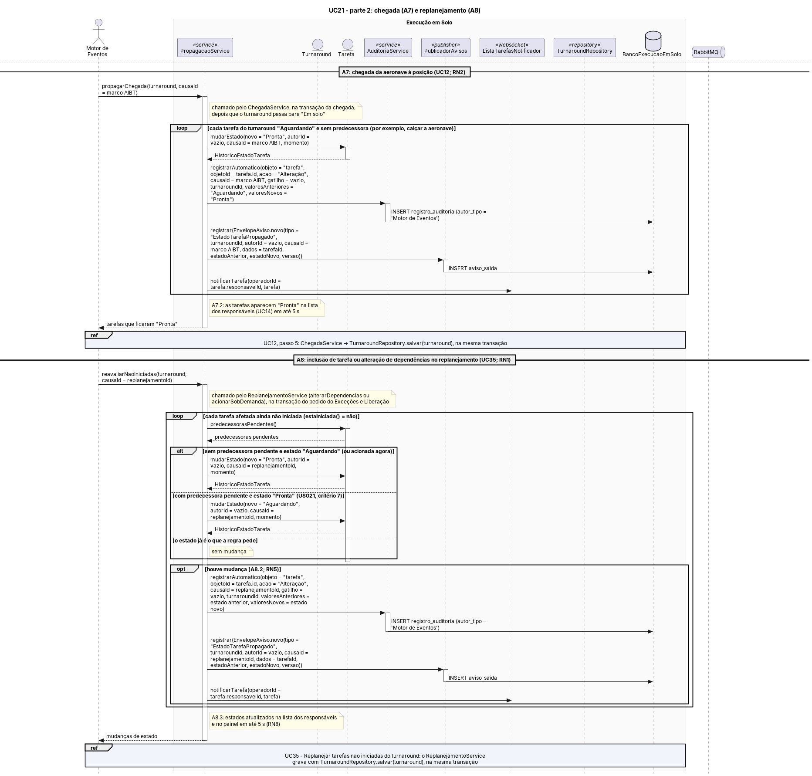

## UC37 – Registrar saída da posição e encerrar turnaround

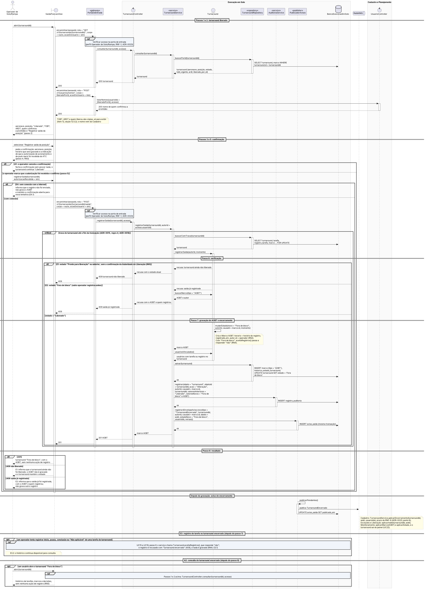
