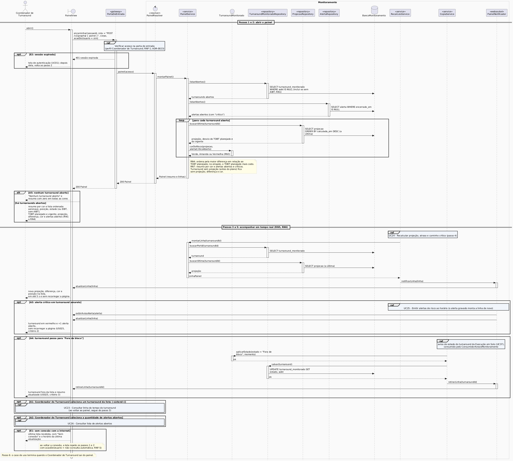
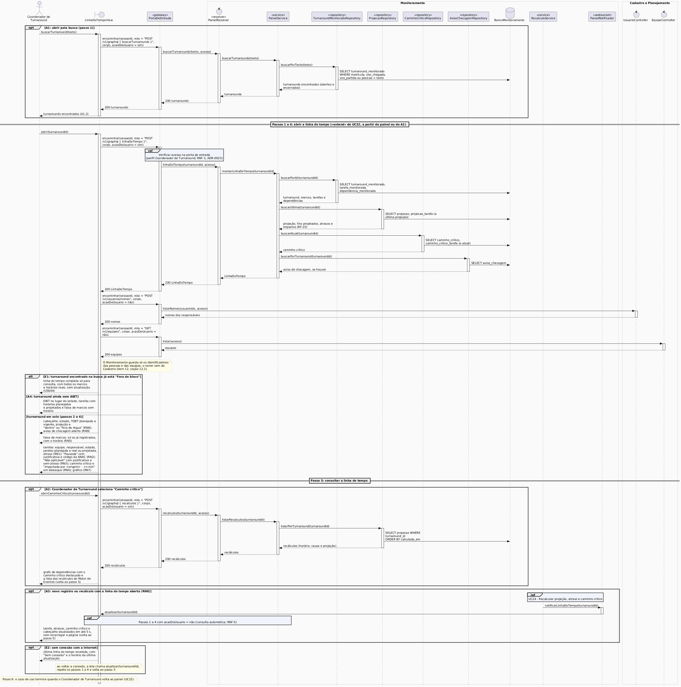
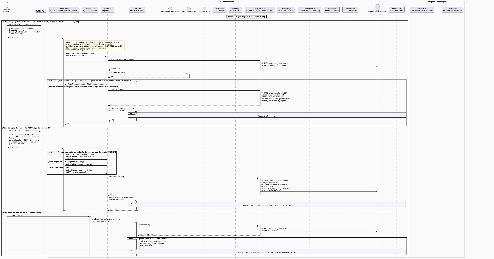
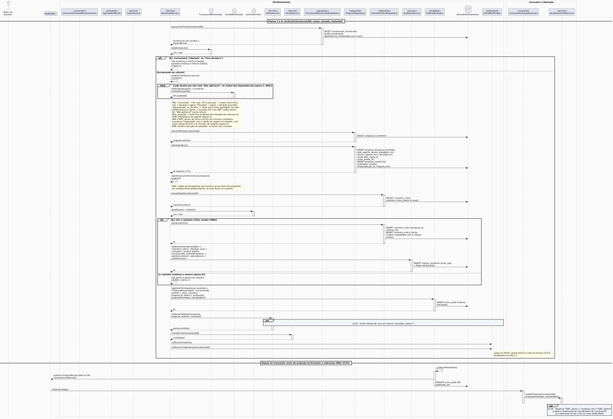
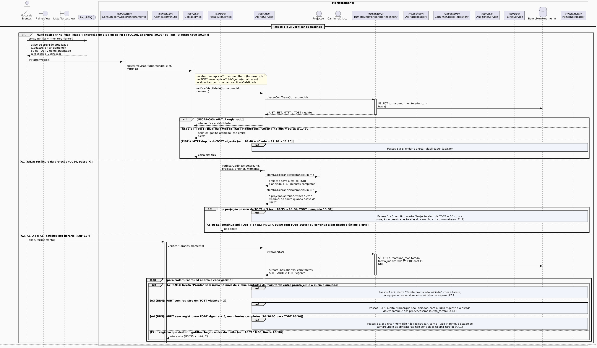
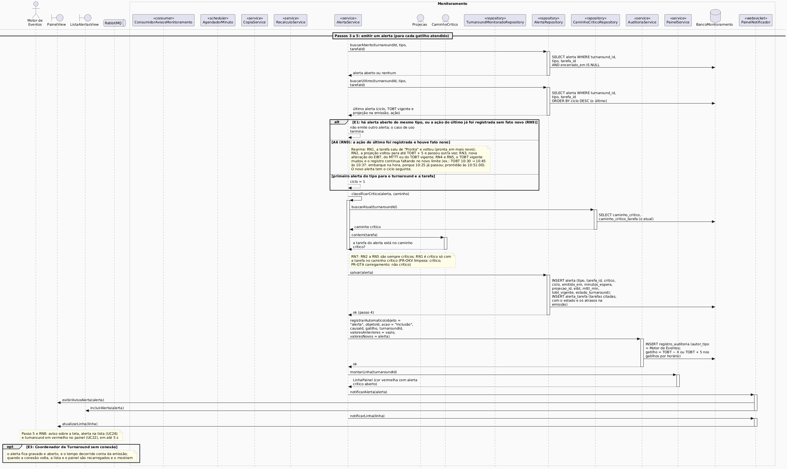
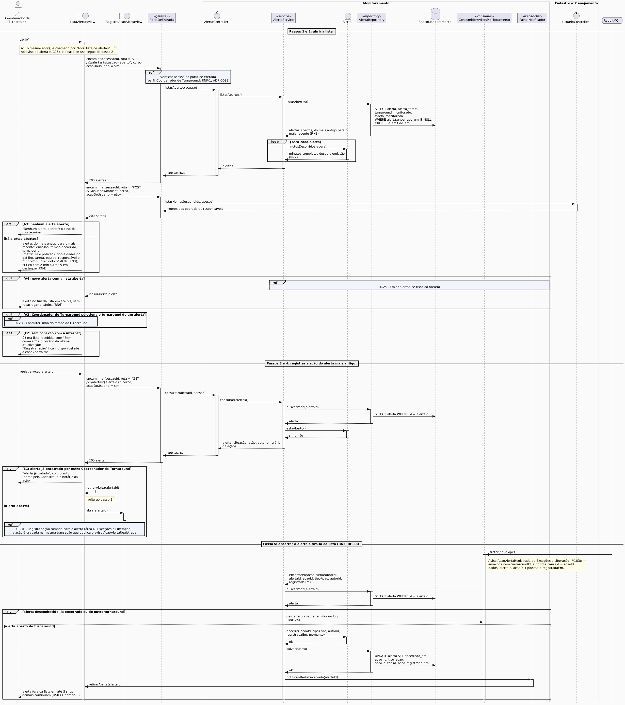
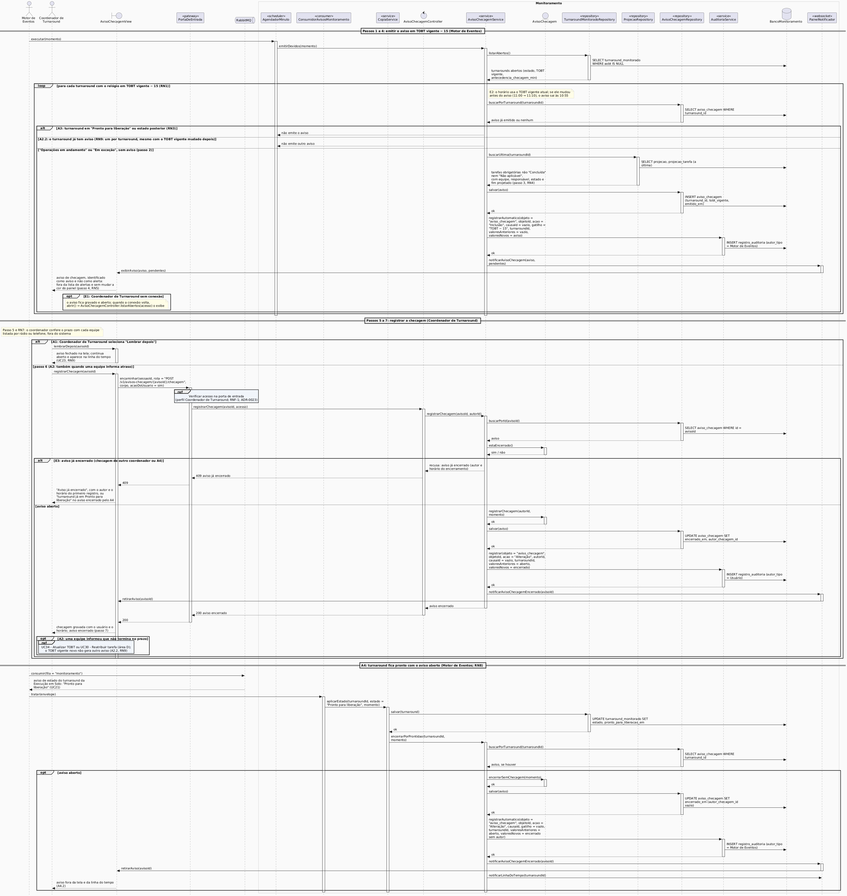
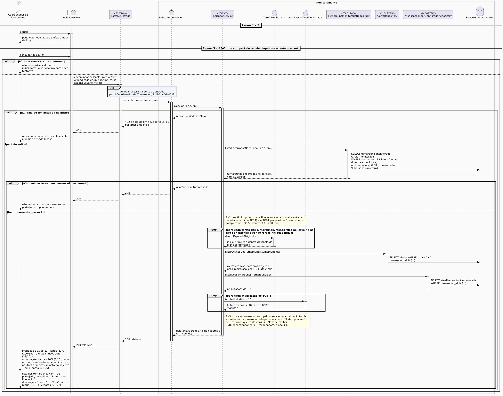

<!-- Área C, serviço Monitoramento (ADR-0015): diagramas de sequência dos casos de uso UC22 a UC28 (issue #150). Formato em 00-item.md. -->
## Convenções dos diagramas da área C

Os diagramas da área C mostram o serviço Monitoramento, que é dono da projeção de prontidão, do caminho crítico, dos alertas e do aviso de checagem (ADR-0015, regra 1). Os participantes são as classes do item 13: telas («boundary»), controles («control» e, nos painéis, «resolver» de GraphQL), serviços («service»), classes de negócio («entity»), repositórios («repository») e o banco do serviço. Cada chamada ao banco cita a tabela do item 12 (Apêndice B.3). Toda ação do site passa pela `PortaDeEntrada`, e o fragmento `ref` "Verificar acesso na porta de entrada" resume a consulta ao Cadastro e Planejamento a cada ação (requisito não funcional (RNF) 1; ADR-0023). As telas buscam no Cadastro o nome das pessoas, porque o Monitoramento guarda só o identificador (item 12, seção 12.2).

O Motor de Eventos, ator dos casos de uso UC24, UC25 e UC27, não é uma classe: é o comportamento automático do `RecalculoService`, do `AlertaService` e do `AvisoChecagemService` (item 13, seção 13.1). Nos diagramas, ele inicia a sequência de dois jeitos. No primeiro, consome um aviso da fila "monitoramento" do RabbitMQ e o entrega ao `ConsumidorAvisosMonitoramento`. O `tratar(envelope)` desse consumidor é chamado depois de o `receber(envelope)` herdado descartar o aviso repetido (ADR-0016, ponto 5). No segundo, aciona o `AgendadorMinuto` (ADR-0015, regra 7). Entre serviços, os diagramas mostram o aviso na mensageria, e nenhum serviço lê o banco de outro. Dois avisos foram propostos com a área D na pendência #183: `ProjecaoRecalculada`, que o Monitoramento publica para o Exceções e Liberação comparar a projeção com o horário-alvo de prontidão (TOBT) vigente, e `AcaoAlertaRegistrada`, que o Exceções e Liberação publica para o Monitoramento encerrar o alerta (RF-38). Os avisos das outras áreas aparecem descritos pelo conteúdo, e não pelo nome.

`«include»` aparece como fragmento `ref` (o UC24 inclui o UC25), e `«extend»` como fragmento `opt` com a condição (o UC23 estende o UC22). Os fluxos agrupados, que não mudam a interação, são estes:

- UC22: o A1 e o A2 são `ref` ao UC23 e ao UC26.
- UC24: o A2 e o E3 ficam no mesmo ramo do registro de tarefa, com a regra em nota; o E2 é nota, porque o registro recusado não gera aviso.
- UC25: o A2, o A3 e o A4 usam o mesmo trecho de emissão (passos 3 a 5); o E1 e o A6 são as duas saídas da conferência do último alerta.
- UC26: o A1 é nota no passo 1, porque o aviso do alerta chama o mesmo `abrir()`.
- UC27: o A2 usa o ramo do registro da checagem.
- UC28: o A1 repete os passos 3 a 6 com o período novo.

O UC24 e o UC25 têm duas partes cada um. No UC24, a parte 1 mostra o que dispara o recálculo, e a parte 2 mostra o recálculo. No UC25, a parte 1 mostra os gatilhos, e a parte 2 mostra a emissão de um alerta.

## UC22 – Acompanhar painel dos turnarounds

## UC23 – Consultar linha do tempo do turnaround

## UC24 – Recalcular projeção, atraso e caminho crítico

## UC25 – Emitir alertas de risco ao horário

## UC26 – Consultar lista de alertas abertos

## UC27 – Registrar checagem com as equipes em TOBT − 15

## UC28 – Consultar indicadores de aderência

