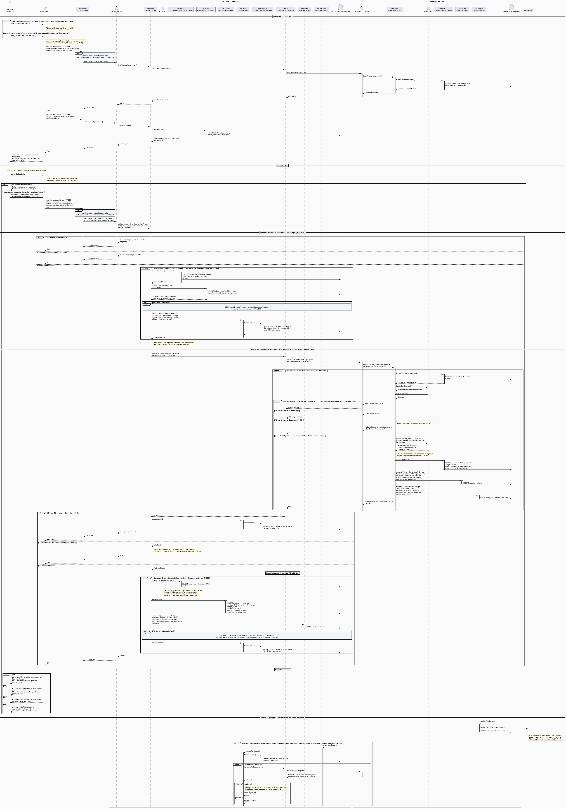
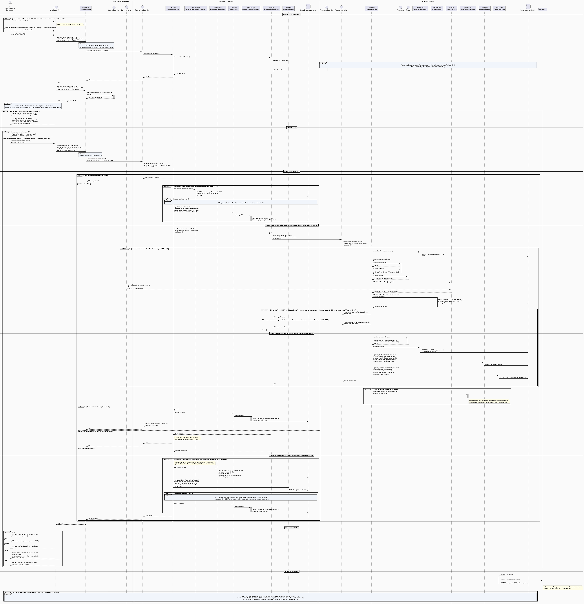
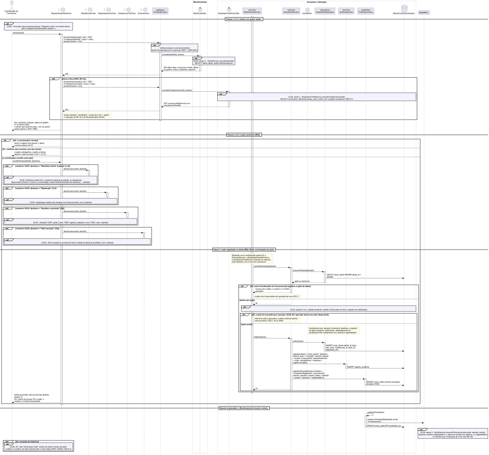
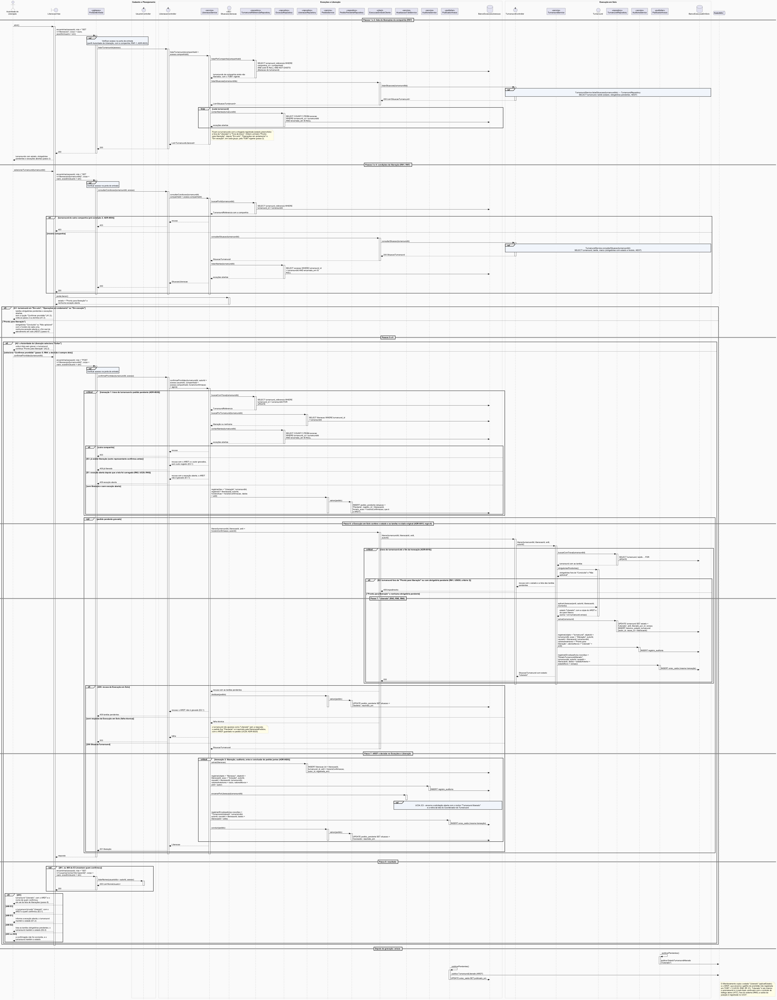
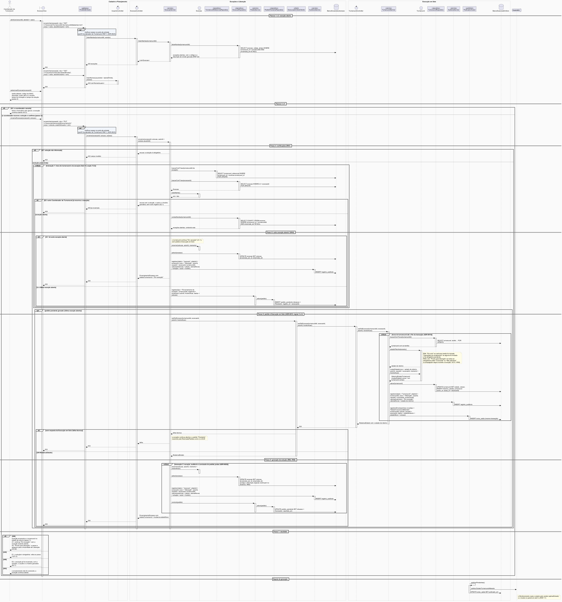
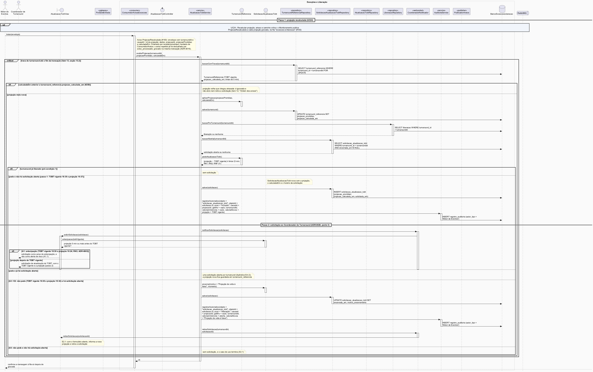
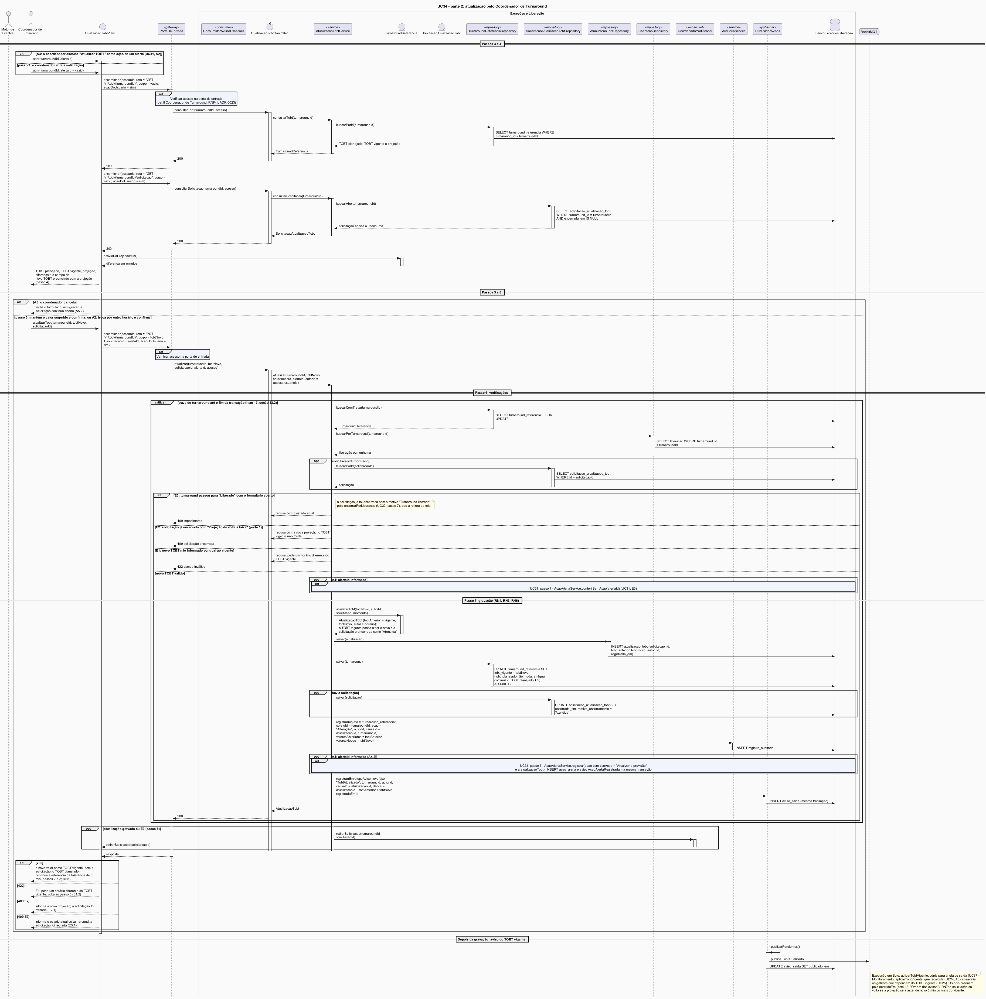
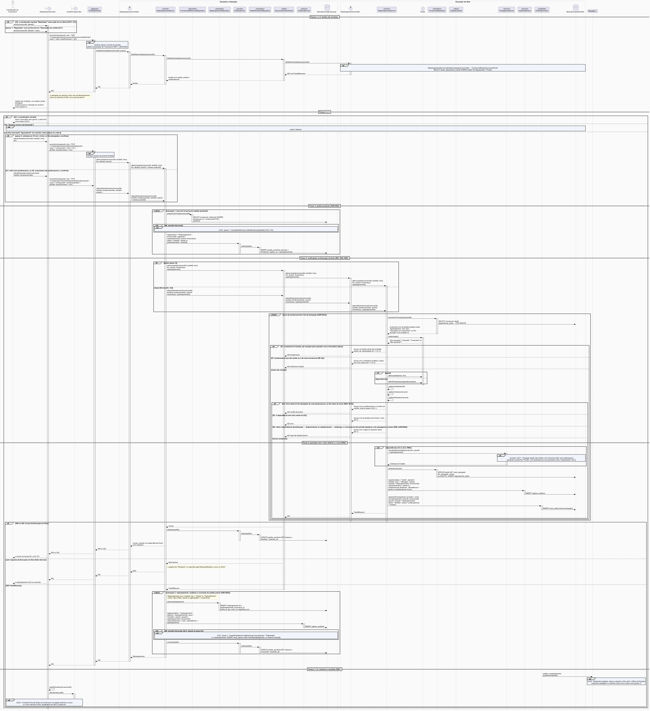
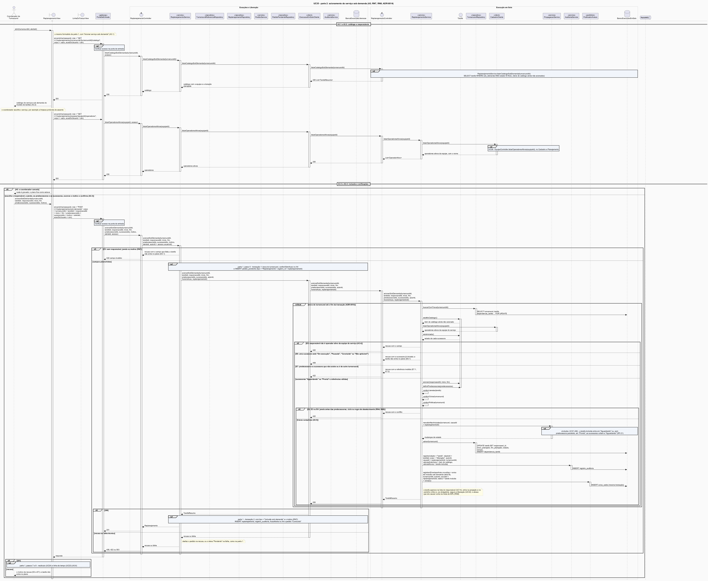
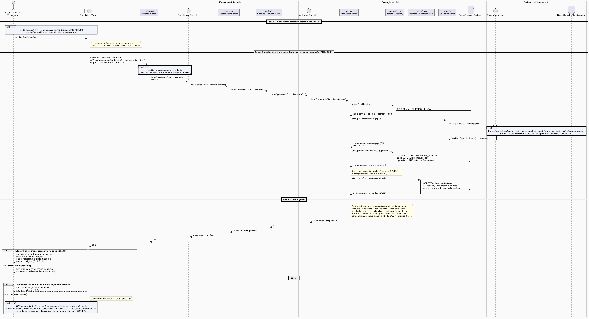

<!-- Área D, serviço Exceções e Liberação (ADR-0015): diagramas de sequência dos casos de uso UC29 a UC36 (issue #151). Formato em 00-item.md. -->
## Convenções dos diagramas da área D

Os diagramas da área D mostram o serviço Exceções e Liberação, dono das exceções, das ações sobre os alertas, dos motivos de reatribuição e de replanejamento, do horário-alvo de prontidão (TOBT) vigente e do horário real de prontidão (ARDT), como decide o registro de decisão de arquitetura (ADR) 0015 (regra 1). Os participantes são as classes do item 13: telas («boundary»), controles («control»), serviços («service»), classes de negócio («entity»), repositórios («repository»), o `ExecucaoEmSoloCliente`, o `CoordenadorNotificador`, o `PublicadorAvisos`, a `PortaDeEntrada` e o banco do serviço. Cada chamada ao banco cita a tabela do item 12 (Apêndice B.4). Toda ação do site passa pela `PortaDeEntrada`, e o fragmento `ref` "Verificar acesso na porta de entrada" resume a consulta ao Cadastro e Planejamento a cada ação (requisito não funcional (RNF) 1; ADR-0023). As mensagens usam os métodos e os argumentos do item 13, e `python scripts/conferir_classes.py --sequencia` não acusa nenhuma mensagem da área D (C13.8).

**Pedidos à Execução em Solo.** Quase toda ação da área D depende de um dado da Execução em Solo, dona da tarefa e do estado do turnaround: a abertura e o encerramento da exceção, a reatribuição, o replanejamento e a liberação são pedidos com resposta (ADR-0015, regras 3, 4 e 6). O caminho é o mesmo em todos, mostrado por inteiro no caso de uso (UC) 29 e repetido nos outros:

- O serviço trava o turnaround (`TurnaroundReferenciaRepository.buscarComTrava`; item 13, seção 13.2), confere o que é dele (campos obrigatórios, exceções abertas, liberação já gravada, ação já registrada no alerta) e grava o pedido como pendente (`PedidoService.registrar`, tabela `pedido_pendente`), com o autor, o horário da ação e a chave do registro a criar. Essa primeira transação termina antes da chamada, para que uma queda não perca o registro (ADR-0020; RNF-20).
- O pedido vai à Execução em Solo pelo `ExecucaoEmSoloCliente`, com o token de serviço da ADR-0025, que não aparece nas setas. A Execução em Solo trava o turnaround, confere o estado e as tarefas no dado original e decide. Quando muda o estado do turnaround ou a tarefa, ela grava o histórico, a auditoria e o aviso aos outros serviços na mesma transação, como nos diagramas da área B.
- Com a resposta positiva, o serviço grava o registro (exceção, reatribuição, replanejamento ou liberação), a auditoria, a ação sobre o alerta e o aviso, e conclui o pedido, numa segunda transação. Com a recusa, desfaz o pedido e não grava nada. Sem resposta, não repete sozinho o pedido (ADR-0020, ponto 3): o pedido fica pendente, e a `RetomadaPedidos` pergunta à Execução em Solo pela chave (`consultarPedido`) se ele foi aplicado, e conclui ou desfaz o registro.
- Na liberação, o ARDT é o horário da confirmação, guardado no pedido pendente, e não o horário em que a resposta chegou (ADR-0020).

**Motor de Eventos.** No Exceções e Liberação, o Motor de Eventos é o `AtualizacaoTobtService.avaliarProjecao` (item 13, seção 13.1). Ele inicia a parte 1 do UC34: recebe o aviso `ProjecaoRecalculada` do Monitoramento pela fila "excecoes-e-liberacao" e o entrega ao `ConsumidorAvisosExcecoes`, cujo `tratar(envelope)` é chamado depois de o `receber(envelope)` herdado descartar o aviso repetido (ADR-0016). A projeção calculada antes da última aplicada é ignorada (`turnaround_referencia.projecao_calculada_em`), para que uma projeção velha que chega atrasada não abra nem retire a solicitação (item 12, "Ordem dos avisos"; #259). A solicitação chega à tela do Coordenador de Turnaround por WebSocket, pelo `CoordenadorNotificador` (ADR-0020, ponto 3).

**Avisos.** Os avisos que o Exceções e Liberação publica usam o envelope comum da ADR-0016 (`EnvelopeAviso`). Eles entram na tabela `aviso_saida` na mesma transação da mudança e só depois vão para o RabbitMQ (`publicarPendentes`); quem recebe descarta o aviso repetido. A abertura e o encerramento da exceção não geram aviso deste serviço: a mudança de estado do turnaround é avisada pela Execução em Solo (`EstadoTurnaroundAlterado`). Os nomes são estes:

| Aviso | Quando | Dados | Quem recebe (item 13) |
|---|---|---|---|
| `AcaoAlertaRegistrada` | UC31: a ação sobre o alerta é gravada, na transação da ação (UC29, UC30, UC34 ou UC35) | envelope com `turnaroundId`, `autorId` e `causaId` = `acaoId`; `dados` com `alertaId`, `acaoId`, `tipoAcao` e `registradaEm` (#183) | Monitoramento (`encerrarPorAcao`), que encerra o alerta |
| `TobtAtualizado` | UC34: o Coordenador de Turnaround atualiza o TOBT vigente | `atualizacaoId`, `tobtAnterior`, `tobtNovo` e `registradaEm` | Execução em Solo e Monitoramento (`aplicarTobtVigente`), que ordenam pelo `ocorridoEm` (item 12, "Ordem dos avisos") |
| `TurnaroundLiberado` | UC32: a Autoridade de Liberação confirma a prontidão e a Execução em Solo aceita a liberação | `liberacaoId` e ARDT | Monitoramento, que guarda o ARDT para o gatilho de prontidão não registrada (UC25, regra de negócio (RN) 5; requisito funcional (RF) 31) |

Os avisos que a Execução em Solo publica nos pedidos da área D (troca de responsável e replanejamento) aparecem descritos pelo conteúdo, e não pelo nome, porque são da área B.

`«include»` aparece como fragmento `ref` (o UC30 inclui o UC36, e o UC35 inclui o UC21), e `«extend»` como fragmento `opt` com a condição de extensão: no UC31, o UC29, o UC30, o UC34 e o UC35 estendem o registro da ação, cada um com o tipo da ação escolhida. Nos quatro, o fluxo que vem do alerta (UC29, A2; UC30, A1; UC34, A4; UC35, A4) passa o `alertaId` e chama o `AcaoAlertaService`, desenhado uma vez no UC31, passo 7. O ator da parte 1 do UC34 é o Motor de Eventos, e o da parte 2, o Coordenador de Turnaround.

Algumas telas mostram dado que nenhum método do item 13 ainda devolve à tela que o exibe; os diagramas marcam o ponto numa nota: a posição e o estado do turnaround no formulário do UC29 (passo 2) e a indicação de caminho crítico na lista do UC35 (passo 2).

Os fluxos agrupados, que não mudam a interação, são estes:

- UC29: o A1 é o ramo da Execução em Solo em que o turnaround já está "Em exceção" e o estado não muda.
- UC31: o A1, o A2 e o A3 são os fragmentos `opt` «extend» do UC35, do UC34 e do UC29; o A4 é `ref` à aba "Encerrados hoje" do UC26.
- UC32: o E1 é conferido nos dois serviços: a exceção aberta, no Exceções e Liberação, e o estado "Em exceção", na Execução em Solo.
- UC33: o A2 é o estado de retorno "Pronto para liberação" do mesmo `estadoPeloAndamento()`.
- UC34: o A3 e o E2 são o mesmo ramo da parte 1 (projeção de volta à faixa), com e sem formulário aberto; o A2 é o mesmo `atualizarTobt` com outro valor.
- UC35: o A1 e o A2 usam o mesmo `alterarDependencias`; o E2, o E3 e o E4 da parte 2 usam as travas da parte 1.
- UC36: o A1 chama de novo o `escolherTarefa`; o E2 é `ref` ao UC30, E2.

O UC34 e o UC35 têm duas partes cada um. No UC34, a parte 1 mostra o Motor de Eventos e a solicitação, e a parte 2 mostra a atualização pelo Coordenador de Turnaround. No UC35, a parte 1 mostra a janela e as dependências, e a parte 2 mostra o acionamento do serviço sob demanda.

## UC29 – Abrir exceção do turnaround

## UC30 – Reatribuir tarefa

## UC31 – Registrar ação tomada para o alerta

## UC32 – Confirmar prontidão e liberar aeronave

## UC33 – Encerrar exceção do turnaround

## UC34 – Atualizar TOBT

## UC35 – Replanejar tarefas não iniciadas do turnaround

## UC36 – Consultar operadores disponíveis da equipe

