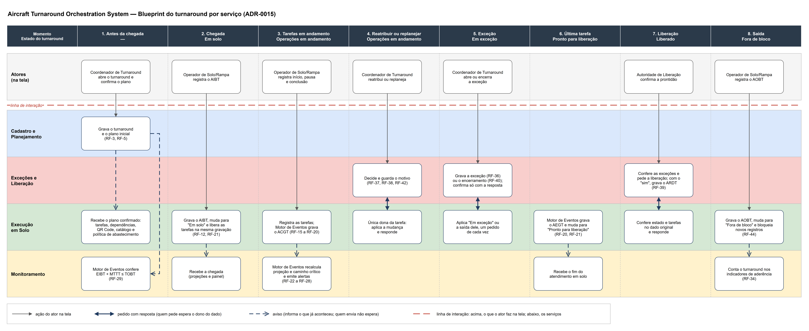

# APÊNDICE C — BLUEPRINT DO TURNAROUND POR SERVIÇO

<!-- Apêndice C, decidido na issue #184: o blueprint do turnaround na versão com a correção, ou seja, a divisão em
microsserviços do registro de decisão de arquitetura ADR-0015. A primeira proposta e os cinco conflitos que levaram à
correção ficam só na pesquisa (pesquisa/topicos/service-blueprint.md), que guarda o histórico. Se a ADR-0015 mudar,
este apêndice muda junto. O gerador o põe depois do Apêndice B. A figura (diagramas/apendice-c-blueprint.drawio, com PNG e SVG) mostra a
mesma tabela em raias; se a tabela mudar, a figura muda junto. -->

Este apêndice percorre o turnaround do Aircraft Turnaround Orchestration System em oito momentos, da chegada da aeronave à saída da posição, e mostra, em cada um, qual serviço grava o quê e que mensagem vai de um serviço para outro. É a divisão em quatro microsserviços do registro de decisão de arquitetura (ADR) ADR-0015, com o contrato da ADR-0016, e sustenta os itens 12 a 14. Cada passo cita os requisitos funcionais (RF) que o definem.

## C.1 Conceitos

- **Serviço:** programa separado, com banco de dados próprio. Um serviço não lê o banco de outro: para saber algo, ele pergunta ou é avisado.
- **Dono do dado:** o serviço que guarda o dado original. Qualquer outro tem uma cópia, que pode estar atrasada, e só o dono decide sobre o dado.
- **Aviso (evento):** mensagem que diz "isto aconteceu". Quem envia não espera, e quem recebe pode receber um pouco depois.
- **Pedido (comando):** pergunta que espera resposta ("posso fazer isto?"). Quem pede espera o dono do dado responder.

O celular do Operador de Solo/Rampa é só a tela: o registro vai para o serviço dono do dado.

## C.2 Os oito momentos

Serviços: Cadastro e Planejamento (Cad.), Execução em Solo (Exe.), Monitoramento (Mon.) e Exceções e Liberação (Exc.).

| # | Momento | Estado do turnaround | Quem grava e o que vai para outro serviço |
|---|---|---|---|
| 1 | Antes da chegada | — | O Cad. abre o turnaround e confirma o plano (RF-3 e RF-5) e passa o plano confirmado para a Exe. Um aviso vai ao Mon., que confere se o horário estimado de chegada à posição (EIBT) somado ao tempo mínimo de turnaround (MTTT) cabe antes do horário-alvo de prontidão (TOBT) (RF-29). |
| 2 | Chegada | Em solo | O Operador de Solo/Rampa registra o horário real de chegada à posição (AIBT). A Exe. grava o AIBT, muda o turnaround para "Em solo" e libera as tarefas na mesma gravação (RF-12, RF-21; ADR-0013). Aviso ao Mon. |
| 3 | Tarefas em andamento | Operações em andamento | A Exe. registra início, pausa e conclusão das tarefas e grava o início real do atendimento em solo (ACGT) (RF-15 a RF-20). Avisos ao Mon., que recalcula projeções e caminho crítico e emite alertas (RF-22 a RF-28). |
| 4 | Reatribuir ou replanejar | Operações em andamento | A Exe. é a única dona da tarefa durante o turnaround. A Exc. decide (RF-37, RF-38, RF-42), faz um pedido à Exe. e espera a resposta. O Cad. fica só com o modelo e o plano inicial. |
| 5 | Exceção | Em exceção | A Exc. abre a exceção (RF-36) e pede à Exe. que aplique "Em exceção"; só confirma ao Coordenador de Turnaround com a resposta. O encerramento segue o mesmo caminho (RF-40). |
| 6 | Última tarefa | Pronto para liberação | A Exe. grava o fim real do atendimento em solo (AEGT) e muda o estado (RF-20, RF-21). Aviso ao Mon. |
| 7 | Liberação | Liberado | A Exc. confere as exceções e pede a liberação à Exe., que confere o estado e as tarefas no dado original. Só com o "sim" a Exc. grava o horário real de prontidão (ARDT) confirmado pela Autoridade de Liberação (RF-39). |
| 8 | Saída | Fora de bloco | O Operador de Solo/Rampa registra o horário real de saída da posição (AOBT). A Exe. grava o AOBT, muda o turnaround para "Fora de bloco" e bloqueia novos registros na mesma gravação (RF-44). Aviso ao Mon. (RF-34). |

A figura mostra os mesmos oito momentos em raias: na raia de cima, o que cada ator faz na tela; abaixo da linha de interação, uma raia por serviço. A seta dupla é um pedido com resposta, e a seta tracejada é um aviso.

## C.3 Regras que o blueprint aplica

Toda mudança de estado do turnaround passa pela Execução em Solo, que atende um pedido de cada vez por turnaround (ADR-0015, regra 4). Assim, a ordem de chegada das mensagens não muda o resultado, e a liberação é decidida sobre o dado original, e não sobre uma cópia. Isso garante a meta do objetivo 3 de zero liberações com tarefa obrigatória pendente.

Os oito momentos não cobrem todos os casos entre serviços, e as regras da ADR-0015 resolvem os demais. Um exemplo é o encerramento de um alerta quando a ação é registrada (RF-38). O alerta é do Monitoramento, e a ação é registrada pela Exceções e Liberação. Como a ação já aconteceu, ela vai num aviso (regra 2), e o Monitoramento encerra o alerta.
